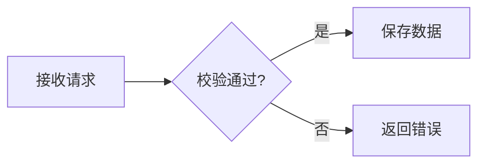

# 个人学习知识库

基于 Astro Starlight 构建的个人学习与知识管理网站，用于整理知识专题、学习路线和问题复盘。线上地址：https://notes.ian2000.xyz

## 本地运行

需要 Node.js 22.12 或更高版本（使用 nvm 时执行 `nvm install && nvm use`）。

```bash
npm ci
npm run dev -- --background
```

后台服务用 `npx astro dev stop`、`npx astro dev status`、`npx astro dev logs` 管理。

提交前检查与构建：

```bash
npm run check
npm run build
```

`check` 包含标题层级检查；标题层级不符合时，用 `node scripts/normalize-markdown-headings.mjs --write` 自动修正。

不需要数据库的单元测试：

```bash
npm run test:good-pairs
npm run test:prefix-sum
npm run test:difference
npm run test:english-schedule
npm run test:english-analysis
npm run test:english-journey
```

CI 会跑以上测试以及 `check` 和 `build`。

## 内容目录

```text
src/content/docs/
├── index.mdx
├── knowledge/<专题>/<二级分类>/<文章>.md
├── learning-paths/
├── retrospectives/
└── about.md
```

Markdown 和 MDX 文件会根据 `src/content/docs/` 下的路径生成对应页面，图片放在同目录的 `assets/` 下并用相对路径引用。

专题和二级分类在 `src/config/site-routing.ts` 中登记，侧栏和专题概览页都从这里生成，概览页会自动列出分类下的全部文章。新增二级分类时，在这里加一项并建对应目录即可。

文章的 frontmatter：

```yaml
---
title: Redis 分布式锁实践
description: 分析常见失效场景及验证方法
status: draft
sidebar:
  order: 3
  label: 分布式锁实践
---
```

- `status` 可选 `draft`、`verified`、`evergreen`、`outdated`；除 `draft` 外都会显示在标题下方。
- `sidebar.order` 决定侧栏和“上一页 / 下一页”的顺序，`sidebar.label` 是可选的侧栏短标题。
- “最近更新”日期取自 git 提交时间。

改名、合并或删除文章时，在 `src/config/redirects.mjs` 里把旧地址指向新页面，避免外部链接失效。

## Mermaid 图表

在 Markdown 或 MDX 中使用 `mermaid` 代码围栏，页面会自动显示图表：

````markdown

````

图表进入阅读区域时按需渲染，放在 `<details>` 中的图表会在展开后渲染。支持切换原尺寸、查看源码；语法错误或加载失败时保留源码，不影响其他内容。Mermaid 随站点打包，无需在文章中引入脚本或使用外部 CDN。

## 英语学习模块

入口为 `/english/`，个人记录保存在 PostgreSQL，通过个人口令访问。数据与访问、本地运行、云端启用、测试和“分析与巩固”的备课流程见 [docs/english.md](docs/english.md)。
