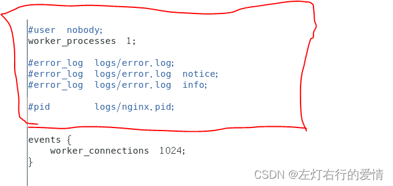
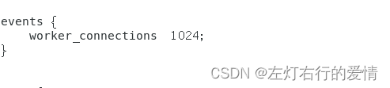
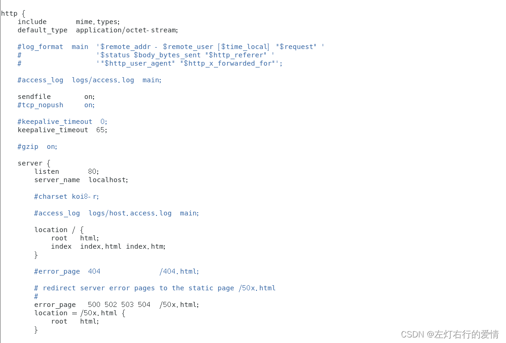
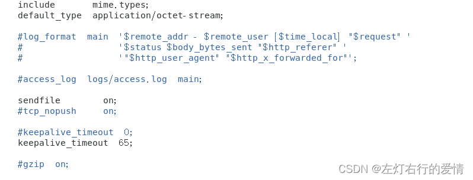
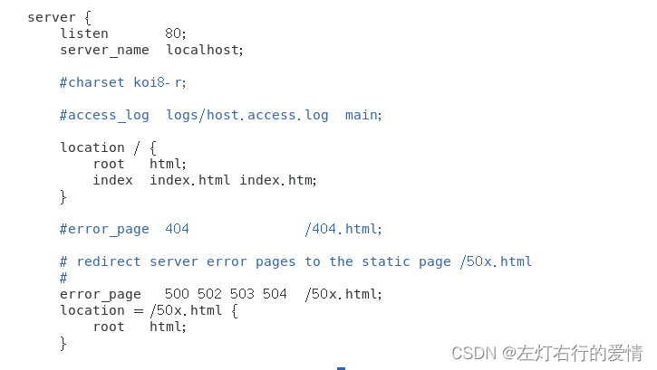

> 原文：[CSDN](https://blog.csdn.net/qq_45852626/article/details/147380628)

## 前言

应用层是互联网协议栈的最顶层，直接面向我们日常使用的各种网络应用，例如网页浏览、文件传输、电子邮件等。理解应用层的核心协议对于任何Web开发者来说都至关重要  
 **阅读前提：** 默认读者已具备基础的计算机网络知识（如TCP/IP模型、IP地址、端口等）。

## 一、HTTP：Web的基石

HTTP（HyperText Transfer Protocol，超文本传输协议）是互联网上应用最广泛的一种网络协议，是构建Web世界的基石。所有的Web浏览器和Web服务器之间的数据交互都依赖于它。

### 1.1 HTTP协议的核心特点

理解HTTP的特点有助于我们把握其设计哲学：

1. **无状态 (Stateless):** 这是HTTP最核心的特点之一。服务器默认不保存任何关于客户端请求的信息。每个请求都被视为独立的事务，服务器处理请求时不需要依赖之前的请求状态。
   * **优点：** 极大地简化了服务器的设计，使其更容易扩展（因为任何服务器都可以处理任何请求），提高了处理并发请求的能力。
   * **缺点：** 对于需要保持用户登录状态或跟踪用户行为的应用（如购物车、在线银行），无状态带来了挑战。这催生了Cookie、Session、Token等状态管理技术。
2. **文本协议 (Text-based):** HTTP/1.x 版本的报文是基于ASCII文本的，人类可读。
   * **优点：** 便于调试和理解。你可以直接通过telnet或网络抓包工具查看HTTP报文内容。
   * **缺点：** 传输效率相对较低，因为文本格式包含冗余信息（如换行符、空格）。HTTP/2和HTTP/3通过引入二进制帧格式解决了这个问题。
3. **基于TCP:** HTTP通常（但不强制）建立在可靠的传输层协议TCP之上。
   * **优点：** 保证了数据传输的可靠性和顺序性。
   * **缺点：** 继承了TCP的一些问题，如连接建立的开销（三次握手）和队头阻塞（Head-of-Line Blocking）。
4. **请求-响应模型 (Request-Response):** 通信由客户端发起请求，服务器进行响应。服务器不能主动向客户端推送信息（除非使用WebSocket等技术）。
5. **灵活可扩展:** 通过HTTP头部（Headers），可以轻松地添加新的功能，如缓存控制 (`Cache-Control`)、内容协商 (`Accept`)、认证 (`Authorization`) 等，而无需修改协议的核心结构。

### 1.2 HTTP 报文格式

HTTP报文是客户端和服务器之间交换数据的载体，分为请求报文（Request Message）和响应报文（Response Message）。

**请求报文结构:**

```
<Method> <Request-URI> <HTTP-Version>\r\n  (请求行: 方法 URL 版本)
<Header-Name1>: <Header-Value1>\r\n       (请求头)
<Header-Name2>: <Header-Value2>\r\n
...
\r\n                                      (空行 CRLF)
<Request-Body>                           (请求体, 可选)


```

**响应报文结构:**

```
<HTTP-Version> <Status-Code> <Reason-Phrase>\r\n (状态行: 版本 状态码 描述)
<Header-Name1>: <Header-Value1>\r\n          (响应头)
<Header-Name2>: <Header-Value2>\r\n
...
\r\n                                         (空行 CRLF)
<Response-Body>                              (响应体, 可选)


```

**关键点:**

* **请求行/状态行:** 定义了请求的意图或响应的结果。
* **头部字段 (Headers):** 包含关于请求/响应或报文主体的元数据，采用`名称: 值`的格式。
* **空行 (CRLF):** 一个单独的`\r\n`行，用于分隔头部和主体。**这是解析HTTP报文的关键分隔符。**
* **主体 (Body):** 包含实际传输的数据，如HTML文档、图片、JSON数据等。GET请求通常没有主体。

### 1.3 HTTP 方法 (Methods)

HTTP方法定义了客户端希望对服务器上的资源执行的操作类型。它们是HTTP协议语义的核心。

* **GET:** 获取资源。请求指定资源的数据。**安全且幂等。**
* **POST:** 提交数据以进行处理。通常用于创建新资源或提交表单数据。**不安全且不幂等。**
* **PUT:** 替换目标资源的所有当前表示。上传文件或完整更新资源。**不安全但幂等。**
* **DELETE:** 删除指定的资源。**不安全但幂等。**
* **HEAD:** 类似于GET，但响应中只包含头部，没有主体。用于获取资源的元数据（如检查资源是否存在、最后修改时间）。**安全且幂等。**
* **OPTIONS:** 获取目标资源所支持的通信选项。常用于CORS（跨域资源共享）中的预检请求。**安全且幂等。**
* **PATCH:** 对资源应用部分修改。与PUT不同，它只更新资源的部分内容。**不安全，是否幂等取决于具体实现。**
* **CONNECT:** 建立一个到由目标资源标识的服务器的隧道。主要用于HTTPS代理。

**理解安全与幂等:**

* **安全 (Safe):** 指该方法**不应该**改变服务器上的资源状态（副作用）。只读操作通常是安全的。缓存、爬虫可以安全地执行这些方法。
* **幂等 (Idempotent):** 指同样的请求执行一次和执行多次，对服务器资源状态产生的效果是相同的。这对于处理网络中断后的重试非常重要。

**【理解帮助】GET 一定安全且幂等吗？**

从协议规范（RFC）的角度看，GET方法**应该**是安全和幂等的。服务器**不应该**在处理GET请求时修改资源状态。

然而，实际开发中，开发者**可能**不遵循规范。例如，在一个GET请求的处理器中执行了数据库插入操作，或者每次调用都使计数器加一。在这种情况下，这个特定的GET请求就不再是安全或幂等的了。**但这是不良的API设计，违反了HTTP方法的语义。**

**伪代码示例 (Node.js/Express 风格):**

```javascript
// 示例：处理不同HTTP方法的服务器端逻辑 (伪代码)

// 获取用户信息 (GET - 安全, 幂等)
app.get('/users/:id', (req, res) => {
  const userId = req.params.id;
  // 仅从数据库查询用户信息，不修改任何状态
  const user = db.findUserById(userId);
  if (user) {
    res.json(user); // 返回用户信息
  } else {
    res.status(404).send('User not found');
  }
});

// 创建新用户 (POST - 不安全, 不幂等)
app.post('/users', (req, res) => {
  const newUserInfo = req.body;
  // 每次调用都会尝试在数据库中创建新用户
  try {
    const createdUser = db.createUser(newUserInfo);
    res.status(201).json(createdUser); // 201 Created
  } catch (error) {
    res.status(400).send('Invalid user data');
  }
});

// 完整更新用户信息 (PUT - 不安全, 幂等)
app.put('/users/:id', (req, res) => {
  const userId = req.params.id;
  const updatedUserInfo = req.body;
  // 无论调用多少次，都用提供的完整信息替换指定ID的用户信息
  const success = db.replaceUser(userId, updatedUserInfo);
  if (success) {
    res.status(200).send('User updated');
  } else {
    res.status(404).send('User not found'); // 或者根据情况也可以是 204 No Content
  }
});

// 删除用户 (DELETE - 不安全, 幂等)
app.delete('/users/:id', (req, res) => {
  const userId = req.params.id;
  // 第一次调用删除用户，后续调用删除一个不存在的用户，效果相同（用户不存在）
  const success = db.deleteUser(userId);
  if (success) {
    res.status(204).send(); // 204 No Content 表示成功但无返回内容
  } else {
    res.status(404).send('User not found');
  }
});


```

### 1.4 HTTP 状态码 (Status Codes)

状态码是服务器对客户端请求的响应结果的标准化代码。它们分为五类：

* **1xx (信息性):** 收到请求，继续处理。 (如 `100 Continue`)
* **2xx (成功):** 操作成功接收、理解并接受。
  + `200 OK`: 请求成功。最常见的成功状态码。
  + `201 Created`: 请求成功并且服务器创建了新的资源。通常在POST或PUT请求成功后返回。
  + `204 No Content`: 服务器成功处理请求，但没有返回任何内容。通常在DELETE成功后或PUT更新成功后返回。
  + `206 Partial Content`: 服务器成功处理了部分GET请求（范围请求）。用于断点续传。
* **3xx (重定向):** 需要后续操作才能完成请求。
  + `301 Moved Permanently`: 请求的资源已永久移动到新URL。浏览器和搜索引擎会记住新地址。
  + `302 Found` (或 `307 Temporary Redirect` in HTTP/1.1): 请求的资源临时从不同URL响应。浏览器和搜索引擎**不应**更新记录。`302`允许改变请求方法（如POST变GET），`307`不允许。
  + `304 Not Modified`: 资源未修改。用于缓存控制，告诉客户端可以使用本地缓存的版本。
* **4xx (客户端错误):** 请求包含语法错误或无法完成请求。
  + `400 Bad Request`: 服务器无法理解请求，通常因为客户端语法错误。
  + `401 Unauthorized`: 请求需要用户认证。客户端需要提供凭证（如通过`Authorization`头）。
  + `403 Forbidden`: 服务器理解请求但拒绝执行。通常因为权限不足，与`401`不同，认证了也可能被禁止。
  + `404 Not Found`: 服务器找不到请求的资源。最常见的错误之一。
* **5xx (服务器错误):** 服务器在处理请求过程中发生了错误。
  + `500 Internal Server Error`: 服务器遇到了不知道如何处理的情况。通用的服务器内部错误。
  + `502 Bad Gateway`: 作为网关或代理的服务器，从上游服务器收到了无效的响应。常见于使用了Nginx等反向代理的架构。
  + `503 Service Unavailable`: 服务器当前无法处理请求（可能因为过载或维护）。通常是暂时的。
  + `504 Gateway Timeout`: 作为网关或代理的服务器，未能及时从上游服务器（如应用服务器）收到响应。常见于后端处理超时。

**【理解帮助】502 vs 504**

这两个错误都经常出现在使用了反向代理（如Nginx）的架构中，都表示代理服务器与后端应用服务器之间的通信出了问题，但原因不同：

* **502 Bad Gateway:** Nginx成功连接到了后端服务，但后端服务返回了一个无效的、无法理解的响应，或者后端服务异常崩溃了（例如，应用服务器进程挂了，连接被异常关闭）。可以理解为“后端服务说了胡话或者挂了”。
* **504 Gateway Timeout:** Nginx尝试连接后端服务，或者已经连接上并在等待后端处理请求，但在配置的超时时间内没有收到任何响应。可以理解为“后端服务响应太慢，Nginx等不及了”。

### 1.5 连接管理：短连接 vs 长连接

* **HTTP/1.0 (默认短连接):** 每个HTTP请求/响应对都需要建立一个新的TCP连接。请求完成后，连接立即关闭。
  + **缺点:** 效率低下，因为TCP连接建立（三次握手）和慢启动都有开销。对于包含多个资源（图片、CSS、JS）的网页，需要建立大量TCP连接。
* **HTTP/1.1 (默认长连接/持久连接):** 引入`Connection: keep-alive`（默认行为），允许在一个TCP连接上传输多个HTTP请求/响应。连接会保持一段时间（可配置），等待后续请求。
  + **优点:** 大幅减少了TCP连接建立的开销，提高了页面加载速度。
  + **注意:** 长连接并非永久连接，服务器或客户端都可以在一段时间不活动后关闭连接。

### 1.6 HTTP 版本演进

* **HTTP/1.0 (1996):** 基本功能，短连接，无Host头。
* **HTTP/1.1 (1999):**
  + **持久连接 (Keep-Alive):** 默认开启，性能提升关键。
  + **管道化 (Pipelining):** 允许客户端在收到前一个响应前发送多个请求，但服务器仍需按序响应，存在队头阻塞问题，实际效果有限。
  + **Host 头:** 允许一台服务器托管多个域名（虚拟主机）。
  + **范围请求 (Range):** 支持只请求资源的一部分（断点续传）。
  + 更丰富的缓存控制 (`Cache-Control`)。
  + 明确了`PUT`, `DELETE`, `OPTIONS`等方法。
* **HTTP/2 (2015):** 对HTTP/1.1的重大性能改进。
  + **二进制分帧 (Binary Framing):** 不再是文本协议，将通信数据分割成更小的二进制帧，解析更高效。
  + **多路复用 (Multiplexing):** **核心改进！** 允许在单个TCP连接上并行、交错地发送和接收多个请求/响应，彻底解决了HTTP/1.1的队头阻塞问题。浏览器不再需要限制同域名下的连接数。
  + **头部压缩 (Header Compression - HPACK):** 使用特定算法压缩冗余的HTTP头部，减少传输开销。
  + **服务器推送 (Server Push):** 服务器可以主动向客户端推送资源（如CSS、JS），客户端无需显式请求。
* **HTTP/3 (2022):** 基于QUIC协议，进一步优化性能，尤其是在网络不佳的情况下。
  + **基于QUIC:** QUIC (Quick UDP Internet Connections) 是一个基于UDP的新的传输层协议。
  + **解决了TCP队头阻塞:** HTTP/2解决了应用层的队头阻塞，但TCP层仍然存在。如果一个TCP包丢失，整个连接的所有流都必须等待重传。QUIC基于UDP，并在其上实现了独立的流，一个流的丢包不会阻塞其他流。
  + **更快的连接建立:** QUIC可以将传输层握手（类似TCP）和加密层握手（TLS）合并，减少连接建立的RTT（往返时间）。首次连接通常只需1-RTT，后续连接可能实现0-RTT。
  + **连接迁移:** 当客户端网络变化时（如从WiFi切换到4G），QUIC可以保持连接不中断，只需更新IP地址和端口即可，而TCP连接会断开。

**【理解帮助】队头阻塞 (Head-of-Line Blocking)**

* **HTTP/1.1 队头阻塞:** 在一个TCP连接上，请求必须按顺序发送，响应也必须按顺序返回。如果第一个请求的响应很慢，后续请求即使服务器已经处理完，也必须等待第一个响应发送完毕才能发送。就像排队结账，前面的人没结完，后面的人只能等着。浏览器通过同时开多个TCP连接（通常6个）来缓解这个问题，但这增加了资源消耗。
* **TCP 队头阻塞 (影响HTTP/2):** TCP协议本身保证包的有序性。如果在一个TCP连接中，某个数据包丢失了，TCP需要等待这个包重传成功后，才能将后续收到的包按顺序交给上层（HTTP/2）。即使HTTP/2的多个流是独立的，底层的TCP丢包也会阻塞所有流。就像高速公路某个车道发生事故，整个方向的车流都会受影响。
* **HTTP/3 解决:** QUIC基于UDP，它在应用层实现了自己的可靠传输和流控制。每个流的数据包是独立处理的，一个流的丢包和重传不会影响其他流的数据递交。就像给每个车道分配了独立的应急通道。

### 1.7 状态管理：Cookie, Session, Token

由于HTTP无状态，我们需要额外的机制来跟踪用户状态。

1. **Cookie:**

   * **原理:** 服务器通过`Set-Cookie`响应头将少量数据（键值对）发送给客户端浏览器，浏览器会存储这些数据。在后续对**同源**服务器的请求中，浏览器会自动通过`Cookie`请求头将这些数据带回给服务器。
   * **用途:** 身份认证、跟踪用户会话、个性化设置等。
   * **关键属性:**
     + `Expires`/`Max-Age`: 控制Cookie的有效期（持久性Cookie vs 会话Cookie）。
     + `Domain`/`Path`: 控制Cookie的作用域。
     + `Secure`: 只在HTTPS连接中发送。
     + `HttpOnly`: 防止客户端JavaScript访问Cookie（缓解XSS攻击）。
     + `SameSite`: 控制第三方请求是否携带Cookie（缓解CSRF攻击）。
   * **缺点:** 大小有限（约4KB），每次请求都会携带（增加网络开销），存在安全风险（XSS, CSRF）。
2. **Session:**

   * **原理:** 将用户状态数据存储在**服务器端**。服务器为每个用户会话创建一个唯一的Session ID，并通过Cookie（或其他方式）将这个ID发送给客户端。客户端后续请求只需携带Session ID，服务器根据ID查找对应的会话数据。
   * **优点:** 数据存储在服务器，相对更安全；可以存储更复杂、更大的数据。
   * **缺点:** 占用服务器资源（内存或外部存储）；在分布式集群环境下需要处理**会话共享**问题（如使用粘性会话、共享存储如Redis、会话复制等）。
3. **Token (特别是 JWT - JSON Web Token):**

   * **原理:** 服务器对用户的身份信息或其他声明进行编码和签名，生成一个字符串（Token），发送给客户端。客户端存储Token，并在后续请求中通过`Authorization: Bearer <token>`这样的HTTP头发送给服务器。服务器收到Token后，**验证签名**的有效性即可信任其中的信息，**无需查询后端存储**。
   * **JWT 结构:** 由三部分组成，用`.`分隔：`Header.Payload.Signature`
     + **Header:** 包含令牌类型（JWT）和签名算法（如HS256, RS256）。Base64Url编码。
     + **Payload:** 包含"声明"（Claims），是关于实体（通常是用户）和其他数据的陈述。常见的有`iss` (签发者), `exp` (过期时间), `sub` (主题, 用户ID), `aud` (接收方)，也可以包含自定义数据。Base64Url编码。**注意：Payload默认只是编码，不是加密，不应存放敏感信息。**
     + **Signature:** 使用Header中指定的算法，对`base64UrlEncode(Header) + "." + base64UrlEncode(Payload)`这个内容，加上一个密钥（Secret）进行签名。用于验证Token是否被篡改。
   * **优点:**
     + **无状态 (服务端):** 服务器本身不存储会话信息，验证逻辑简单，易于扩展。非常适合分布式/微服务架构。
     + **自包含:** Token包含了验证所需的所有信息（除密钥外）。
     + 适用于多种客户端（浏览器、原生App）。
   * **缺点:**
     + **难以撤销:** 一旦签发，在过期前通常有效。强制撤销需要引入额外的状态（如黑名单），违背了无状态初衷。
     + **体积可能较大:** 如果Payload包含信息过多，会增加网络开销。
     + **签名计算开销:** 相比Session ID查找，签名验证有一定计算成本。
     + **安全性:** 密钥需要安全保管。如果使用对称加密(HS256)，集群所有节点需共享密钥；如果使用非对称加密(RS256)，签发服务保管私钥，验证服务持有公钥。

**【代码示例】JWT 生成与验证 (伪代码/概念)**

```javascript
// --- JWT 生成 (服务器端，用户登录成功后) ---
const jwt = require('jsonwebtoken'); // 假设使用 'jsonwebtoken' 库

const payload = {
  userId: 'user123', // 用户ID
  username: 'alice',
  roles: ['user', 'admin'], // 用户角色
  // ... 其他需要包含的信息
};

const secretKey = 'your-very-strong-secret-key'; // 密钥，需要安全保管!
const options = {
  expiresIn: '1h', // 过期时间，例如 1 小时
  issuer: 'my-auth-server', // 签发者
  // audience: 'my-api-resource' // 接收方 (可选)
};

// 使用 HS256 (HMAC SHA-256) 对称算法签名
const token = jwt.sign(payload, secretKey, options);

// 将 token 返回给客户端
// res.json({ token: token });


// --- JWT 验证 (服务器端，处理受保护的API请求) ---
function authenticateToken(req, res, next) {
  const authHeader = req.headers['authorization'];
  const token = authHeader && authHeader.split(' ')[1]; // 从 "Bearer <token>" 中提取

  if (token == null) {
    return res.sendStatus(401); // 没有提供 token
  }

  // 使用相同的密钥验证 token
  jwt.verify(token, secretKey, (err, decodedPayload) => {
    if (err) {
      // 常见的错误: TokenExpiredError, JsonWebTokenError (签名无效)
      console.error('JWT Verification Error:', err.message);
      return res.sendStatus(403); // Token 无效或过期
    }

    // Token 验证通过，可以将解码后的 payload 附加到请求对象上
    req.user = decodedPayload;
    console.log('Decoded Payload:', decodedPayload);
    next(); // 继续处理请求
  });
}

// 在需要保护的路由上使用中间件
// app.get('/api/protected-resource', authenticateToken, (req, res) => { ... });


```

### 1.8 跨域资源共享 (CORS)

* **同源策略 (Same-Origin Policy):** 浏览器的核心安全策略。它限制从一个源（协议+域名+端口）加载的文档或脚本如何与来自**另一个源**的资源进行交互。这是为了防止恶意网站读取或操作其他网站的数据。
* **跨域请求:** 当一个请求的源与目标资源的源**不同**时，就发生了跨域请求。例如，`http://a.com` 的页面请求 `http://b.com/api` 的数据。
* **CORS (Cross-Origin Resource Sharing):** 一种W3C标准，允许服务器**声明**哪些源站有权限访问其资源。它通过一系列特殊的HTTP头部来实现。
  + **简单请求 (Simple Requests):** 对于某些请求（如GET、HEAD、POST且Content-Type为特定值），浏览器会直接发送请求，并在请求头中加入`Origin`字段表明来源。服务器检查`Origin`，如果允许，就在响应头中加入`Access-Control-Allow-Origin: <允许的源或*>`。浏览器看到这个头，就知道可以访问响应内容。
  + **预检请求 (Preflight Requests):** 对于可能对服务器数据产生副作用的请求（如`PUT`, `DELETE`, `PATCH`，或者带有自定义头、非简单`Content-Type`的POST），浏览器会先发送一个`OPTIONS`方法的**预检请求**到目标URL。预检请求包含`Origin`、`Access-Control-Request-Method` (实际请求方法)、`Access-Control-Request-Headers` (实际请求携带的自定义头)。
    - 服务器收到预检请求后，检查这些信息，如果允许跨域访问，就返回一个成功的响应（2xx），并带有`Access-Control-Allow-Origin`, `Access-Control-Allow-Methods`, `Access-Control-Allow-Headers`等头部，告知浏览器允许的跨域操作。
    - 浏览器收到成功的预检响应后，才会发送**实际的**跨域请求。

### 1.9 RESTful API

REST (Representational State Transfer) 不是一个具体的协议或标准，而是一种**软件架构风格**，用于设计网络应用程序，特别是Web服务。它强调利用HTTP协议的现有特性和语义。

**核心原则:**

1. **资源 (Resources):** 应用的核心是资源。任何信息或实体都可以是资源（用户、订单、产品等）。资源通过**URI (Uniform Resource Identifier)** 进行唯一标识（通常是URL）。
2. **表述 (Representation):** 客户端和服务器之间传递的是资源的**表述**，而不是资源本身。常见的表述格式是JSON或XML。客户端可以通过`Accept`请求头指定期望的格式，服务器通过`Content-Type`响应头告知实际格式。
3. **状态转移 (State Transfer):** 客户端通过操作资源的表述来改变资源的状态。这些操作通过标准的**HTTP方法** (GET, POST, PUT, DELETE, PATCH) 来实现，每个方法都有明确的语义。
4. **统一接口 (Uniform Interface):** 这是REST的核心约束，包含：
   * 资源的标识 (URI)。
   * 通过表述操作资源。
   * **自描述消息 (Self-descriptive Messages):** 每个消息应包含足够的信息来理解如何处理它（如`Content-Type`）。
   * **HATEOAS (Hypermedia as the Engine of Application State):** 响应中应包含链接（超媒体），指导客户端下一步可能的操作或相关资源。这使得客户端可以动态发现API，降低耦合。
5. **无状态 (Stateless):** 服务器不应存储任何客户端上下文。每个请求必须包含所有必要信息。状态可以由客户端管理或通过Token传递。
6. **可缓存 (Cacheable):** 响应应该能够被标记为可缓存或不可缓存。
7. **分层系统 (Layered System):** 客户端通常不知道它是否直接连接到最终服务器，还是中间的代理、负载均衡器等。这提高了系统的可伸缩性。

**RESTful URL 特点:**

* **名词而非动词:** URL标识资源，使用名词。例如 `/users`, `/users/123`, `/users/123/orders`。避免使用动词，如 `/getUser?id=123`, `/createUser`。
* **层级结构:** 反映资源间的关系。
* **清晰简洁:** 易于理解和记忆。
* **版本控制:** 通常在URL中包含版本号，如 `/v1/users`。

---

## 二、HTTPS：安全的HTTP

HTTPS (HyperText Transfer Protocol Secure) 并非一个全新的协议，而是HTTP通信接口部分用SSL/TLS协议替代而已。它在HTTP的基础上增加了**加密**、**身份认证**和**数据完整性**保护。

### 2.1 HTTP vs HTTPS 主要区别

| 特性 | HTTP | HTTPS |
| --- | --- | --- |
| **安全性** | 明文传输，不安全 | 使用SSL/TLS加密，安全 |
| **默认端口** | 80 | 443 |
| **证书** | 不需要 | 需要由CA颁发的SSL/TLS证书来验证服务器身份 |
| **连接过程** | TCP三次握手 | TCP三次握手 + SSL/TLS握手 |
| **性能开销** | 较小 | 加密解密消耗更多CPU和内存，握手增加延迟 |
| **URL前缀** | `http://` | `https://` |

### 2.2 加密基础

HTTPS的安全性依赖于三种基本的密码学技术：

1. **对称加密 (Symmetric Encryption):**
   * **原理:** 使用**同一个密钥**进行加密和解密。
   * **优点:** 加密速度快，效率高，适合加密大量数据。
   * **缺点:** **密钥分发困难**。如何在不安全的信道上将密钥安全地传递给对方是个难题。
   * **常见算法:** AES (Advanced Encryption Standard - 当前主流), DES, 3DES。
2. **非对称加密 (Asymmetric Encryption):**
   * **原理:** 使用一对密钥：**公钥 (Public Key)** 和 **私钥 (Private Key)**。公钥可以公开分发，私钥必须保密。用公钥加密的数据只能用对应的私钥解密；用私钥签名的数据可以用对应的公钥验证。
   * **优点:** 解决了对称加密的密钥分发问题。可以用于身份认证（数字签名）。
   * **缺点:** 加密速度**非常慢**（比对称加密慢几个数量级），不适合加密大量数据。
   * **常见算法:** RSA, ECC (Elliptic Curve Cryptography - 效率更高)。
3. **哈希算法 (Hash Function):**
   * **原理:** 将任意长度的输入数据转换成固定长度的输出（哈希值或摘要）。
   * **特性:**
     + **单向性:** 从哈希值无法反推出原始数据。
     + **确定性:** 相同的输入总能得到相同的输出。
     + **抗碰撞性:** 难以找到两个不同的输入产生相同的输出。
   * **用途:** 保证**数据完整性**（检查数据是否被篡改）、密码存储、数字签名等。它不是用来加密数据的。
   * **常见算法:** MD5 (已不安全), SHA-1 (已不安全), SHA-256, SHA-3。

**【场景应用】大文件上传加密选择？**

对于大文件加密，**绝不应该直接使用非对称加密**，因为其性能太差。正确的做法是**混合加密 (Hybrid Encryption)**：

1. **生成一次性的对称密钥** (例如，一个随机的AES密钥)。
2. **使用对称密钥加密大文件** (利用对称加密的高效性)。
3. **使用接收方的公钥 (非对称加密) 加密这个一次性的对称密钥** (利用非对称加密解决密钥分发问题)。
4. 将**加密后的文件**和**加密后的对称密钥**一起发送给接收方。
5. 接收方使用**自己的私钥**解密得到对称密钥，然后使用该对称密钥解密文件。

HTTPS的TLS握手过程就采用了类似的混合加密思想来协商后续通信使用的对称密钥。

### 2.3 TLS/SSL 握手过程 (以TLS 1.2为例)

TLS (Transport Layer Security) 及其前身 SSL (Secure Sockets Layer) 是为网络通信提供安全及数据完整性保障的安全协议。HTTPS的核心就是TLS握手，这个过程发生在TCP三次握手之后，HTTP数据传输之前。目的是安全地协商出后续通信所需的**对称会话密钥**，并完成服务器身份验证。

**简化步骤 (客户端发起):**

1. **Client Hello (第1次 RTT - 发送):**

   * 客户端向服务器发送问候消息。
   * 内容：
     + 客户端支持的最高TLS协议版本。
     + 客户端支持的密码套件 (Cipher Suites) 列表（包含密钥交换算法、对称加密算法、哈希算法等组合）。
     + **客户端随机数 (Client Random):** 一个由客户端生成的随机数。
     + 会话ID（可选，用于会话恢复）。
     + 扩展信息（如支持的签名算法、服务器名称指示SNI等）。
2. **Server Hello & Certificate & Server Key Exchange (可选) & Server Hello Done (第1次 RTT - 接收):**

   * 服务器收到Client Hello后，进行响应。
   * **Server Hello:**
     + 选择一个客户端和服务器都支持的TLS版本。
     + 从客户端列表中选择一个密码套件。
     + **服务器随机数 (Server Random):** 一个由服务器生成的随机数。
     + 会话ID。
   * **Certificate:**
     + 服务器将其**数字证书**发送给客户端。证书中包含了服务器的**公钥**以及服务器身份信息，并由**证书颁发机构 (CA)** 签名。
   * **Server Key Exchange (可选):** 如果选择的密钥交换算法（如DHE/ECDHE）需要额外信息（如Diffie-Hellman参数），服务器会在此发送。对于RSA密钥交换则不需要此步。
   * **Server Hello Done:** 服务器告知客户端，Hello阶段的消息发送完毕。
3. **客户端验证证书 & Client Key Exchange & Change Cipher Spec & Encrypted Handshake Message (第2次 RTT - 发送):**

   * **客户端验证证书:**
     + 检查证书是否过期。
     + 检查证书中的域名是否与正在访问的域名匹配。
     + **验证CA签名:** 浏览器内置了受信任的根CA证书列表。客户端使用相应的CA公钥验证服务器证书的签名是否有效，从而确认证书的真实性（信任链验证）。如果验证失败，浏览器会报**安全警告**。
   * **Client Key Exchange:**
     + 客户端生成**第三个随机数**，称为 **预主密钥 (Pre-Master Secret)**。
     + **根据协商的密钥交换算法进行处理:**
       - **RSA:** 客户端用**服务器证书中的公钥**加密Pre-Master Secret，发送给服务器。
       - **DHE/ECDHE:** 客户端生成自己的Diffie-Hellman参数，结合服务器的参数计算出Pre-Master Secret，并将自己的公开参数发送给服务器。
     + **关键:** 此时，客户端和服务器双方都拥有了三个关键信息：**Client Random**、**Server Random** 和 **Pre-Master Secret**。双方使用**相同的算法**，基于这三个值独立计算出最终的**会话密钥 (Session Key)**，包括对称加密密钥和消息认证码（MAC）密钥。
   * **Change Cipher Spec:** 客户端通知服务器，后续消息将使用协商好的会话密钥进行加密。
   * **Encrypted Handshake Message (Finished):** 客户端将**之前所有握手消息的摘要**用**会话密钥**加密后发送给服务器。这是对握手过程的第一次验证，确保密钥协商成功且握手消息未被篡改。
4. **服务器 Change Cipher Spec & Encrypted Handshake Message (第2次 RTT - 接收):**

   * 服务器收到Client Key Exchange后（如果是RSA，用**私钥**解密得到Pre-Master Secret；如果是DHE/ECDHE，用客户端参数和自己私钥计算出Pre-Master Secret），同样计算出会话密钥。
   * 服务器解密客户端的Finished消息，验证摘要是否正确。
   * **Change Cipher Spec:** 服务器通知客户端，后续消息也将使用会话密钥加密。
   * **Encrypted Handshake Message (Finished):** 服务器将**之前所有握手消息（除了客户端的Finished）的摘要**用**会话密钥**加密后发送给客户端。客户端解密并验证。

**握手完成!** 至此，双方确认密钥协商成功，身份验证完成（至少服务器身份），握手过程完整。后续的HTTP请求和响应都将使用协商好的**对称会话密钥**进行加密传输。

**【理解帮助】为什么需要三个随机数？**

* Client Random 和 Server Random：确保每次握手生成的会话密钥都是**唯一**的，即使其他参数相同。增加了随机性。
* Pre-Master Secret：这是最关键的部分，它通过**非对称加密**（RSA）或安全的密钥交换协议（DHE/ECDHE）进行传输或协商。只有合法的服务器（拥有私钥）才能获取或计算出正确的Pre-Master Secret。
* 结合三个随机数生成会话密钥：即使前两个随机数被截获，没有Pre-Master Secret也无法计算出会话密钥。即使攻击者能破解Pre-Master Secret的加密（理论上极其困难），由于Client/Server Random的存在，也无法轻易重用之前的会话密钥。这大大提高了安全性，使得会话密钥更难预测和破解。

**【理解帮助】为什么握手用非对称加密，数据传输用对称加密？**

* **非对称加密用于握手:** 主要是为了**安全地协商**出后续通信用的**对称密钥**，并完成**身份验证**。它解决了对称密钥在不安全信道上的分发问题。
* **对称加密用于数据传输:** 因为非对称加密**速度太慢**，性能开销巨大。如果用它来加密大量的HTTP报文，会导致网络传输效率极低。对称加密速度快得多，非常适合加密实际的应用数据。

**【理解帮助】HTTPS 加密了 URL 吗？**

**是的**。HTTPS加密的是**整个HTTP报文**，包括：

* 请求行 (包含方法、**URL**、HTTP版本)
* 所有请求头部
* 请求主体 (如果有)

同样，服务器返回的响应报文（状态行、头部、主体）也都被加密了。因此，中间的窃听者无法直接看到你访问的具体URL路径、参数、提交的表单数据或服务器返回的内容。他们只能知道你连接了哪个服务器的哪个IP地址和端口（因为TCP/IP头部是未加密的），以及传输了多少数据。

**注意:** SNI (Server Name Indication) 扩展允许客户端在Client Hello中以**明文**方式告知服务器它想访问的**域名**。这是为了让同一个IP地址托管多个HTTPS网站的服务器能正确选择并返回对应的证书。虽然URL的路径和参数是加密的，但目标**域名**在TLS握手初期可能是可见的。

### 2.4 数字证书与CA

* **数字证书 (Digital Certificate):** 由权威的**证书颁发机构 (CA - Certificate Authority)** 签发，用于证明某个公钥确实属于某个实体（如网站域名）。
* **内容:** 通常包含：
  + 证书持有者的公钥
  + 持有者信息（如域名）
  + 证书有效期
  + 签发者CA的信息
  + CA对以上所有信息的**数字签名**
* **CA的作用:** CA的核心职责是**核实申请者的身份**。根据证书类型的不同（DV, OV, EV），验证严格程度不同。验证通过后，CA用**自己的私钥**对证书信息进行签名。
* **信任链:** 浏览器和操作系统内置了一组**受信任的根CA证书**。当收到服务器证书时，浏览器会检查签发该证书的CA。如果该CA不是根CA，浏览器会继续检查签发这个CA证书的上级CA，直到找到一个内置的受信任根CA为止。如果这条**信任链**能够建立，并且链上所有签名都有效，浏览器就认为服务器证书是可信的。
* **自签名证书:** 可以自己生成证书给自己签名，无需CA。但这种证书不被浏览器默认信任，访问时会收到严重的安全警告。通常只用于内部测试或特定场景。

---

## 三、RPC：像调用本地方法一样调用远程服务

RPC (Remote Procedure Call，远程过程调用) 是一种允许程序调用另一个地址空间（通常是另一台机器上）的过程或函数的协议。它的目标是让开发者能够像调用本地函数一样调用远程服务，**屏蔽底层网络通信的复杂性**。

### 3.1 RPC 的作用

* **简化分布式系统开发:** 让开发者专注于业务逻辑，而不是网络传输、序列化/反序列化等细节。
* **提高开发效率:** 提供清晰的接口定义和调用方式。
* **适用于微服务架构:** 是微服务之间进行内部通信的常用方式。

### 3.2 HTTP vs RPC

虽然HTTP API (特别是RESTful API) 也可以用于服务间通信，但RPC在某些场景下（尤其是内部微服务间）更受欢迎，主要原因在于：

| 特性 | HTTP API (通常指 RESTful JSON API) | RPC (如 gRPC, Thrift) |
| --- | --- | --- |
| **协议** | 基于HTTP协议 | 可基于TCP, HTTP/2, 或自定义协议 |
| **数据格式** | 通常使用JSON或XML (文本) | 通常使用二进制格式 (如Protobuf, Thrift) |
| **传输效率** | 相对较低 (文本开销大) | 较高 (二进制格式紧凑) |
| **接口定义** | 较为松散 (基于HTTP方法和URL) | 严格 (通过IDL - 接口定义语言定义) |
| **调用方式** | 请求-响应模型 | 更接近本地函数调用 |
| **性能** | 序列化/反序列化开销较大 | 序列化/反序列化效率高 |
| **适用场景** | 对外开放API, Web浏览器交互 | 内部微服务间高性能通信 |
| **网络编程细节** | 部分暴露 (需要处理HTTP状态码等) | 高度封装 |

**核心区别:**

* **性能:** RPC通常使用更高效的二进制序列化协议（如Protocol Buffers）和传输协议（可以直接基于TCP或利用HTTP/2的多路复用），相比基于文本的JSON和HTTP/1.1，性能更好，延迟更低，网络开销更小。
* **易用性:** RPC框架通常会自动生成客户端和服务端代码（Stub/Skeleton），开发者只需实现业务逻辑接口，调用远程方法就像调用本地库函数一样简单。
* **耦合度:** RPC通常需要客户端和服务端共享接口定义文件（IDL），耦合度相对较高。RESTful API则更松散。

**结论:** HTTP协议通用性强，适合浏览器交互和对外API。RPC则在需要高性能、低延迟的内部服务间通信场景下更具优势。两者并非互斥，可以根据具体场景选择。

---

## 四、Nginx：高性能反向代理与负载均衡

Nginx是一款高性能的HTTP和反向代理Web服务器，同时也提供了IMAP/POP3/SMTP服务。它以其**高并发、低资源消耗、高稳定性**而闻名。

### 4.1 Nginx 的核心角色

1. **Web服务器:** 可以直接托管静态文件（HTML, CSS, JS, 图片等）。
2. **反向代理 (Reverse Proxy):** 这是Nginx最常用的功能之一。客户端请求发送给Nginx，Nginx再将请求转发给后端的**一个或多个**应用服务器（如Tomcat, Node.js, Python应用），并将后端服务器的响应返回给客户端。客户端只知道它在与Nginx通信，并不知道实际处理请求的后端服务器。
3. **负载均衡 (Load Balancer):** 当Nginx作为反向代理后面有多个应用服务器时，Nginx可以将收到的请求**分发**到这些服务器上，避免单点故障，提高系统的处理能力和可用性。
4. **缓存服务器:** 可以缓存后端服务器的响应，加速静态或动态内容的访问。
5. **SSL/TLS 终端:** 可以在Nginx层面处理HTTPS加密解密，后端应用服务器只需处理HTTP请求，减轻后端压力。

### 4.2 正向代理 vs 反向代理

* **正向代理 (Forward Proxy):**
  + **代理对象:** 客户端。
  + **作用:** 客户端（如浏览器）配置代理服务器地址，所有对互联网的请求都先发给正向代理，代理服务器再将请求转发给目标服务器，并将响应返回给客户端。
  + **典型用途:** 访问被限制的资源（翻墙）、缓存资源加速访问、访问控制和审计。**客户端知道目标服务器，但目标服务器不知道真实的客户端（只看到代理）。**
* **反向代理 (Reverse Proxy):**
  + **代理对象:** 服务器。
  + **作用:** 客户端直接访问反向代理服务器的地址（通常是网站的域名），反向代理服务器根据配置将请求转发给内部网络中的一个或多个真实服务器。
  + **典型用途:** 负载均衡、隐藏后端服务器IP提高安全性、SSL/TLS卸载、缓存、压缩。**客户端不知道真实的后端服务器，只知道反向代理。**

### 4.3 Nginx 常见的负载均衡策略

Nginx通过`upstream`模块配置后端服务器集群，并指定负载均衡算法：

1. **轮询 (Round Robin - 默认):** 按顺序将请求逐一分配到不同的后端服务器。如果某台服务器宕机，会自动剔除。最简单公平的策略。
2. **加权轮询 (Weighted Round Robin):** 在轮询的基础上，可以为每个服务器指定一个权重（`weight`）。权重越高的服务器被分配到的请求比例就越高。适用于服务器性能不一致的情况。

   ```
   upstream backend {
       server backend1.example.com weight=3; # 权重为3
       server backend2.example.com;         # 默认权重为1
   }


   ```
3. **IP 哈希 (IP Hash):** 根据请求来源的客户端IP地址进行哈希计算，将同一客户端的请求固定分配到同一台后端服务器。
   * **优点:** 可以解决Session共享问题（因为同一用户的请求总到同一台服务器）。
   * **缺点:** 如果某台服务器宕机，原来分配给它的客户端请求会重新哈希到其他服务器，可能导致Session丢失；负载可能不均（如果大量请求来自少数几个IP）。

   ```
   upstream backend {
       ip_hash;
       server backend1.example.com;
       server backend2.example.com;
   }


   ```
4. **最少连接 (Least Connections):** 将新请求优先分配给当前活动连接数最少的后端服务器。适用于请求处理时间不一，可能导致连接堆积的情况。

   ```
   upstream backend {
       least_conn;
       server backend1.example.com;
       server backend2.example.com;
   }


   ```
5. **URL 哈希 (URL Hash - 通常需要第三方模块):** 根据请求的URL进行哈希计算，将相同URL的请求固定分配到同一台服务器。适用于后端服务器缓存了特定URL内容的情况，提高缓存命中率。
6. **最短响应时间 (Fair - 通常需要第三方模块):** 根据后端服务器的平均响应时间来分配请求，优先分配给响应更快的服务器。

---

## 总结

* **HTTP** 是Web的基础，理解其方法、状态码、版本演进和状态管理机制（Cookie, Session, JWT）至关重要。RESTful风格是构建现代Web API的常用模式。
* **HTTPS** 通过TLS/SSL为HTTP提供了加密、认证和完整性保护，其核心在于TLS握手过程中的混合加密和证书验证。
* **RPC** 提供了一种高效、便捷的方式来实现分布式系统（尤其是微服务）之间的通信，通常性能优于传统的HTTP/JSON API。
* **Nginx** 作为高性能的反向代理和负载均衡器，在现代Web架构中扮演着关键角色，能够提升系统的性能、可用性和安全性。

Happy coding!

## HTTP 协议补充

> 本节合并自同主题的另一篇笔记，原文：[CSDN](https://blog.csdn.net/qq_45852626/article/details/147133289)。

### 一、HTTP 协议基础

#### 1.1 HTTP 简介

**HTTP**（HyperText Transfer Protocol）是互联网的核心应用层协议，主要用于浏览器与服务器之间的数据传输。HTTP 协议建立在 TCP/IP 协议之上，采用请求-响应模式实现通信。

> **示例**：当你在浏览器中输入 `https://www.example.com` 并按下回车时，浏览器会向服务器发送一个 HTTP 请求，并接收服务器返回的网页内容。

#### 1.2 HTTP 的核心特性

* **无状态性（Stateless）**  
   每个请求都是独立的，服务器不会自动保存请求之间的状态。虽然这使得服务器扩展性更高，但实际开发中常借助 Cookie、Session 或 JWT 等手段实现“伪有状态”。
* **明文传输**  
   HTTP 协议采用明文方式传递数据，便于调试，但在安全性要求高的场景中需使用 HTTPS 进行加密。
* **无连接（短连接）**  
   HTTP/1.0 默认每个请求使用一次 TCP 连接；而 HTTP/1.1 引入长连接（keep-alive）以复用 TCP 连接，提升效率。
* **可扩展性强**  
   通过自定义 Header，HTTP 能灵活支持缓存控制、认证、内容协商等功能。
* **跨平台与跨语言**  
   无论后端使用 Java、Python、Go 还是其他语言，都能够很好地支持 HTTP 协议。

---

### 二、HTTP 报文结构

HTTP 报文由请求报文和响应报文构成，均遵循固定的文本或二进制格式（HTTP/2 及以上版本）。

#### 2.1 请求报文

请求报文结构通常包含以下部分：

1. **请求行**：包括请求方法、请求 URL 和 HTTP 版本  
    例如：`GET /index.html HTTP/1.1`
2. **请求头部**：一组键值对，描述客户端环境、内容格式等  
    例如：`User-Agent: Java-HttpClient`
3. **空行**：标识头部与请求体之间的分隔
4. **请求体**（可选）：POST、PUT 请求中传递的数据，如 JSON、表单数据等

##### 示例：GET 请求

```
GET /api/users HTTP/1.1
Host: example.com
User-Agent: Java-HttpClient
Accept: application/json


```

##### 示例：POST 请求

```
POST /api/login HTTP/1.1
Host: example.com
Content-Type: application/json
Content-Length: 50

{"username": "jack", "password": "123456"}


```

#### 2.2 响应报文

响应报文由下列部分构成：

1. **状态行**：包括 HTTP 版本、状态码及简短描述  
    如：`HTTP/1.1 200 OK`
2. **响应头部**：传输服务器信息、数据类型、缓存控制等  
    例如：`Content-Type: application/json`
3. **空行**：分隔响应头与响应体
4. **响应体**：返回的具体数据，可以是 HTML、JSON 或文件内容

##### 示例

```
HTTP/1.1 200 OK
Content-Type: application/json
Content-Length: 27

{"status": "success"}


```

#### 2.3 分隔规则

* 每行终止符为 `\r\n`
* 请求或响应头部与正文间由两个连续的 `\r\n` 分隔

> **提示**：HTTP/2 开始采用二进制帧，虽然逻辑结构不变，但不再使用纯文本格式，从而提升传输效率。

---

### 三、HTTP 方法详解

HTTP 方法表达客户端对资源的操作意图，常用方法及特点如下：

| 方法 | 说明 | 幂等性 | 安全性 |
| --- | --- | --- | --- |
| GET | 读取资源 | 幂等、安全 | 是 |
| POST | 提交数据、创建资源 | 非幂等 | 否 |
| PUT | 完全替换/更新资源 | 幂等 | 否 |
| PATCH | 局部更新资源 | 非幂等 | 否 |
| DELETE | 删除资源 | 幂等 | 否 |
| HEAD | 获取头信息（不返回内容） | 幂等、安全 | 是 |
| OPTIONS | 获取服务器支持的方法 | 安全 | 是 |

> **注意**：理论上 GET 方法应为安全（无副作用）且幂等，但开发时若错误地在 GET 中包含数据修改逻辑，则会违背这一原则。

#### 3.1 Java 示例

##### GET 请求示例

```java
// 使用 HttpURLConnection 实现 GET 请求
HttpURLConnection conn = (HttpURLConnection) new URL("https://api.example.com/user?id=123").openConnection();
conn.setRequestMethod("GET");
// 读取响应...


```

##### POST 请求示例

```java
// 使用 HttpURLConnection 实现 POST 请求
HttpURLConnection conn = (HttpURLConnection) new URL("https://api.example.com/login").openConnection();
conn.setRequestMethod("POST");
conn.setDoOutput(true); // 允许写入数据
conn.setRequestProperty("Content-Type", "application/json");

// 写入请求体数据
OutputStream os = conn.getOutputStream();
os.write("{\"username\":\"jack\",\"password\":\"123456\"}".getBytes());
os.close();

// 读取响应...


```

---

### 四、HTTP 状态码解析

状态码用于描述服务器处理请求的结果，分为五类：

#### 4.1 状态码分类

* **1xx（信息类）**

  + `100 Continue`：初步请求成功，客户端继续发送请求体
* **2xx（成功类）**

  + `200 OK`：请求成功 - `201 Created`：新资源创建成功 - `204 No Content`：请求成功但无内容返回
* **3xx（重定向类）**

  + `301 Moved Permanently`：永久重定向 - `302 Found`：临时重定向 - `307 Temporary Redirect` / `308 Permanent Redirect`：保持原请求方法的重定向
* **4xx（客户端错误）**

  + `400 Bad Request`：请求参数错误 - `401 Unauthorized`：未认证 - `403 Forbidden`：禁止访问 - `404 Not Found`：资源不存在
* **5xx（服务器错误）**

  + `500 Internal Server Error`：服务器内部错误 - `502 Bad Gateway`：网关错误（如反向代理无法获取后端响应） - `503 Service Unavailable`：服务不可用 - `504 Gateway Timeout`：服务器响应超时

#### 4.2 常见问题场景

##### 502 Bad Gateway

* 后端服务异常或挂掉
* 代理配置错误（如 HTTP 与 HTTPS 混用）
* 后端返回非法数据格式

##### 504 Gateway Timeout

* 后端处理数据耗时过长
* 代理服务器超时设置不匹配
* 数据库或其他依赖资源响应延迟

---

### 五、HTTP 连接与会话管理

#### 5.1 长连接 vs 短连接

* **短连接**（HTTP/1.0）：每次请求均建立新连接，建连成本较高。
* **长连接**（HTTP/1.1+）：通过 `Connection: keep-alive` 复用同一个 TCP 连接，减少握手和慢启动开销。

##### Java 中启用长连接示例

```
conn.setRequestProperty("Connection", "keep-alive");


```

#### 5.2 会话状态管理

尽管 HTTP 是无状态协议，但实际应用中需要保持用户状态，常用策略包括：

* **Cookie + Session**  
   服务器生成一个唯一标识（sessionId），存入 Cookie，并在服务端保存与之对应的用户状态。

  ```java
  Cookie cookie = new Cookie("sessionId", "xyz123");
  cookie.setHttpOnly(true);
  cookie.setMaxAge(3600); // 一小时后过期
  response.addCookie(cookie);


  + 1
  + 2
  + 3
  + 4
  ```

* **JWT（JSON Web Token）**  
   将用户状态信息封装在令牌中，自包含并通过签名校验，无需集中存储，适合分布式系统。
* **Sticky Session**  
   让负载均衡器固定用户请求到同一台服务器，缺点在于容错性较差。

---

### 六、HTTP 各版本对比

#### 6.1 HTTP/1.0 vs HTTP/1.1

* **HTTP/1.0**：默认短连接，每次请求均建立新连接。简单但效率低。
* **HTTP/1.1**：默认采用长连接，通过 `Host` 头支持虚拟主机，增加了分块传输和断点续传支持。

#### 6.2 HTTP/1.1 vs HTTP/2

* HTTP/2 使用二进制协议代替文本协议，支持多路复用、头部压缩（HPACK）和服务端推送，提升性能和效率。

#### 6.3 HTTP/2 vs HTTP/3

* **HTTP/3** 基于 QUIC 协议（使用 UDP），大幅减少队头阻塞问题，并支持 0-RTT 握手，进一步提升连接建立速度和移动网络稳定性。

| 特性 | HTTP/1.1 | HTTP/2 | HTTP/3 |
| --- | --- | --- | --- |
| 连接类型 | 长连接（TCP） | 长连接，多路复用（TCP） | 多路复用（UDP, QUIC） |
| 报文格式 | 文本 | 二进制帧 | 二进制帧 |
| 头部压缩 | 无 | HPACK | QPACK |
| 队头阻塞 | 存在 | 解决应用层队头阻塞 | 完全消除 |
| 握手延时 | 3 次 TCP 握手 | 3 次 TCP 握手 + TLS 握手 | 1 RTT（或 0 RTT） |

> **提示**：各版本的选择需结合实际应用场景，目前主流 Web 应用大多已采用 HTTP/1.1，HTTP/2 和 HTTP/3 在高并发、大流量环境中更为有效。

---

### 七、HTTPS 安全协议详解

#### 7.1 什么是 HTTPS？

**HTTPS**（HTTP Secure）是在 HTTP 协议上加入 SSL/TLS 加密层，用以保护数据传输的安全性。它保障数据在传输过程中不被窃听、篡改或伪造，并提供服务器身份验证机制。

#### 7.2 HTTP 与 HTTPS 的区别

| 特性 | HTTP | HTTPS |
| --- | --- | --- |
| 默认端口 | 80 | 443 |
| 传输方式 | 明文传输 | 加密传输 |
| 安全性 | 易受中间人攻击 | 防止窃听、篡改 |
| 性能 | 略快 | 初次握手略慢（但后续数据传输快） |
| 证书 | 不需要证书 | 需要 CA 签发的 SSL/TLS 证书 |

#### 7.3 HTTPS 的加密算法

HTTPS 采用混合加密算法，包括：

* **对称加密**  
   例：AES，用于数据加解密，性能高。
* **非对称加密**  
   例：RSA、ECDHE，用于密钥交换和身份认证。虽速度较慢，但确保安全性。
* **哈希算法**  
   例：SHA-256，用于校验数据完整性。

这种组合既保证了传输性能，又能提供强大的安全防护。

#### 7.4 HTTPS 建立过程（TLS 握手简化版）

1. **客户端发起**：发送 Client Hello，包含支持的加密算法及随机数。
2. **服务端响应**：返回 Server Hello、数字证书以及协商的加密参数。
3. **证书验证**：客户端验证服务端证书合法性（通过内置 CA 公钥）。
4. **密钥交换**：客户端生成随机密钥，用服务端公钥加密后发送，服务端用私钥解密；或采用 ECDHE 等算法共同生成共享密钥。
5. **完成握手**：双方使用协商出的对称密钥开始安全数据传输。

#### 7.5 HTTPS 加密机制示意

```
客户端                   服务端
  |   Client Hello（随机数、加密算法列表）   |
  |------------------------------------------->|
  |                Server Hello、证书        |
  |<-------------------------------------------|
  |  验证证书，通过后生成随机密钥，用公钥加密   |
  |   并发送 Client Key Exchange 消息         |
  |------------------------------------------->|
  |       服务端用私钥解密，生成共享对称密钥      |
  |   Finished（加密握手完成消息）             |
  |<-------------------------------------------|
  |          双方使用对称加密传输数据          |


```

#### 7.6 证书验证原理

* **签发与校验**：证书由权威 CA 签发，内含服务器公钥与身份信息。客户端使用内置 CA 公钥验证证书真实性。
* **有效期与撤销检查**：证书包含有效期信息，必要时检查是否被吊销。
* **信任链验证**：通过信任链确保最终证书可信。

> Java 中可通过 `HttpsURLConnection` 与 `SSLContext` 自定义信任管理器处理证书验证。

---

### 八、HTTP 缓存机制

缓存是提升 Web 性能的重要手段，通过减少不必要的数据传输降低服务器压力。

#### 8.1 缓存的作用

* **减少带宽消耗**：避免重复下载相同资源。
* **加速页面加载**：直接使用本地缓存内容。
* **减轻服务器压力**：降低服务器响应请求次数。

#### 8.2 缓存类型

##### 强缓存

浏览器在一定时间内直接使用本地缓存，不发送请求给服务器。  
 设置方法如：

* `Cache-Control: max-age=3600`（缓存 1 小时）
* `Expires: Thu, 01 May 2025 08:00:00 GMT`

##### 协商缓存

浏览器发送请求后带上缓存验证信息，如 `If-Modified-Since` 或 `If-None-Match`；服务器判断资源是否修改：

* 未变更：返回 `304 Not Modified`，继续使用缓存。
* 已变更：返回最新内容。

#### 8.3 Java 设置缓存示例

```
response.setHeader("Cache-Control", "max-age=3600");
response.setDateHeader("Expires", System.currentTimeMillis() + 3600000);


```

#### 8.4 常见缓存策略

| 场景 | 推荐策略 |
| --- | --- |
| 静态资源（JS、CSS） | 强缓存 + 长过期时间 |
| 接口数据 | 协商缓存 + ETag/Last-Modified |
| 高频更新数据 | 不缓存或设置短缓存 |

---

### 九、源码实践：Node.js 发起 HTTP 请求示例

以下示例展示如何使用 Node.js 发起 HTTP 请求，供参考与对比。

```javascript
const http = require('http');

function getRequest(options, callback) {
  const req = http.request(options, (res) => {
    let data = '';
    res.on('data', (chunk) => {
      data += chunk;
    });
    res.on('end', () => {
      callback(null, data);
    });
  });

  req.on('error', (e) => {
    callback(e);
  });

  req.end();
}

// 调用示例
getRequest({
  hostname: 'example.com',
  path: '/',
  method: 'GET'
}, (err, data) => {
  if (err) console.error(err);
  else console.log(data);
});


```

> **说明**：可参考 HttpURLConnection、Apache HttpClient 或 OkHttp 实现类似功能。

## Nginx 学习与使用

> 本节合并自同主题的另一篇笔记，原文：[CSDN](https://blog.csdn.net/qq_45852626/article/details/128285043)。

### Nginx命令

1.使用Nginx操作命令前提：必须进入nginx的目录，举例：/usr/local/nginx/sbin  
 2. 查看nginx的版本号：./nginx -v  
 3. 启动nginx ./nginx  
 4. 关闭nginx ./nginx - -s stop  
 5. 重新加载nginx ./nginx -s reload

### Nginx 配置文件

配置文件的位置： /usr/local/nginx/conf/nginx.conf。

#### 文件组成

##### 全局块：配置服务器整体运行的配置指令

从配置文件开始到events块之间的内容，主要会设置一些**影响nginx服务器整体运行的配置指令**，主要包括：配置运行Nginx服务器的用户（组），允许生成的worker process数，进程PID存放路径，日志存放路径和类型以及配置文件的引入等。  
   
 比如上面第一行配置的，是Nginx服务器并发处理服务的关键配置，worker\_processes值越大，可以支持的并发处理量也越多，但是会受到硬件，软件等设备的制约。

##### Events块：影响Nginx服务器与用户的网络连接

Events块涉及的指令主要影响**Nginx服务器与用户的网络连接**，常用的设置包括是否开启对多work process下的网络连接进行序列化，是否运  
 允许同时接受多个网络连接，选取哪种事件驱动模型来处理连接请求，每个word process可以同时支持的最大连接数等。  
   
 上面表示每个work process支持的最大连接数为1024。  
 这部分的配置对Nginx的性能影响较大，在实际中应该灵活配置。

##### Http块

Nginx服务器配置中最频繁的部分，代理，缓存和日志定义等绝大多数和第三方模块的配置都在这里。  
 需要注意的是：Http块也可以包括Http全局块，Server块。  
 

###### Http全局块

包括文件引入，MIME-TYPE定义，日志自定义，连接超时时间，单链接请求数上限等。  
 

###### Server块

这块和虚拟主机有密切关系，每个Http块可以包括多个Server块，而每个Server块就相当于一个虚拟主机。  
 而每个Server块也分为全局Server块，以及可以同时包含多个location块。  
 

###### 全局Server快

最常见的配置是本虚拟机的监听配置和本虚拟机主机的名称或IP配置。

###### Location块

一个Server块可以配置多个Location块。  
 这块的主要作用是基于Nginx服务器接受到的请求字符串（例如server\_name/uri-string），对虚拟主机名称（也可以是IP别名）之外的字符串（例如，前面的/uri-string）进行匹配，对特定的请求进行处理。  
 地址定向，数据缓存和应答控制等功能，还有许多第三方模块的配置也在这里进行。

### 配置实例

#### Nginx配置实例——反向代理

1.实现效果  
 2.准备工作

后续填坑
