> 原文：[CSDN](https://blog.csdn.net/qq_45852626/article/details/145508618)

## 什么是事务

事务(Transaction) 是指一组操作的集合,集合中的操作作为一个整体被执行,全部成功或全部失败.  
 核心目的: 保证数据的一致性和可靠性,尤其是系统发生故障或错误时,能够保证数据的一致性.

## 为什么需要事务

我们以一个简单的银行转账为例，来说明为什么数据库需要保证数据的可靠性。  
 场景：  
 小王和小黎都在银行有账户，账户表如下：

```sql
CREATE TABLE account (
    id INT NOT NULL AUTO_INCREMENT COMMENT '自增id',
    name VARCHAR(100) COMMENT '客户名称',
    balance INT COMMENT '余额',
    PRIMARY KEY (id)
) Engine=InnoDB CHARSET=utf8;


```

当小王和小黎分别存入11元和2元时，数据库中对应记录是：

| id | name | balance |
| --- | --- | --- |
| 1 | 小王 | 11 |
| 2 | 小黎 | 2 |
| 假设有一天，小黎因为学习买资料，需要借10元钱，小王决定帮他转账。现实世界中，小王在ATM机上输入小黎的账户信息，确认转账。对应的数据库操作如下： |  |  |

```sql
UPDATE account SET balance = balance - 10 WHERE id = 1; -- 小王账户减10
UPDATE account SET balance = balance + 10 WHERE id = 2; -- 小黎账户加10


```

问题：  
 如果在执行这两条语句时，突然发生了
服务器 
崩溃，可能导致：

* 小王的账户已经扣了10元
* 但小黎的账户却没有得到这10元  
   这种情况就意味着，小黎仍然会面临借了钱,但没有买到资料并且还要还钱的风险！  
   你也不想这样的事情发生在你身上对吧.  
   如何解决：  
   为了解决这种问题，数据库设计者提出了事务的概念。事务保证了所有数据库操作要么完全成功，要么完全失败，这样就避免了数据不一致的情况。  
   事务的四个特性（ACID）：

| 特性 | 说明 |
| --- | --- |
| 原子性（Atomicity） | 事务中的所有操作要么全部成功，要么全部失败，不会出现只执行了部分操作的情况。 |
| 一致性（Consistency） | 事务执行前后，数据库的状态是符合所有约束和规则的。 |
| 隔离性（Isolation） | 多个事务并发执行时，互不干扰，保证每个事务的独立性。 |
| 持久性（Durability） | 一旦事务成功提交，对数据库的修改是永久保存的，不会丢失。 |

下面我们细聊这些特性帮助更好的理解.

## 事务特性

### 原子性

我们从下面几个方面去理解原子性.

#### 现实世界的转账操作是不可分割的

现实世界中的转账操作是一个整体，**不能被拆分**为“转账了一部分”或“转账失败一部分”的情况。要么转账完全成功，要么完全不成功，这就是我们在实际操作中想要的结果。  
 例如，如果小王要给小黎转账10元.这件事只会是下面这样的结果:

1. 要么小王扣了10元
2. 小黎得到了10元
3. 要么转账完全没有发生。

#### 数据库世界的转账操作可能是多个步骤

在数据库世界中，转账操作可能包含多个不同的操作。  
 例如:

1. 首先需要更新小王的账户余额
2. 接着更新小黎的账户余额，还可能涉及缓存更新、磁盘写入等步骤。  
    每个步骤可能都有不同的延迟和潜在风险，这些操作看似独立，实际上都属于同一个业务过程。

#### 可能发生的错误和故障

数据库的操作过程中，可能会发生许多不可预见的错误，像是数据库本身的故障、操作系统错误，甚至是硬件故障（如断电）。**如果在执行过程中某个步骤成功执行了，另一个步骤却因为故障未能完成，数据库就会处于一个不一致的状态，导致数据丢失或不准确。**

---

总结原子性:  
 原子性就是确保一系列操作在数据库中作为一个不可分割的整体要么完全成功，要么完全失败。数据库设计者需要通过事务管理来确保，即使在发生错误的情况下，也能恢复操作之前的状态，从而避免数据库进入不一致的状态。

### 隔离性

现实世界中的两次状态转换应该是互不影响的.  
 举个例子: 小王对小黎同时进行两次金额为5元的转账(在两个ATM上操作).  
 最后结果肯定是小王账户少10元,小黎账户多10元.  
 小王的两次操作是互不影响的,这也很符合我们的直觉判断.  
 但是在数据库里事情就复杂了,我们简化一下问题,来分析小王给小黎转5元的转账流程是什么样的:

1. 读取小王的账户余额到变量A
2. 从小王账户余额减去5元
3. 将修改后的小王账户余额写到磁盘里
4. 读取小黎的账户余额到变量B
5. 从小黎账户余额加上5元
6. 将修改后的小黎账户余额写到磁盘里  
    这么一看,如果是单独执行且不考虑数据库错误的情况下,整个流程是没有问题的.  
    但是如果说我们模拟计算机中常见的并发执行情况,那就问题不小了.  
    假设我们还是小王给小黎同时进行2次转5元,我们记为T1,T2操作.  
    理想状态是,先执行T1或T2,然后结束转账.  
    但是很不幸，真实的数据库中T1和T2的操作可能交替执行.  
    那就有可能我T1变量A读取为11,然后执行T1的线程挂起了.  
    然后T2的变量A也紧跟着读取为11.  
    但正确情况应该是T2变量A读取为6(因为T1要先执行一次转账).  
    那么最后的结果是小王只扣了一次钱,但是小黎获取了10块钱,银行亏麻了.

---

所以不仅要以原子性的方式执行完成,还要保证它的状态转换不会被其他状态转换影响,这种规则就叫做隔离性.  
 怎么实现我们后面去聊.

### 一致性

我们生活的这个世界存在着形形色色的约束，比如身份证号不能重复，性别只能是男或者女，高考的分数只能在0～750之间.  
 比如有个小孩儿跟你说他高考考了1000分，你一听就知道他胡扯呢。  
 数据库世界只是现实世界的一个映射，现实世界中存在的约束当然也要在数据库世界中有所体现。**如果数据库中的数据全部符合现实世界中的约束（all defined rules），我们说这些数据就是一致的，或者说符合一致性的。**

#### 数据库的一致性

一致性在数据库中意味着，\*\*数据在执行操作之前和之后必须符合数据库定义的所有约束规则。\*\*比如，在银行系统中，账户余额不应该小于 0，这是一个一致性的要求。  
 那么我们如何保证一致性呢?

* **数据库内建机制**  
   数据库提供了很多内建的功能来保证数据一致性。例如，MySQL 可以为表设置 主键（Primary Key）、唯一索引（Unique Index）、外键（Foreign Key） 和 NOT NULL 约束。这些机制能够保证插入或更新数据时，不会违反一些基础的规则。  
   举例来说:

```sql
CREATE TABLE account (
   id INT NOT NULL AUTO_INCREMENT COMMENT '自增id',
   name VARCHAR(100) COMMENT '客户名称',
   balance INT COMMENT '余额',
   PRIMARY KEY (id),
   CHECK (balance >= 0)  -- 确保账户余额不为负
);


```

这里的 
CHECK 
 (balance >= 0) 约束表示，账户余额不可以为负数。

* **CHECK 约束的实际问题**  
   但是，MySQL 中的 CHECK 约束实际上并没有被启用（即使语法正确，数据库并不会检查数据是否满足该条件）。这意味着如果你插入一个余额为负数的记录，MySQL 并不会报错。  
   对于这类情况，像 SQL Server 和 Oracle 这样的数据库系统会检查 CHECK 约束，并拒绝插入不符合条件的数据。
* **通过触发器保证一致性**  
   由于 MySQL 不支持 CHECK 约束，通常可以通过编写 触发器（Triggers） 来保证一致性。触发器是数据库中的一类机制，可以在特定操作（如插入、更新）之前或之后执行一些自动化的检查或操作。
* **业务代码保证一致性**  
   在一些复杂的情况下，一致性需求可能无法仅依靠数据库自身的功能来保证。例如，银行可能要求每次交易都检查所有账户的余额和交易的总金额，确保系统总的余额是对的。这种操作很复杂，可能影响系统的性能，因此数据库并不直接处理，往往交给应用层的业务代码来完成。

总结而言呢,**一致性 是保证数据符合现实世界规则的约束，确保数据合法有效。**

### 持久性

当这个现实世界的转账操作映射到数据库时，持久性确保了一旦事务成功提交，所有的数据库修改都会保存在磁盘中。无论后续发生什么意外（如数据库崩溃、系统断电等），这些操作的结果都不会丢失。  
 **它保证了所有经过提交的事务都不可撤销，即使发生系统崩溃或故障后，数据的变化仍会被恢复并保留，避免丢失。**

## 事务的状态

我们现在知道事务是一个抽象的概念，它其实对应着一个或多个数据库操作，事务在执行过程中经历的各个阶段都对数据库的状态产生不同的影响。理解这些状态有助于我们更好地掌握事务管理和处理错误,让我们来详细分析每个状态及其含义：

### 状态分析

#### 活动的（Active）

**定义**：事务正在执行过程中，所有的数据库操作都在进行中，但还没有提交或回滚。  
 **举例**：小王正在向小黎转账5元，读取数据、修改余额、计算等操作正在进行时，事务处于“活动的”状态。

#### 部分提交的(Partially Committed)

**定义**：事务中的最后一个操作执行完成，但数据还没有刷新到磁盘。也就是说，虽然操作在内存中完成，但还没有写入持久化
存储 
中。  
 **举例**：小王正在向小黎转账5元，所有数据库操作（如扣除小王余额、增加小黎余额）都已完成，但修改还只存在于内存中，并未最终写入磁盘，事务就处于“部分提交”的状态。

#### 提交的(Committed)

**定义**：当事务的所有操作成功执行，并且所有修改都已经同步到磁盘时，事务进入“提交”状态。此时，事务对数据库的所有修改都永久生效。  
 **举例**：在转账完成后，小王账户的余额已减少，小黎账户的余额已增加，这些修改成功写入磁盘，事务进入“提交”状态，转账完成。

#### 失败的(Failed)

**定义**：事务在“活动”或“部分提交”状态时，因某些错误（如数据库错误、操作系统错误、系统崩溃等）无法继续执行。这时，事务无法完成，状态变为“失败的”。  
 **举例**：小王正在向小黎转账时，系统崩溃，事务处于“活动”状态，但由于错误，事务无法继续执行，进入“失败”的状态。

#### 中止的(Aborted)

**定义**：：事务已经处于“失败”状态，需要进行回滚操作，即撤销事务对数据库的修改。回滚会将数据恢复到事务开始前的状态。完成回滚后，事务变为“中止”状态。  
 **举例**：如果在转账过程中，小王账户扣款成功，但小黎账户没有增加金额，发生系统崩溃，事务进入“失败”状态。在这种情况下，已经执行的操作（如扣款）需要回滚，以确保数据库状态不受影响，最终事务进入“中止”状态。

### 事务生命周期总结

* 活动状态（Active）：事务正在执行中，数据库操作尚未提交。
* 部分提交状态（Partially Committed）：事务的操作完成，但数据尚未写入磁盘。
* 失败状态（Failed）：事务因为某些错误无法继续执行。
* 中止状态（Aborted）：事务由于失败需要回滚，撤销之前做出的所有更改。
* 提交状态（Committed）：事务成功执行，所有更改已保存并且持久化。

### 举例说明

* 活动状态：小王向小黎转账操作开始，读取并修改账户余额。
* 部分提交状态：操作在内存中完成，但尚未写入磁盘。
* 失败状态：操作未能继续完成，可能因为数据库错误、系统崩溃等。
* 中止状态：由于操作失败，小王账户的余额被回滚，恢复到未扣款前的状态。
* 提交状态：如果操作成功，小王账户余额减少，小黎账户余额增加，修改持久保存到磁盘，操作完成。  
   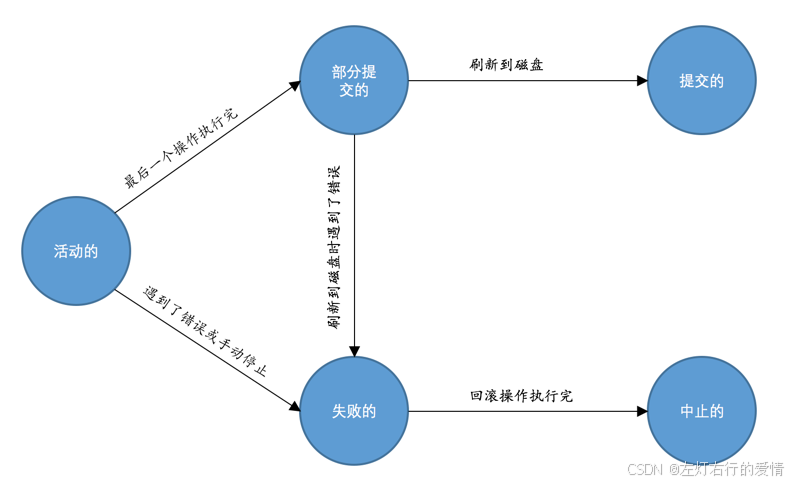

## 事务语法

### 开启事务

* BEGIN  
   BEGIN语句代表开启一个事务.  
   开启事务后，就可以继续写若干条语句，这些语句都属于刚刚开启的这个事务。

```
mysql> BEGIN;
Query OK, 0 rows affected (0.00 sec)
mysql> 加入事务的语句...


```

* START TRANSACTION  
   START TRANSACTION语句和BEGIN语句有着相同的功效，都标志着开启一个事务，比如这样：

```
mysql> START TRANSACTION;
Query OK, 0 rows affected (0.00 sec)
mysql> 加入事务的语句...


```

不过比BEGIN语句牛逼一点儿的是，可以在START TRANSACTION语句后边跟随几个修饰符，就是它们几个：

1. READ ONLY:标识当前事务是一个只读事务
2. READ WRITE:标识当前事务是一个读写事务
3. WITH CONSISTENT SNAPSHOT:启动一致性读

### 提交事务

开启事务之后就可以继续写需要放到该事务中的语句了，当最后一条语句写完了之后，我们就可以提交该事务了，提交的语句也很简单：

```
COMMIT 


```

COMMIT语句就代表提交一个事务.比如我们上面说小王给小黎转10元钱其实对应MySQL中的两条语句，我们就可以把这两条语句放到一个事务中，完整的过程就是这样：

```
mysql> BEGIN;
Query OK, 0 rows affected (0.00 sec)

mysql> UPDATE account SET balance = balance - 10 WHERE id = 1;
Query OK, 1 row affected (0.02 sec)
Rows matched: 1  Changed: 1  Warnings: 0

mysql> UPDATE account SET balance = balance + 10 WHERE id = 2;
Query OK, 1 row affected (0.00 sec)
Rows matched: 1  Changed: 1  Warnings: 0

mysql> COMMIT;
Query OK, 0 rows affected (0.00 sec)


```

### 手动中止事务

如果我们写了几条语句之后发现上面的某条语句写错了，我们可以手动的使用下面这个语句来将数据库恢复到事务执行之前的样子：

```
ROLLBACK 


```

比如我们在写小王给小黎转账10元钱对应的MySQL语句时，先给小王扣了10元，然后一时大意只给小黎账户上增加了1元，此时就可以使用ROLLBACK语句进行回滚，完整的过程就是这样：

```
mysql> BEGIN;
Query OK, 0 rows affected (0.00 sec)

mysql> UPDATE account SET balance = balance - 10 WHERE id = 1;
Query OK, 1 row affected (0.00 sec)
Rows matched: 1  Changed: 1  Warnings: 0

mysql> UPDATE account SET balance = balance + 1 WHERE id = 2;
Query OK, 1 row affected (0.00 sec)
Rows matched: 1  Changed: 1  Warnings: 0

mysql> ROLLBACK;
Query OK, 0 rows affected (0.00 sec)


```

ROLLBACK语句是我们程序员手动的去回滚事务时才去使用的，如果事务在执行过程中遇到了某些错误而无法继续执行的话，事务自身会自动的回滚。

### 自动提交

MySQL中有一个
系统变量
autocommit：

```
mysql> SHOW VARIABLES LIKE 'autocommit';
+---------------+-------+
| Variable_name | Value |
+---------------+-------+
| autocommit    | ON    |
+---------------+-------+
1 row in set (0.01 sec)


```

以看到它的默认值为ON，也就是说默认情况下，如果我们不显式的使用START TRANSACTION或者BEGIN语句开启一个事务，那么每一条语句都算是一个独立的事务，这种特性称之为事务的自动提交。  
 假如我们在小王向小黎转账10元时不以START TRANSACTION或者BEGIN语句显式的开启一个事务，那么下面这两条语句就相当于放到两个独立的事务中去执行：

```sql
UPDATE account SET balance = balance - 10 WHERE id = 1;
UPDATE account SET balance = balance + 10 WHERE id = 2;


```

当然，如果我们想关闭这种自动提交的功能，可以使用下面两种方法之一：

* 显式的的使用START TRANSACTION或者BEGIN语句开启一个事务。
* 把系统变量autocommit的值设置为OFF，就像这样:`SET autocommit = OFF;`

### 隐式提交

当我们使用START TRANSACTION或者BEGIN语句开启了一个事务，或者把系统变量autocommit的值设置为OFF时，事务就不会进行自动提交，但是如果我们输入了某些语句之后就会悄悄的提交掉，就像我们输入了COMMIT语句了一样，这种因为某些特殊的语句而导致事务提交的情况称为隐式提交.  
 这些会导致事务隐式提交的语句包括:

* 定义或修改数据库对象的数据定义语言（Data definition language，缩写为：DDL）。  
   所谓的数据库对象，指的就是数据库、表、视图、存储过程等等这些东西。当我们使用CREATE、ALTER、DROP等语句去修改这些所谓的数据库对象时，就会隐式的提交前面语句所属于的事务，就像这样：

```sql
BEGIN;

SELECT ... # 事务中的一条语句
UPDATE ... # 事务中的一条语句
... # 事务中的其它语句

CREATE TABLE ... # 此语句会隐式的提交前面语句所属于的事务


```

* 隐式使用或修改mysql数据库中的表

```
当我们使用ALTER USER、CREATE USER、DROP USER、GRANT、RENAME USER、REVOKE、SET PASSWORD等语句时也会隐式的提交前面语句所属于的事务。


```

* 事务控制或关于锁定的语句  
   当我们在一个事务还没提交或者回滚时就又使用START TRANSACTION或者BEGIN语句开启了另一个事务时，会隐式的提交上一个事务，比如这样：

```sql
BEGIN;

SELECT ... # 事务中的一条语句
UPDATE ... # 事务中的一条语句
... # 事务中的其它语句

BEGIN; # 此语句会隐式的提交前面语句所属于的事务


```

* 还有其他的一些语句,也不经常用,遇到了搜一下就可以了

### 保存点

如果你开启了一个事务，并且已经敲了很多语句，忽然发现上一条语句有点问题，你只好使用ROLLBACK语句来让数据库状态恢复到事务执行之前的样子，然后一切从头再来，总有一种一夜回到解放前的感觉。  
 就像是打空洞骑士(难度高,死忙代价很高,会丢失很多东西)一样,死一次就让你抓狂.  
 相反奥日的森林就很轻松一点,里面的存档点很多,死亡代价小,让玩家更敢操作.  
 那这个游戏里的存档点就像这里的保存点一样:  
 在事务对应的数据库语句中打几个点，我们在调用ROLLBACK语句时可以指定会滚到哪个点，而不是回到最初的原点。定义保存点的语法如下：

```
SAVEPOINT 保存点名称;


```

当我们想回滚到某个保存点时，可以使用下面这个语句：

```
ROLLBACK TO 保存点名称;

如果ROLLBACK语句后边不跟随保存点名称的话，会直接回滚到事务执行之前的状态。


```

如果我们想删除某个保存点，可以使用这个语句：

```
RELEASE SAVEPOINT 保存点名称;


```

下面还是以小王向小黎转账10元的例子展示一下保存点的用法，在执行完扣除小王账户的钱10元的语句之后打一个保存点：

```
mysql> SELECT * FROM account;
+----+--------+---------+
| id | name   | balance |
+----+--------+---------+
|  1 | 小王   |      11 |
|  2 | 小黎   |       2 |
+----+--------+---------+
2 rows in set (0.00 sec)

mysql> BEGIN;
Query OK, 0 rows affected (0.00 sec)

mysql> UPDATE account SET balance = balance - 10 WHERE id = 1;
Query OK, 1 row affected (0.01 sec)
Rows matched: 1  Changed: 1  Warnings: 0

mysql> SAVEPOINT s1;    # 一个保存点
Query OK, 0 rows affected (0.00 sec)

mysql> SELECT * FROM account;
+----+--------+---------+
| id | name   | balance |
+----+--------+---------+
|  1 | 小王   |       1 |
|  2 | 小黎   |       2 |
+----+--------+---------+
2 rows in set (0.00 sec)

mysql> UPDATE account SET balance = balance + 1 WHERE id = 2; # 更新错了
Query OK, 1 row affected (0.00 sec)
Rows matched: 1  Changed: 1  Warnings: 0

mysql> ROLLBACK TO s1;  # 回滚到保存点s1处
Query OK, 0 rows affected (0.00 sec)

mysql> SELECT * FROM account;
+----+--------+---------+
| id | name   | balance |
+----+--------+---------+
|  1 | 小王   |       1 |
|  2 | 小黎   |       2 |
+----+--------+---------+
2 rows in set (0.00 sec)


```

## 事务与事务日志

> 本节合并自同主题的另一篇笔记，原文：[CSDN](https://blog.csdn.net/qq_45852626/article/details/128187466)。

### 前言

整理回顾MySQL的核心内容，后面每天会抽时间更新整理。  
 内容来自各个博客和书籍整理而来。

### 什么是事务

事务就是由单独单元的一个或多个
SQL语句
组成，在这个单元中，每个SQL语句都是相互依赖，而整个单独单元是不可分割的存在。  
 事务是一个整体，事务中的内容只能是都成功或者都不成功，不存在部分执行成功或者部分失败。

#### 事务的特性

事务的特性内容简称ACID：

* 原子性 Atomicity  
   过程的保证  
   事务是数据库的逻辑工作单位，事务中包含的各操作要么都做，要么都不做。
* 一致性 consistency  
   结果的保证  
   事务执行的结果必需是使数据库从一个一致性状态变到另一个一致性状态。  
   因此当数据库只包含成功事务提交的结果时，就说数据库处于一致性状态，如果数据库系统运行中发生故障，有些事务尚未完成就被迫中断，这些未完成事务对数据库所做的修改有一部分已写入物理数据库，这时数据库就处于一种不正确的状态，或者说是不一致的状态。
* 隔离性 Isolation  
   防止并发事物相互干扰  
   一个事物的执行不能被其他事物干扰。即一个事务内部的操作及使用的数据对其他并发事物是隔离的，并发执行的各个事务之间不能相互干扰。
* 持久性 （永久性）Durability  
   永久性保存  
   一个事务一旦提交，它对数据库中的数据的改变就应该是永久性的。接下来的其他操作或故障不应该对其执行结果有任何影响。

InnoDB引擎通过什么技术来保证事务这四个特性呢？

* 原子性通过 undo log（回滚日志）保证
* 一致性通过持久性+原子性+隔离性来保证
* 隔离性是通过MVCC（多版本并发控制）或锁机制保证
* 持久性是通过redo log（重做日志）保证  
   这些具体的日志，MVCC，锁在后面专辑内容里 我们都会介绍，这篇文章只谈涉及到的。

#### 事务的状态

我们现在知道 事务 是一个抽象的概念，它其实对应着一个或多个数据库操作，MySQL根据这些操作所执  
 行的不同阶段把 事务 大致划分成几个状态：

* 活动的（Active）  
   事务对应的数据库操作正在执行过程中时，我们就说该事务处在活动的状态。
* 部分提交的（Partially Committed）  
   当事务中的最后一个操作执行完成，但由于操作都在内存中执行，**所造成的影响并没有刷新到磁盘时**，我们就说该事务处在部分提交的状态。
* 失败的（Failed）  
   当事务处在活动的或者部分提交的状态时，可能遇到了某些错误（数据库自身的错误，操作系统或者直接断电等）而无法继续执行，或者人为的停止当前事务的执行，我们就说该事务处在失败的状态
* 中止的（Aborted）  
   如果事务执行了一部分而变为失败的状态，那么就需要把已经修改的事务中的操作还原到事务执行前的状态。  
   换句话说，就说要撤销失败事务对当前数据库造成的影响。  
   我们把这个撤销称为回滚。当回滚操作执行完毕时，也就是数据库恢复到了执行事务前的状态，我们就说事务处在了中止的状态。
* 提交的（Committed）  
   当一个处在部分提交的状态的事务将修改过的数据都同步到磁盘上之后，我们就可以说该事务处在了提交的状态。

状态转换图如下所示：  
 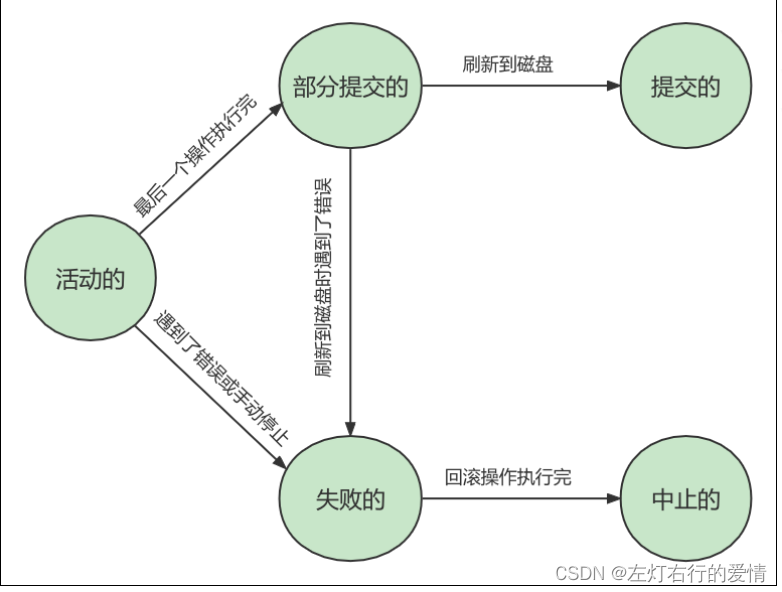

#### 事务会引发什么问题？

MySQL服务端是允许多个客户端链接的，这意味着MySQL会出现同时处理多个事务的情况。  
 那么在处理多个事务，会出现以下几种问题：

* 脏读（Dirty Read）  
   一个事务在处理过程中读取了另外一个事务未提交的数据。  
   当一个事务正在访问数据并且对其进行了修改，但是还没提交事务，这时另外一个事务也访问了这个数据，然后使用了这个数据，因为这个数据的修改还没提交到数据库，所以另外一个事务读取的数据就是“脏数据”，这种行为就是“脏读”，依据“脏数据”所做的操作可能是会出现这个问题。  
   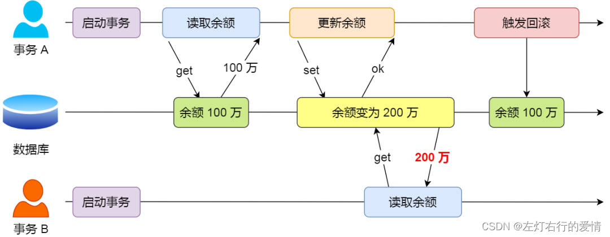
* 修改丢失（Lost of Modify）  
   是指一个事务读取一个数据时，另外一个数据也访问了该数据，那么在第一个事务修改了这个数据之后，第二个事务也修改了这个数据。  
   这样第一个事务内的修改结果就被丢失。  
   **这个其实不会影响到程序的结果，只是逻辑上不正确。**
* 不可重复读（Unrepeatableread）  
   指在一个事务内多次读取同一数据，在这个事务还没结束时，另外一个事务也访问了这个数据并对这个数据进行了修改，那么就可能造成第一个事务两次去读的数据不一致。  
   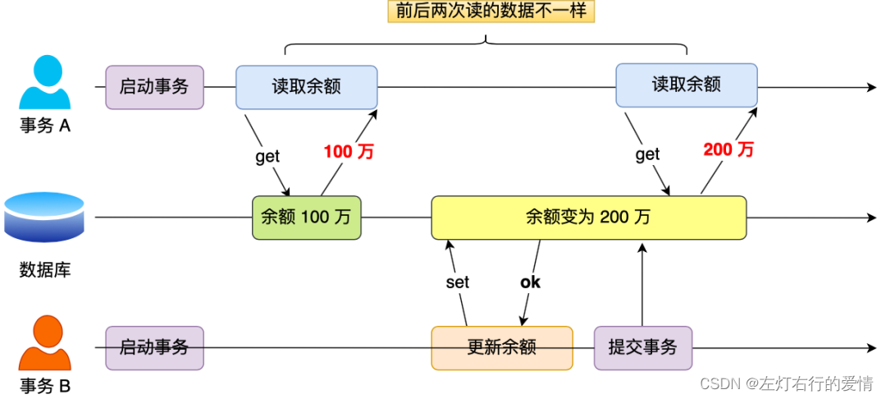
* 幻读（Phantom Read）  
   指同一个事务内多次查询返回的结果集不一样（比如增加了或者减少了行记录）  
   幻读与不可重复读类似，幻读是指一个事务读取了几行数据，这个事务还没结束，接着另外一个事务插入了一些数据，在随后的查询中，第一个事务读取的数据就会别原本读取的多，就像发生幻觉了一样。  
   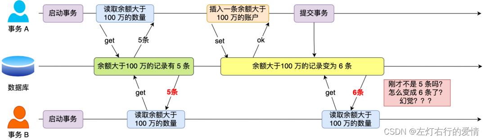  
   总结一下：
* 脏读：读到其他事物未提交的数据
* 不可重复读：前后读取的数据不一致
* 幻读：前后读取的记录数量不一致  
   这三个现象的严重性排序如下：  
     
   那么如何解决上面的问题呢？

#### 解决事物引发的问题手段

SQL标准提出了四种隔离级别来规避这些现象，隔离级别越高，性能越低，这四个隔离级别如下：

* 读未提交：指一个事务还没提交，它做的变更就能被其他事物看到；
* 读提交：指一个事务提交之后，它做的变更才能被其他事物看到；
* 可重复读：指一个事务执行过程中看到的数据，一直跟这个事务启动时看到的数据是一致的，MySQL InnoDB引擎的默认隔离级别；
* 串行化：会对记录加上读写锁，在多个事务对这条记录进行读写操作时，如果发生了读写冲突的时候，后访问的事务必需等前一个事务执行完成，才能继续执行。  
   按隔离水平高低排序如下：  
     
   针对不同的隔离级别，并发事物时可能发生的现象也会不同：  
   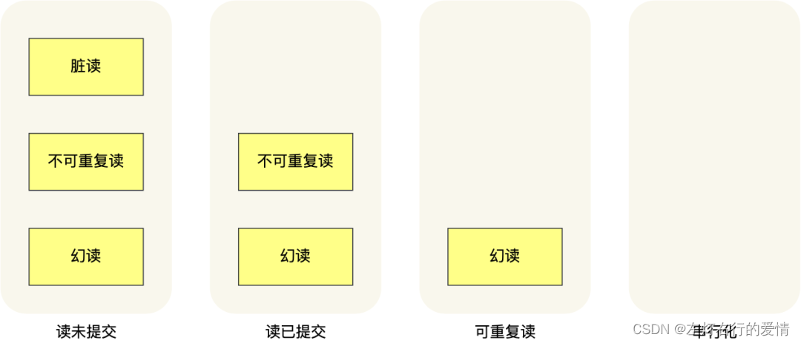  
   那么这四种隔离级别具体是如何实现的呢？

### 事务日志

我们知道了事务有四种特性：原子性，一致性，隔离性和持久性。  
 事务的原子性，一致性和持久性可以由事务日志实现，我们下面具体来看一看。  
 日志大概分为三种：

* undo log（回滚日志）：是InnoDB存储引擎层生成的日志，实现了事务中的原子性，主要用于事务回滚和MVCC。
* redo log‘（重做日志）：是InnoDB存储引擎层生成的日志，实现了事务中的持久性，主要用于掉电等故障回复
* binlog（归档日志）：是Server层生成的日志，主要用于数据备份和主从赋值。  
   注意，undo log是逻辑日志，对事物回滚时，只是将数据库逻辑地恢复到原来的样子。  
   redo log是物理日志，记录的是数据页的物理变化，undo log不是redo log的逆过程。

#### Undo Log 日志

##### 简单介绍

我们在执行执行一条“增删改”语句的时候，虽然没有输入 begin 开启事务和 
commit 
 提交事务，但是 MySQL 会**隐式开启事务**来执行“增删改”语句的，执行完就自动提交事务的，这样就保证了执行完“增删改”语句后，我们可以及时在数据库表看到“增删改”的结果了。  
 是否开启自动提交事务，是由**autocommit**参数决定的，默认是开启。  
 有个问题需要考虑一下：  
 **一个事务执行过程中，在还没有提交事务之前，如果MySQL发生了崩溃，要怎么回滚到事务之前的数据呢？**

答案：我们在事务在执行过程中，都记录下回滚需要的信息到一个日志里，那么事务执行中途发生了MySQL崩溃后，就不需要担心无法回滚到事务之前的数据，我们可以通过这个日志回滚到事务之前的数据。

实现这一机制就是 Undo log（回滚日志），它保证了事务的ACID特性中的原子性（Atomicity）。

undo log 是一种用于撤销回退的日志。在事务没提交之前，MySQL会先记录更新前的数据到Undo log日志文件里面，当事务回滚时，可以利用undo log 来记录回滚，如下图：  
 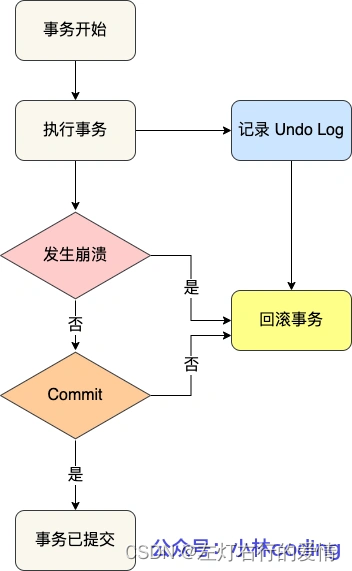  
 每当InnoDB引擎对一条记录进行操作（新增，修改，删除）时，就把回滚时需要的信息都记录到undo log里，比如：

* 在插入一条记录时  
   要把这条记录的主键值记下来，这样之后回滚时只需要把这个主键值对应的记录删掉就好了；
* 在删除一条记录时  
   要把这条记录中的内容都记下来，这样之后回滚时再把由这些内容组成的记录插入到表中就好了；
* 在更新一条记录时  
   要把被更新的列的旧值记下来，这样之后回滚时再把这些列更新为旧值就好了。

在发生回滚时，就读取undo log里的数据，然后做原先相反的操作。

##### 具体实现

不同的操作，需要记录的内容也是不同的，所以不同类型的操作产生的undo  
 log格式也不同，具体每个操作产生的undo log格式就不详细介绍了，感兴趣自己去查查吧。

一个记录的每一次更新操作产生的undo log格式都有一个roll\_pointer指针和一个trx\_id事务id：

* 通过trx\_id可以知道该记录被哪个事务修改的；
* 通过roll\_pointer指针可以将这些undo log串成一个链表，这个链表就称为版本链，如下图：  
   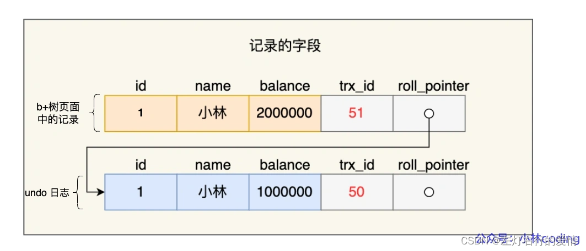  
   另外，undo log还有一个作用，通过ReadView+undo log 实现MVCC（多版本并发控制）。

对于【读提交】和【可重复读】隔离级别，他们快照读（普通select语句）是通过ReadView+undo log来实现的，它们的区别在于创建
Read 
 View的时机不同：

* 【读提交】隔离级别是在每个select都会生成一个新的Read View，事务期间多次读取同一条数据，前后两次读的数据可能会出现不一致，因为这期间可能另外一个事务修改了该记录，并提交了事务。
* 【可重复读】隔离级别是启动事务时生成了一个Read View，然后整个事务期间都在用这个Read View,这样就保证了在事务期间读到的数据都是事务启动前的记录。

这两个级别实现通过【事务的Read View里的字段】和【记录中的两个隐藏列（trx\_id和roll\_pointer指针）】的比对，如果不满足可见行，就会顺着undo log版本链里找到满足其可见性的记录，从而控制并发事物访问同一个记录时的行为，这就叫MVCC（多版本并发控制），

因此 undo log两大作用：

* 实现事务回滚，保障事务的原子性。  
   事务处理过程中，如果出现了错误或者用户执行了ROLLBACK语句，MYSQL可以易用undo log中的历史数据将数据恢复到事务开始之前的状态。
* 实现MVCC（多版本并发控制）关键因素之一。  
   MVCC是通过ReadView+undo log实现的。  
   undo log为每条记录保存多份历史数据，MySQL在执行快照读（普通select语句）的时候，会根据事物的Read View里的信息，顺着undo log 的版本链找到满足其可见性的记录。

#### Buffer Pool

MySQL的数据都是存在磁盘中，那么我们要更新一条记录时，得先要从磁盘读取记录，然后在内存中修改这条记录。那修改完这条记录是选择直接写回磁盘，还是选择缓存起来呢？

当然是缓存起来好，这样下次有查询语句命中管理这条记录，直接读取缓存中的记录，就不需要从磁盘获取数据了。

为此InnoDB存储引擎设计了一个缓冲池（Buffer Pool），来提高数据库的读写性能。  
 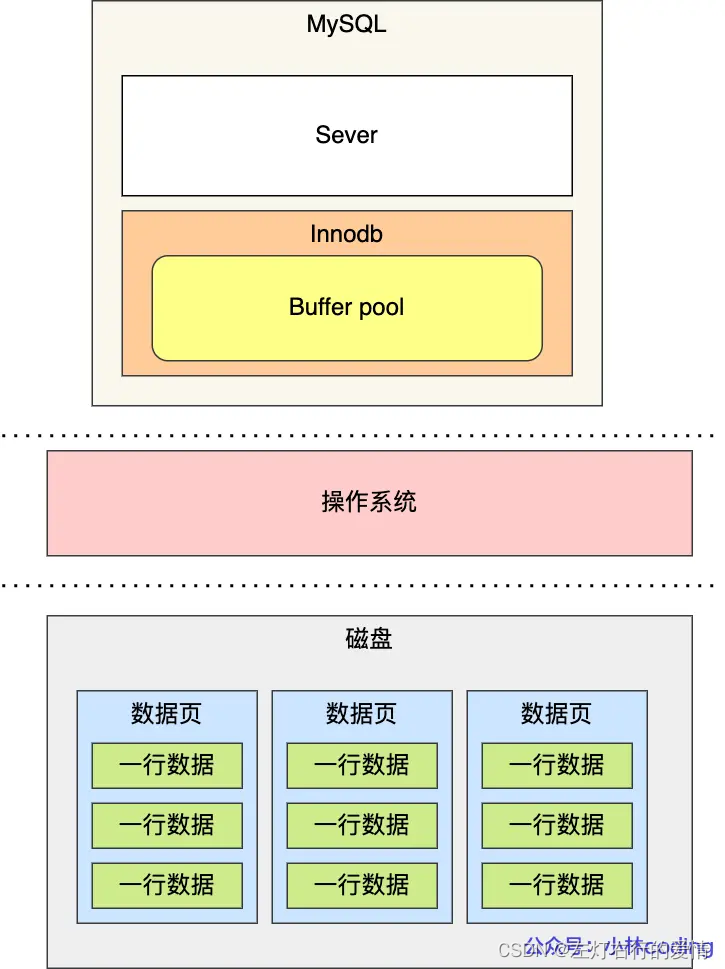  
 有了Buffer Pool之后：

* 读取数据时  
   如果数据存在Buffer Pool中，客户端就会直接读取Buffer Pool中的数据，否则再去磁盘中读取。
* 修改数据时  
   如果数据存在Buffer Pool中，那直接修改Buffer Pool中数据所在的页，然后将其页设置为脏页（该页的内存数据和磁盘上的数据已经不一致），为了减少磁盘I/O，不会立即将脏页写入磁盘，后续由后台线程选择合适时机将脏页写入磁盘。

##### Buffer Pool缓存什么？

InnoDB会把存储的数据划分为若干个【页】，以页作为磁盘和内存交互的基本单位，一个页的默认大小为16KB，因此，Buffer Pool同样按照【页】来划分。  
 在 MySQL 启动的时候，InnoDB 会为 Buffer Pool 申请一片连续的内存空间，然后按照默认的16KB的大小划分出一个个的页， Buffer Pool 中的页就叫做缓存页。此时这些缓存页都是空闲的，之后随着程序的运行，才会有磁盘上的页被缓存到 Buffer Pool 中。

所以，MySQL 刚启动的时候，你会观察到使用的
虚拟内存 
空间很大，而使用到的物理内存空间却很小，这是因为只有这些虚拟内存被访问后，操作系统才会触发缺页中断，申请物理内存，接着将虚拟地址和物理地址建立映射关系。

Buffer Pool 除了缓存「索引页」和「数据页」，还包括了 Undo 页，插入缓存、自适应哈希索引、锁信息等等。  
 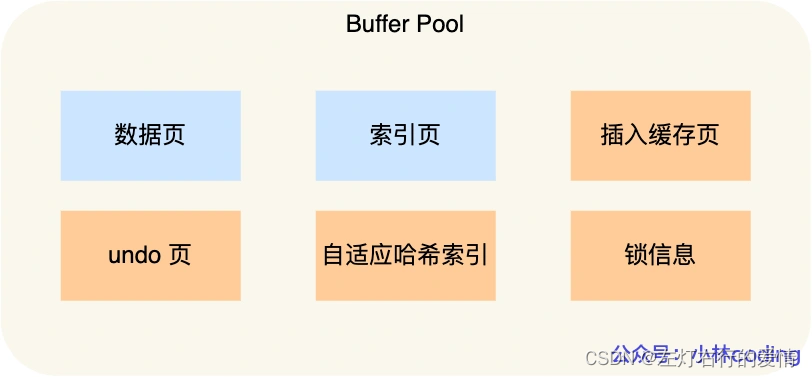  
 注意：并不是查询一条记录，就只缓冲一条记录的。  
 InnoDB会把整个页的数据加载到Buffer Pool中，将页加载到Buffer Pool

#### Redo Log日志

##### 为什么需要Redo Log?

我们知道了Buffer Pool是提高了读写效率，但是问题来了，Buffer Pool是基于内存的，而内存是不可靠的，万一断点重启，还没来得及落盘的脏页数据就会丢失。  
 为了防止断电导致数据丢失的问题，当有一条记录需要更新时，InnoDB引擎就会先更新内存（同时标记为脏页），然后将本次对这个页的修改以redo log的形式记录下来，这个时候更新就算完成了。  
 后续，InnoDB引擎在适当的时候，由后台线程将缓存在Buffer Poll的脏页刷新到磁盘里，这就是WAL（Write-Ahead Logging）技术  
 WAL技术指的是：MySQL的写操作并不是立刻写到磁盘上，而是先写日志，然后在合适的时间再写到磁盘上。  
 过程如下：  
 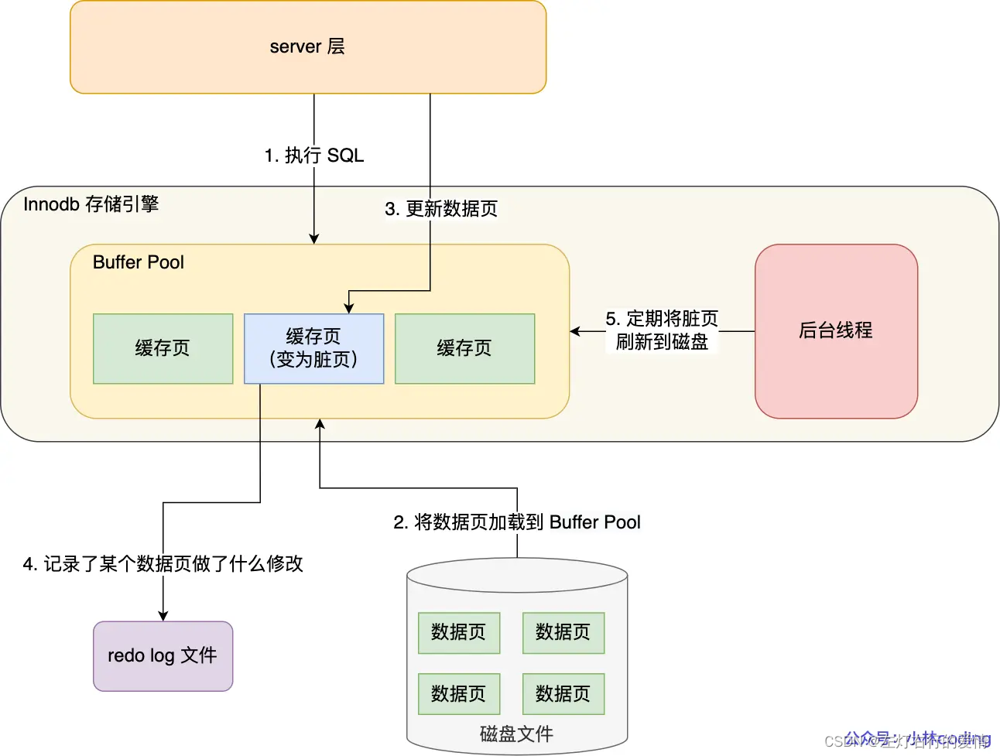

##### 什么是 redo log？

redo log 是物理日志，记录了某个数据页做了什么修改（比如对 XXX 表空间中的 YYY 数据页 ZZZ 偏移量的地方做了AAA 更新），每当执行一个事务就会产生这样的一条或者多条物理日志。

在事务提交时，只要先将 redo log持久化到磁盘即可，可以不需要等到缓存在Buffer Pool里的脏页数据持久化到磁盘。

当系统崩溃时，虽然脏页数据没有持久化，但是redo log已经持久化，接着MySQL重启后，根据redo log的内容，将所有数据恢复到最新的状态。

注意：被修改undo log时，需要记录对应的redo log  
 开始事务后，InnoDB层更新记录前，首先要记录相应的undo log，如果是更新操作，需要把更新的列的旧值记下来，也就是要生成一条undo log，undo log会写入Buffer Pool中的Undo页面。  
 不过在内存修改undo log页面后，需要记录对应的redo log。

##### redo log要写入磁盘，数据也要写磁盘，为什么要多此一举？

写入redo log的方式使用了追加操作，所以磁盘操作是**顺序写**，而写入数据需要**先找到写入位置，然后才写到磁盘，所以磁盘操作是随机写**。

磁盘的顺序写比随机写高效的多，因此redo log写入磁盘的开销更小。

针对顺序写为什么比随机写更快这个问题（举个例子，你有一个本子）

#### Redo Log和Undo Log的区别在哪？

这两种日志都属于InnoDB存储引擎的日志，它们的区别在于：

* redo log记录了此次事务【完成后】的数据状态，记录的是更新之后的值；
* undo log记录了此次事务【开始前】的数据状态，记录的是更新之前的值；  
   事务提交之前发生了崩溃，重启后会通过undo log回滚事务，事务提交之后发生了崩溃，重启后会通过redo log恢复事务，如下图：  
   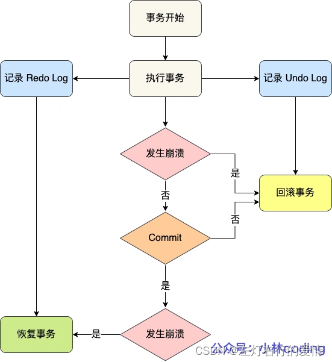  
   所以有了redo log，再通过WAL技术，InnoDB就可以保证即使数据库发生异常重启，之前已提交的记录都不会丢失，这个能力称为crash-safe（崩溃恢复），

---

后面内容待更新，近期补上，上面的内容细节也会补上。
