> 原文：[CSDN](https://blog.csdn.net/qq_45852626/article/details/146058321)

## 为什么需要分布式锁

分布式锁是解决分布式系统中并发控制问题的关键机制。在单体应用中，我们可以使用Java的synchronized或ReentrantLock来实现线程同步，但这些机制只在单个JVM内有效。当应用扩展为分布式架构后，多个服务实例可能同时访问和修改共享资源。传统的单机锁无法跨进程协调资源访问，这就需要分布式锁来解决。"

## 核心场景举例

我认为分布式锁主要应用在以下几个典型场景：

1. 防止重复操作  
    例如支付系统中，防止同一订单被重复处理。
2. 保证数据一致性  
    最典型的就是库存管理，防止超卖问题。在我负责的电商项目中，秒杀活动期间如果没有分布式锁，多个服务实例同时读取库存并扣减，会导致数据不一致。
3. 分布式任务调度  
    确保定时任务只被一个服务实例执行，避免重复执行。
4. 限流控制  
    在分布式环境下控制对共享资源的并发访问量。"

## 技术原理简述

一个有效的分布式锁需要满足几个关键特性：

* 互斥性：任意时刻只有一个客户端能持有锁
* 避免死锁：即使客户端崩溃，锁也能自动释放
* 高可用：锁服务本身不应成为系统瓶颈
* 高性能：获取和释放锁的操作应该是高效的  
   常见的实现方式有基于Redis、Zookeeper或数据库的方案，各有优缺点。在我的项目中，我主要使用Redis实现分布式锁，因为它性能高、实现相对简单。"

## 项目中需要注意的优化和思考

写项目的时候有一些需要注意的问题：

* 锁的粒度：锁粒度过粗会影响并发性能，过细会增加复杂度。我们通常按业务资源ID设计锁粒度，如商品ID。
* 锁的超时时间：需要根据业务处理时间合理设置，过短可能导致业务未完成锁就释放，过长则可能在客户端异常时长时间阻塞其他请求。
* 锁的可重入性：在某些场景下需要支持同一客户端多次获取同一把锁。  
   性能考量：分布式锁虽然解决了并发问题，但也引入了网络开销，需要在一致性和性能间取得平衡。后来引入了Redisson框架，它提供了更完善的分布式锁实现，包括自动续期（看门狗机制）、可重入锁、读写锁等高级特性，进一步提升了系统的可靠性。"

## 小结

总的来说，分布式锁是分布式系统中不可或缺的组件，它解决了单机锁无法解决的跨进程资源协调问题。选择合适的分布式锁实现，需要根据业务场景、一致性要求和性能需求综合考虑。在实际应用中，我们不仅要关注锁的功能实现，还要考虑异常情况处理、性能优化和可用性保障。"

## 分布式锁的本质

分布式锁的本质是在分布式环境下实现的互斥协调机制。与单机锁不同，分布式锁需要解决的核心问题是：如何在没有共享内存的情况下，协调多个分布式节点对共享资源的访问。从技术实现角度看，分布式锁依赖于一个所有节点都能访问的共享协调点（如Redis、Zookeeper或数据库），通过原子操作和一致的协议来确保在任意时刻只有一个客户端能够获取锁。

一个完善的分布式锁应具备四个关键特性：

* 互斥性：任意时刻只有一个客户端能持有锁
* 防死锁：即使客户端崩溃，锁也能自动释放
* 高可用：锁服务的可用性不应成为系统瓶颈
* 一致性：所有节点对锁状态有一致的认知

分布式锁的实现也受CAP理论约束，不同实现方式在一致性、可用性和分区容忍性之间有不同权衡。例如，基于Redis的分布式锁通常偏向AP，而基于Zookeeper的实现偏向CP。

在我的实践经验中，分布式锁的选择需要根据业务场景、一致性要求和性能需求综合考虑。例如，在我负责的xx系统中，对于xx类核心数据，我们使用了Redisson实现的Redis分布式锁，它通过’看门狗’机制解决了锁超时问题；而对于一些非核心数据，我们选择了更轻量的实现方案。

分布式锁的本质挑战在于，它需要在分布式系统固有的网络延迟、分区和节点故障等问题存在的情况下，依然能够提供可靠的互斥保证。这本质上是一个分布式共识问题，也是为什么完美的分布式锁实现是非常有挑战性的。"

### Redis分布式锁的实现原理？

Redis分布式锁的实现原理是利用Redis的单线程模型和原子操作特性，通过在Redis中创建一个键值对来表示锁，确保在任意时刻只有一个客户端能够成功设置这个键值对，从而实现分布式环境下的互斥控制。最基本的实现方式是使用`SET lock_key unique_value NX PX timeout`命令，它将获取锁和设置过期时间合并为一个原子操作。

* `unique_value`通常是客户端的唯一标识，用于安全释放锁；
* `NX`表示只在键不存在时设置；
* `PX timeout`设置锁的过期时间，防止客户端崩溃导致的死锁。释放锁时，需要使用Lua脚本确保只释放自己持有的锁：

```
if redis.call("get", KEYS[1]) == ARGV[1] then
    return redis.call("del", KEYS[1])
else
    return 0
end


```

这种基本实现存在一些挑战：

* 锁过期问题：如果业务执行时间超过锁的过期时间，可能导致其他客户端提前获取到锁。解决方案是实现锁续期机制（看门狗），定期延长锁的过期时间。
* 主从复制延迟：在Redis主从架构中，如果主节点宕机，从节点提升为主节点前可能未完成锁的同步，导致锁丢失。为了提高可靠性，Redis的作者提出了Redlock算法，它使用多个独立的Redis节点来实现更可靠的分布式锁。Redlock的核心思想是，只有在大多数Redis节点上成功获取锁，才认为获取锁成功，这样即使部分节点故障，整体锁服务仍然可用。

我们使用Redisson框架实现Redis分布式锁，它提供了看门狗机制、可重入锁、读写锁等高级特性，大大简化了分布式锁的使用。对于高并发的秒杀场景，我们还结合了Redis的Lua脚本功能，实现了更复杂的原子操作，如库存检查和扣减的原子性。Redis分布式锁虽然实现简单、性能高，但在极端情况下（如网络分区）可能无法保证完全的互斥性。

对于对一致性要求极高的场景，可能需要考虑基于Zookeeper或etcd的分布式锁实现。"

## 什么是Redlock算法

单节点Redis的分布式锁在Redis节点故障时可能导致锁失效。为了提高可靠性Redis提出了Redlock算法，它使用多个独立的Redis节点来实现更可靠的分布式锁。

### 工作流程

1. 获取当前时间：记录开始获取锁的时间
2. 依次尝试从N个独立的Redis实例获取锁：使用相同的键名、值和过期时间
3. 计算获取锁消耗的时间：当前时间减去开始时间
4. 检查锁是否有效：
   * 如果成功获取了超过半数（N/2+1）的Redis实例上的锁
   * 且获取锁消耗的总时间小于锁的有效时间  
      则认为成功获取了分布式锁
5. 释放锁：无论是否获取成功，都尝试释放所有Redis实例上的锁

Redlock算法在一定程度上提高了分布式锁的可靠性，但仍然存在一些问题：

* 锁的过期时间：如果业务执行时间超过锁的过期时间，可能导致其他客户端提前获取到锁。
* 主从复制延迟：在Redis主从架构中，如果主节点宕机，从节点提升为主节点前可能未完成锁的同步，导致锁丢失。
* 网络延迟：在分布式环境中，不同节点之间的网络延迟可能导致锁的竞争和冲突。Redisson框架实现了Redlock算法，并提供了更完善的分布式锁功能，如看门狗机制、可重入锁、读写锁等。

## 实现Redis分布式锁的方式

Redis实现分布式锁有多种方式，每种方式都有其特点和适用场景。

* 第一种是基于SETNX命令的简单实现。这是最基础的方式，通过SETNX的原子性确保只有一个客户端能设置成功。但它存在明显缺陷：没有过期时间机制，如果客户端崩溃，锁将永远存在。虽然可以用EXPIRE设置过期时间，但这不是原子操作，两个命令之间客户端可能崩溃导致死锁。
* 第二种是使用SET命令的扩展选项，这是目前最常用的方式。通过SET lock\_key unique\_value NX PX timeout一个命令同时完成加锁和设置过期时间，解决了原子性问题。释放锁时，需要使用Lua脚本确保只释放自己的锁。这种方式实现简单、性能高，适合大多数场景，但仍存在锁过期和单点故障问题。
* 第三种是基于Lua脚本的增强实现，通过Lua脚本的原子执行特性，实现更复杂的锁语义，如可重入锁、锁续期等。例如，可以使用哈希结构记录线程标识和重入次数，实现可重入特性；通过定期执行脚本延长锁过期时间，解决锁过期问题。
* 第四种是Redlock算法，它使用多个独立的Redis节点，只有在大多数节点上获取锁成功才认为获取锁成功。这种方式提高了可靠性，即使部分Redis节点故障，整体锁服务仍然可用。但实现复杂，性能相对较低，适合对锁可靠性要求极高的场景。
* 第五种是使用Redisson框架，它提供了丰富的分布式锁实现，包括可重入锁、公平锁、读写锁等，并通过看门狗机制自动延长锁的过期时间。Redisson大大简化了分布式锁的使用，适合企业级应用开发。在实际项目中，我通常根据业务需求选择合适的实现方式。对于简单场景，SET命令扩展选项足够；对于复杂场景，我会使用Redisson；对于对可靠性要求极高的场景，会考虑Redlock或结合其他分布式协调服务。

### 分布式锁实现的要点

从核心特性来看，一个完善的分布式锁必须具备几个关键特性：互斥性，防死锁，高可用，高性能。其次在在实现细节上，需要注意以下几点：锁的粒度设计，超时时间设置，锁的获取策略，异常处理机制。从高级特性方面考虑的话：锁续期机制，监控与告警，降级策略  
 在实际项目中，我通常使用Redisson框架，它已经很好地解决了这些问题，包括可重入性、自动续期和读写锁等高级特性，简化了分布式锁的实现和维护。"

## 分布式锁完全可靠吗？

分布式锁不是完全可靠的，它存在几个经典的可靠性问题：

1. 时钟漂移问题。分布式系统中不同节点的时钟可能存在偏差，这会影响基于超时的锁释放机制，可能导致多个客户端同时认为持有锁的情况。
2. 网络分区问题。当网络分区发生时，可能出现’脑裂’现象：客户端A获取锁后与锁服务器断开连接，锁过期释放，客户端B获取同一把锁，当网络恢复时，A和B同时认为自己持有锁。
3. 主从复制延迟问题。在Redis主从架构中，如果主节点宕机，从节点提升为主节点前可能未完成锁的同步，导致锁丢失。
4. 锁过期问题。如果业务执行时间超过锁的过期时间，可能导致其他客户端提前获取到锁。对于一般业务场景，Redis或Zookeeper的分布式锁已经足够可靠，可以通过看门狗机制、合理的超时设置和重试策略来提高可靠性。于金融交易等核心场景，我会采用更严格的方案，如使用Redlock算法、结合数据库事务提供额外保障，或设计操作的幂等性，确保即使锁失效也不会导致数据不一致。

### 如何安全地释放Redis分布式锁？为什么需要这样做？

最开始我们也是简单地用DEL命令删除锁，后来遇到了并发问题才深入研究这块。首先说为什么要安全释放。假设这样一个场景：

* 线程A获取了锁，设置了10秒过期时间
* 但A执行业务时GC停顿了12秒
* 这时锁已经过期了，被线程B获取了
* A从GC中恢复后，直接用DEL删除锁
* 结果把B的锁给删了，导致C也能获取锁  
   这就是最典型的误删问题。所以我们后来改用了Lua脚本来释放锁：

```
if redis.call("get",KEYS[1]) == ARGV[1] then
    return redis.call("del",KEYS[1])
else
    return 0
end


```

这个脚本会先检查锁是否还是自己的(通过之前设置的唯一标识)，是才删除。用Lua脚本是为了保证这个过程的原子性。但是后来我们发现，即使这样还是不够。因为在业务执行期间，锁过期了就会被其他线程获取，导致并发执行。所以我们又引入了看门狗机制。看门狗其实就是一个自动续期的后台线程。它会每隔一段时间(比如10秒)检查锁是否还是自己的，如果是就续期。

这样只要持有锁的客户端还活着，锁就不会过期。现在我们的完整方案是：

* 加锁时设置唯一标识(UUID+线程ID)
* 启动看门狗定时续期
* 用Lua脚本安全释放
* 同时做好监控，及时发现超长耗时任务

### 分布式锁如何解决锁过期问题？

第一是合理设置过期时间。这个要根据业务的实际执行时间来定，比如我们的业务一般是毫秒级的，我们会设置锁的过期时间为30秒，留出足够的冗余来应对各种异常情况。第二是使用看门狗机制。获取锁时，先设置一个相对较短的过期时间，比如30秒  
 同时启动一个后台线程(看门狗)  
 看门狗每隔10秒检查一次，如果发现锁还在使用就自动续期  
 如果客户端崩溃了，看门狗也就停了，锁自然过期，这样不会产生死锁

```
try {
    // 获取锁
    lock.tryLock(waitTime, leaseTime, TimeUnit.SECONDS);
    // 执行业务逻辑
} catch (Exception e) {
    // 异常处理
} finally {
    // 释放锁
    lock.unlock();
}


```

即使有了这些机制，在Redis主从架构下还是可能出现问题。因为如果主节点在复制数据到从节点前崩溃了，这时候从节点被提升为主节点，之前加的锁就丢失了。以对于一些强一致性要求的场景，我们会考虑：要么使用Redis Cluster多主节点  
 要么切换到Zookeeper这样的CP系统

### 请设计一个可重入的分布式锁

首先说下为什么要可重入。在实际业务中，我们经常会遇到同一个线程多次获取同一把锁的场景。比如一个方法获取了锁，它调用的子方法也需要这个锁。如果不支持可重入，就会导致死锁。实现可重入的核心思路是：

* 记录锁的持有者信息
* 记录重入次数
* 只有持有者才能重入和释放锁  
   具体实现上，我们使用Redis的Hash结构：
* key是锁的名称
* field是客户端标识(比如UUID+线程ID)
* value是重入次数  
   加锁过程是这样的：
* 如果锁不存在，创建hash并设置重入次数为1
* 如果锁存在且是当前客户端的，重入次数加1
* 如果是其他客户端的锁，获取失败  
   解锁时：
* 先验证是否是当前客户端的锁
* 将重入次数减1
* 如果重入次数变成0，删除整个锁

当然，这只是基本实现。在生产环境还需要考虑：

* 结合看门狗机制处理锁过期
* 异常情况的处理
* 性能优化等

### 使用Redis实现一个分布式锁，包括获取锁和释放锁的逻辑

```java
public class RedisDistributedLock {
    private StringRedisTemplate redisTemplate;
    private static final long DEFAULT_EXPIRE = 30; // 默认30秒过期
    private static final long DEFAULT_WAIT = 3;   // 默认等待3秒
    
    // 获取锁
    public boolean tryLock(String key, String value, long timeout) {
        try {
            // SET key value NX EX 30
            Boolean result = redisTemplate.opsForValue()
                .setIfAbsent(key, value, timeout, TimeUnit.SECONDS);
            return Boolean.TRUE.equals(result);
        } catch (Exception e) {
            // 记录日志
            return false;
        }
    }
    
    // 释放锁
    public boolean releaseLock(String key, String value) {
        // 使用Lua脚本保证原子性
        String script = 
            "if redis.call('get',KEYS[1]) == ARGV[1] then " +
                "return redis.call('del',KEYS[1]) " +
            "else " +
                "return 0 " +
            "end";
            
        try {
            Long result = redisTemplate.execute(new DefaultRedisScript<>(script, Long.class), 
                Collections.singletonList(key), value);
            return Long.valueOf(1).equals(result);
        } catch (Exception e) {
            // 记录日志
            return false;
        }
    }
    
    // 实际使用示例
    public void doBusinessWithLock() {
        String key = "order:1";
        String value = UUID.randomUUID().toString();
        
        try {
            if (tryLock(key, value, DEFAULT_EXPIRE)) {
                // 获取锁成功,执行业务逻辑
                doBusiness();
            } else {
                // 获取锁失败的处理
                throw new RuntimeException("获取锁失败");
            }
        } finally {
            // 释放锁
            releaseLock(key, value);
        }
    }
}


```

## 基础理论、落地实现与 Redisson

> 本节合并自同主题的另一篇笔记，原文：[CSDN](https://blog.csdn.net/qq_45852626/article/details/130828424)。

### 基本概念

什么是分布式锁  
 满足
分布式
系统或者集群模式下多进程可见并且互斥的锁。

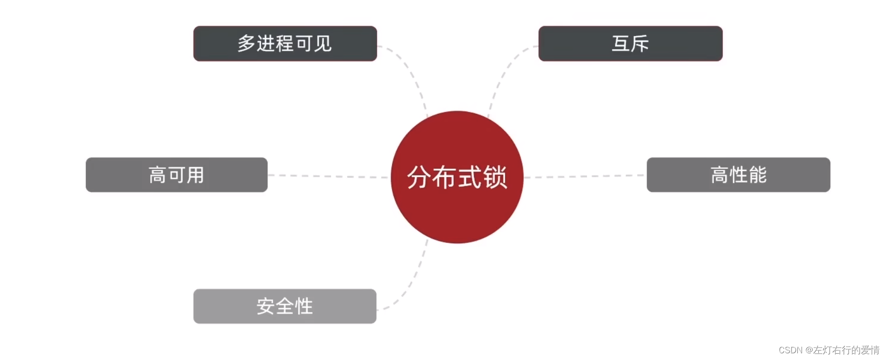

不同分布式锁的实现方案  
 分别从互斥，高可用，高性能，安全性方面来分析。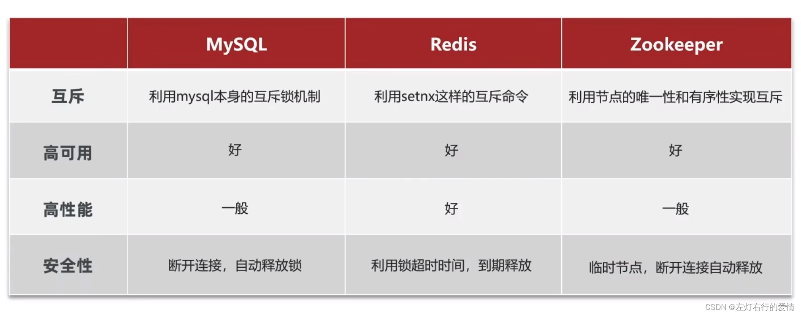

### 基于Redis的分布式锁

#### 基本用法

获取锁：

* 互斥：确保只能有一个线程获取锁。
* 非阻塞：尝试一次，成果返回true，失败返回false。
* + 超时释放：获取锁时添加一个超时时间。

`SETNX lock thread1` # 添加锁，利用setnx的互斥特性。`EXPIRE lock 10` # 添加锁过期时间，避免服务宕机引起的死锁。

释放锁：

* 手动释放

`DEL key` # 释放锁，删除即可。

上面的方式有一个问题：如果在获取锁时，只来得及执行第一句后，就宕机了，过期时间没执行怎么办？

答：将这两个动作设置为原子动作，使用`SET`命令：`SET lock thread1 EX 10 NX`。

流程图如下：

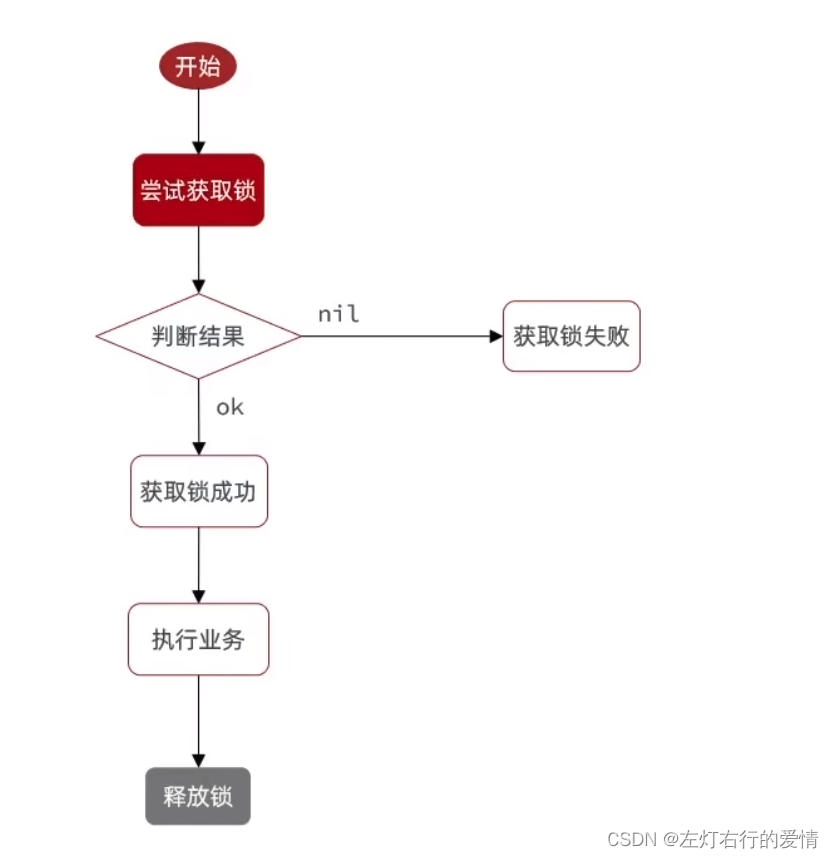

#### 基于Redis实现分布式锁初级版本

先写一个接口：

```java
public interface ILock {
    /**
     * 尝试获取锁
     * @param timeoutSec  锁持有的超时时间，过期后自动释放。
     * @return  true 代表获取锁成功，false代表获取锁失败。
     */
    boolean tryLock(long timeoutSec);

    void unlock();

}


```

再用redis实现一个锁：

```java
import com.wang.Base.ILock;
import org.springframework.data.redis.core.StringRedisTemplate;

import java.util.concurrent.TimeUnit;

public class SimpleRedisLock implements ILock {

    private static final String KEY_PRIFIX = "lock";
    private String name;
    private StringRedisTemplate stringRedisTemplate;

    public SimpleRedisLock(String name ,StringRedisTemplate stringRedisTemplate){
        this.name= name;
        this.stringRedisTemplate = stringRedisTemplate;
    }
    @Override
    public boolean tryLock(long timeoutSec) {
        //获取线程标示
        long threadId = Thread.currentThread().getId();
        //获取锁
        Boolean success = stringRedisTemplate.opsForValue().
                setIfAbsent(KEY_PRIFIX + name, threadId+"", timeoutSec, TimeUnit.SECONDS);
       // return success; 最好不要这样写，因为boolean如果为null，一拆箱就空指针了。
        return Boolean.TRUE.equals(success);
    }

    @Override
    public void unlock() {
         stringRedisTemplate.delete(KEY_PRIFIX+name);
    }
}


```

上面代码存在一个问题：释放锁的时候并没有判断锁是不是自己的，那么在一些极端情况下，会出现问题，下面举个例子。线程1因为业务阻塞的时间超过了锁持有的时间，在未完成业务的情况下释放了。那么线程2此时获取到了锁，在线程2执行业务的期间线程1的业务完成，直接释放了锁。那么此时线程3拿到了锁，开始了执行业务。

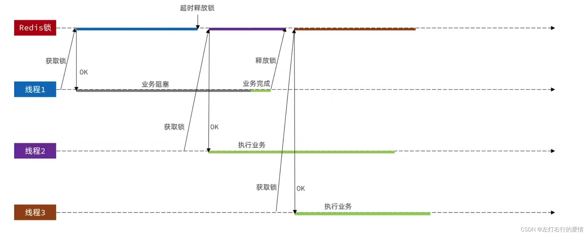

解决方法：在释放锁前，判断一下锁标示是否是自己的。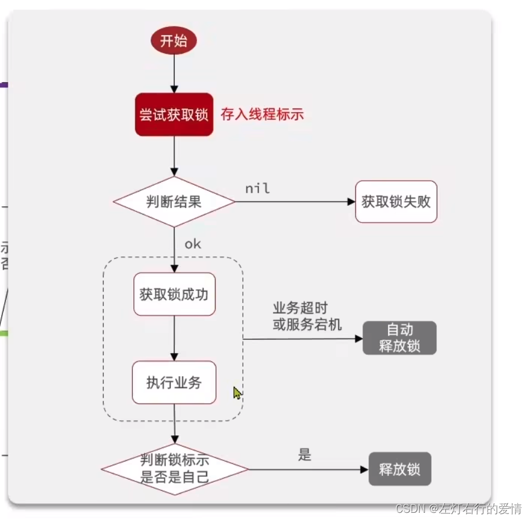

#### 改进Redis的分布式锁

需求：修改之前的分布式锁实现，满足：

1. 在获取锁时存入线程标识（可以用UUID表示，用UUID确保不同的服务，线程id确保不同的线程，确保不同线程标示一定不一样。）
2. 在释放锁时先获取锁中的线程标示，判断是否与当前线程标示一致：

* 如果一致则释放锁。
* 如果不一致则不释放锁。

优化如下代码所示：

```java
import java.util.UUID;
import java.util.concurrent.TimeUnit;

public class SimpleRedisLock implements ILock {

    private static final String KEY_PRIFIX = "lock";
    private static  final String ID_PREFIX = UUID.randomUUID().toString()+"-";
    private String name;
    private StringRedisTemplate stringRedisTemplate;

    public SimpleRedisLock(String name ,StringRedisTemplate stringRedisTemplate){
        this.name= name;
        this.stringRedisTemplate = stringRedisTemplate;
    }
    @Override
    public boolean tryLock(long timeoutSec) {
        //获取线程标示
        String threadId = ID_PREFIX +Thread.currentThread().getId();
        //获取锁
        Boolean success = stringRedisTemplate.opsForValue().
                setIfAbsent(KEY_PRIFIX + name, threadId, timeoutSec, TimeUnit.SECONDS);
       // return success; 最好不要这样写，因为boolean如果为null，一拆箱就空指针了。
        return Boolean.TRUE.equals(success);
    }
    @Override
    public void unlock() {
        //获取线程标示
        String threadId = ID_PREFIX + Thread.currentThread().getId();
        //获取锁中的标示
        String id = stringRedisTemplate.opsForValue().get(KEY_PRIFIX + name);
        //判断标示是否一致
        if(threadId.equals(id)){
            stringRedisTemplate.delete(KEY_PRIFIX+name);
        }
    }
}


```

##### 问题

那么那么，上面的代码就是完美无缺的吗？

答：不是的，在更极端的条件下，依旧会出现问题，现在我们假设一个场景。线程1正常执行了自己的业务完成后，获取锁标示并判断是否一致后，发生了阻塞（这个阻塞并不是代码层面，而是JVM层面，当垃圾回收执行到了Full
GC
的时，因为JVM发生阻塞），如果这个阻塞的时间超过了锁的过期时间，那么其他线程就可以趁虚而入了。这时线程2获取到了锁，执行自己的业务。那么线程1跳出阻塞，会直接把线程2的锁释放掉。线程3就会趁虚而入。

如何避免上面的问题发生呢？  
 解决方法：要把判断和释放并为原子性。这里redis 的事务可以保证原子性，但是无法保证一致性。所以在这里先查询再判断是不行的，拿不到结果，是最后一次性执行的。没有办法把它们放在一个事务中。可以利用乐观锁解决，但是会很麻烦。这里推荐使用Lua脚本去做。

##### Redis的 Lua脚本

Redis提供了Lua脚本功能，在一个脚本中编写多条Redis命令，确保多条命令执行时的原子性。Lua是一种编程语言。

* Lua中使用Redis：Redis在Lua里面给我们提供了一个函数：redis.call(‘命令名称’,‘key’,‘其他参数’)。
* Redis的Lua脚本：写好脚本以后，需要用Redis命令来调用脚本，调用脚本的常见命令如下：  
   `EVAL script numkeys key [key] arg [arg]`

1. 无参数  
    例如我们要执行`redis.call('set','name','jack')这个脚本，语法如下：` EVAL “return redis.call(‘set’,‘name’,‘jacl’)” 0 `

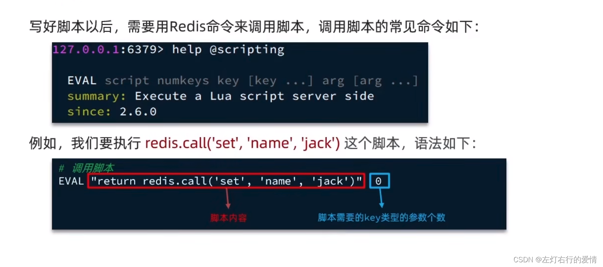
2. 有参数  
    如果脚本中的key，value不写死，可以作为参数传递。key类型参数会放入KEYS数组，其他参数会放入ARGV数组，在脚本中可以从KEYS和ARGV数组获取这些参数：  
    `EVAL "return redis.call('set',KEYS[1], ARGV[1] ) " 1 name wang`

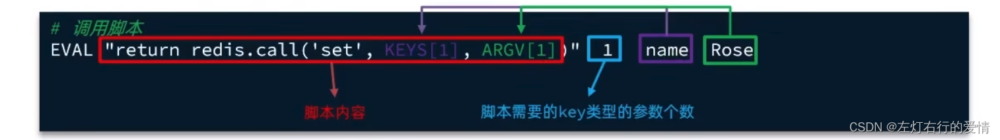

##### 利用Lua脚本写释放锁业务流程

1. 获取锁中的线程标示。
2. 判断是否与指定的标示（当前线程标示）一致。
3. 如果一致则释放锁（删除）。
4. 如果不一致则什么都不做。

```
-- 锁的key
local key = KEYS[1]
-- 当前线程标示
local threadId = ARGV[1]
-- 获取锁中的线程标示 get key
local id = redis.call('get',key)
-- 比较线程标示与锁中标示是否一致
if (id == threadId) then
    -- 释放锁 del key
    return redis.call('del',key)
end
return 0


```

简化写法：

```
local id = redis.call('get',KEYS[1])
-- 比较线程标示与锁中标示是否一致
if (id == ARGV[1]) then
    -- 释放锁 del key
    return redis.call('del',KEYS[1])
end
return 0


```

##### 再次改进Redis的分布式锁

需求：基于Lua脚本实现分布式锁的释放锁逻辑  
 提示：RedisTemplate调用Lua脚本的API如下：

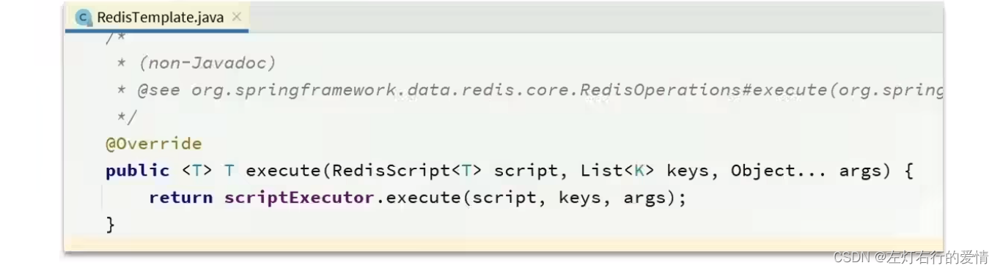

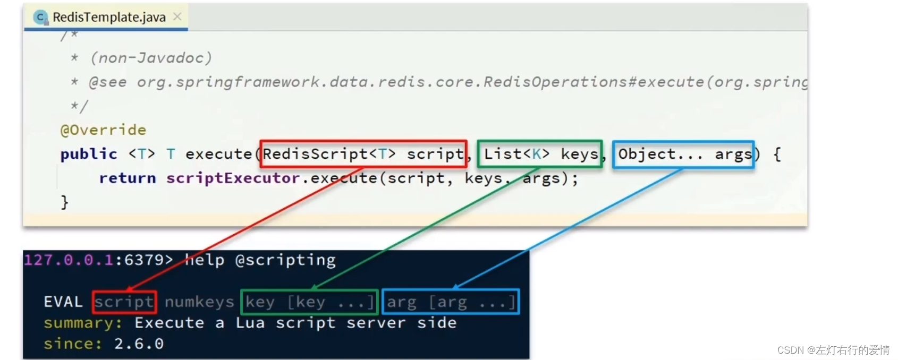

在
idea
中写lua文件：

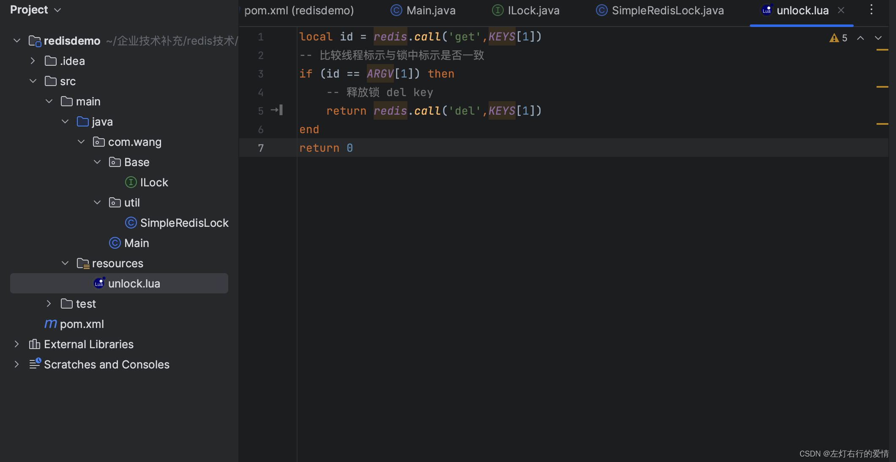

对锁的实现进行改造：

```java
    private static final String KEY_PRIFIX = "lock";
    private static  final String ID_PREFIX = UUID.randomUUID().toString()+"-";

    private static final DefaultRedisScript<Long> UNLOCK_SCRIPT;
      //不要每次释放的时候读取文件，要提前读取好。
    static {
        UNLOCK_SCRIPT = new DefaultRedisScript<>();
        UNLOCK_SCRIPT.setLocation(new ClassPathResource("unlock.lua"));
        UNLOCK_SCRIPT.setResultType(Long.class);
    }
    private String name;
    private StringRedisTemplate stringRedisTemplate;

    public SimpleRedisLock(String name ,StringRedisTemplate stringRedisTemplate){
        this.name= name;
        this.stringRedisTemplate = stringRedisTemplate;
    }
    @Override
    public boolean tryLock(long timeoutSec) {
        //获取线程标示
        String threadId = ID_PREFIX +Thread.currentThread().getId();
        //获取锁
        Boolean success = stringRedisTemplate.opsForValue().
                setIfAbsent(KEY_PRIFIX + name, threadId, timeoutSec, TimeUnit.SECONDS);
       // return success; 最好不要这样写，因为boolean如果为null，一拆箱就空指针了。
        return Boolean.TRUE.equals(success);
    }

    @Override
    public void unlock() {

//        //获取线程标示
//        String threadId = ID_PREFIX + Thread.currentThread().getId();
//        //获取锁中的标示
//        String id = stringRedisTemplate.opsForValue().get(KEY_PRIFIX + name);
//        //判断标示是否一致
//        if(threadId.equals(id)){
//            stringRedisTemplate.delete(KEY_PRIFIX+name);
//        }

        //调用Lua脚本
  
        stringRedisTemplate.execute(UNLOCK_SCRIPT,
                Collections.singletonList(KEY_PRIFIX+name),
                ID_PREFIX+Thread.currentThread().getId()
                );
    }


```

#### 总结

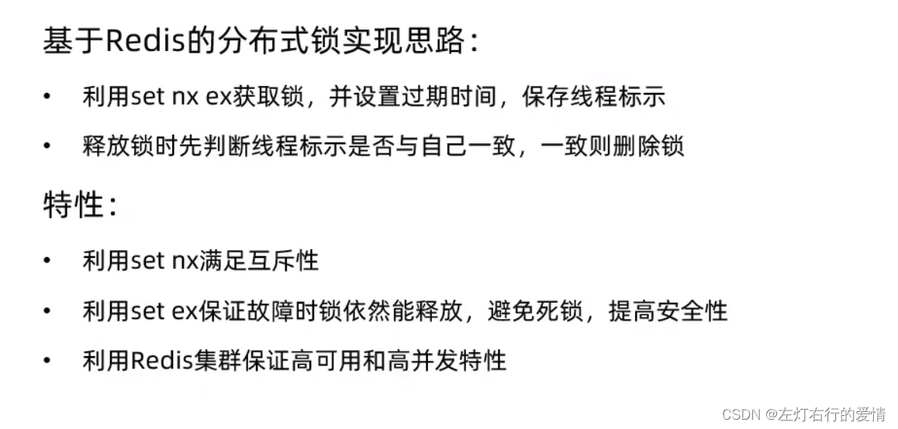

那么，目前为止，我们的分布式锁已经相对完善了，当然好学的你肯定不满足于当前的现状，那么就继续走下去吧。

### Redisson

#### 基于setnx实现的分布式锁存在下面的问题

1. 不可重入  
    同一个线程无法多次获取同一把锁。
2. 不可重试  
    获取锁只尝试一次就返回false，没有重试机制。
3. 超时释放  
    锁超时释放虽然可以避免思索，但如果业务执行耗时较长，也会导致锁释放，存在安全隐患。
4. 主从一致性  
    如果Redis提供了主从集群，主从同步存在延迟，当主宕机时，如果从并去同步主中的锁数据，则会出现锁实现。

#### Redisson入门

1. 引入依赖

```xml
    <dependency>
            <groupId>org.redisson</groupId>
            <artifactId>redisson</artifactId>
            <version>3.13.6</version>
        </dependency>


```

2. 配置Redisson客户端：

```java
import org.redisson.Redisson;
import org.redisson.api.RedissonClient;
import org.redisson.config.Config;
import org.springframework.context.annotation.Bean;
import org.springframework.context.annotation.Configuration;

@Configuration
public class RedisConfig {
   @Bean
   public RedissonClient redissonClient() {
       //配置类
       Config config = new Config();
       //添加redis地址，这里添加了单点地址，也可以使用config.useClusterServers()添加集群地址
       config.useSingleServer().setAddress("redis://47.115.226.111:6379").setPassword("123321");
       //创建客户端
       return Redisson.create(config);
   }
}


```

```java
   @Resource
    private RedissonClient redissonClient;
    
    public void testRedisson() throws InterruptedException {
        //获取锁（可重入），指定锁的名称。
        RLock lock = redissonClient.getLock("anyLock");
        //尝试获取锁，参数分别是：获取锁的最大等待时间（期间会重试），锁自动释放时间，时间单位。
        boolean isLock = lock.tryLock(1,10,TimeUnit.SECONDS);
        //判断释放获取成功
        if(isLock){
            try{
                System.out.println("执行业务");
            }finally {
                //释放锁
                lock.unlock();
            }
        }
    }


```

##### Redisson可重入锁原理

我们先举一个场景，代码如下：

```java
@Slf4j
@SpringBootTest
class RedissonTest {

    @Resource
    private RedissonClient redissonClient;

    private RLock lock;

    @BeforeEach
    void setUp() {
        lock = redissonClient.getLock("order");
    }

    @Test
    void method1() throws InterruptedException {
        // 尝试获取锁
        boolean isLock = lock.tryLock(1L, TimeUnit.SECONDS);
        if (!isLock) {
            log.error("获取锁失败 .... 1");
            return;
        }
        try {
            log.info("获取锁成功 .... 1");
            method2();
            log.info("开始执行业务 ... 1");
        } finally {
            log.warn("准备释放锁 .... 1");
            lock.unlock();
        }
    }
    void method2() {
        // 尝试获取锁
        boolean isLock = lock.tryLock();
        if (!isLock) {
            log.error("获取锁失败 .... 2");
            return;
        }
        try {
            log.info("获取锁成功 .... 2");
            log.info("开始执行业务 ... 2");
        } finally {
            log.warn("准备释放锁 .... 2");
            lock.unlock();
        }
    }


```

如果我们用redis来做的话，不能实现可重入锁，原因如下：

* 首先我们来看一下这个流程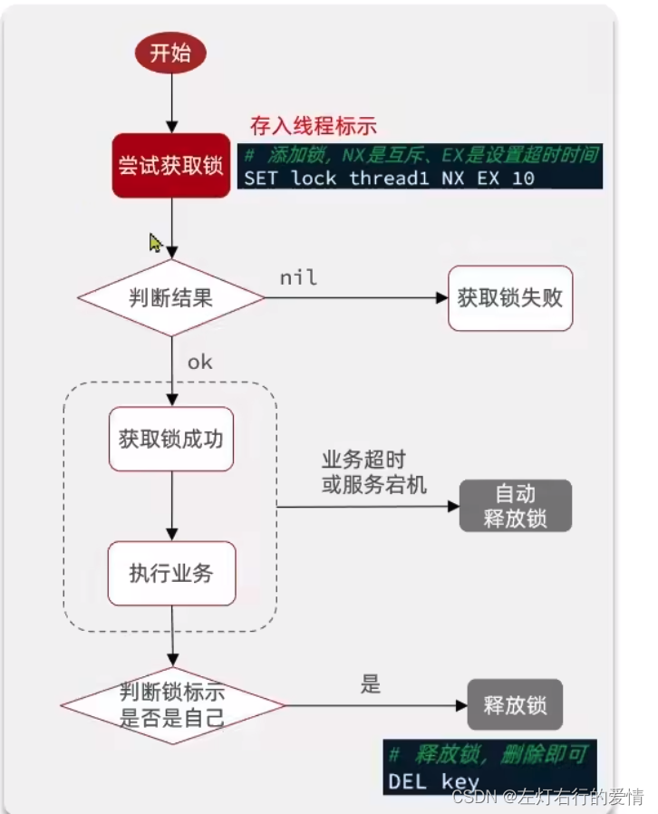
* 数据结构  
   那么这样的数据结构不支持可重入锁的实现，因为我们没有字段去记录重入的次数，只能判断是否为自己的锁。

redisson的数据结构可以支持，它的数据结构如下：

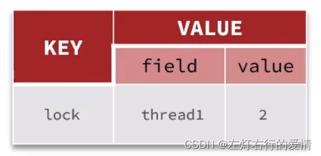

它的流程如下：

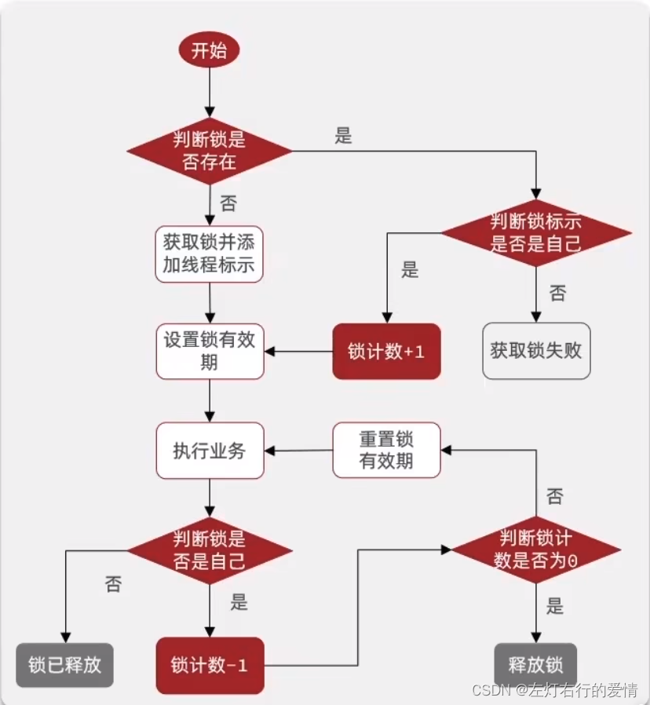

redisson底层是通过Lua脚本去实现的，具体如下所示：

```
local key = KEY[1]; -- 锁的key
local threadId = ARGV[1]; -- 线程的唯一标识
local releaseTime = ARGV[2]; -- 锁的自动释放时间

-- 判断当前锁是否还是被自己持有
if (redis.call('HEXISTS',key,threadId)==0) then
  return nil; --如果已经不是自己，则直接返回
end;

-- 是自己的锁，则重入次数-1
local count = redis.call('HINCRBY’，key ,threadId,-1);
-- 判断是否重入次数是否已经为0
if (count > 0) then
 -- 大于0说明不能释放锁，重置有效期然后返回
 redis.call('EXPIRE',key,releaseTime);
 return nil;
else  -- 等于0说明可以释放锁，直接删除
  redis.call('DEL',key);
  return nil;
end;


```

### 结尾

准备面试八股没时间，有时间再补上吧。
