> 原文：[CSDN](https://blog.csdn.net/qq_45852626/article/details/145812631)

## 为什么哨兵机制

Redis 的主从架构中，由于主从模式是读写分离的，如果主节点（master）挂了，那么将没有主节点来服务客户端的写操作请求，也没有主节点给从节点（slave）进行数据同步了。

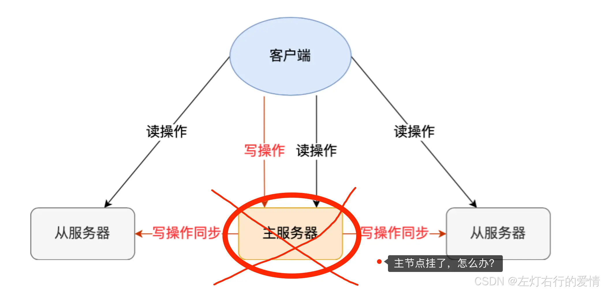

这时如果要恢复服务的话，需要人工介入，选择一个「从节点」切换为「主节点」，然后让其他从节点指向新的主节点，同时还需要通知上游那些连接 Redis 主节点的客户端，将其配置中的主节点 IP 地址更新为「新主节点」的 IP 地址。这样就比较麻烦了，Redis2.8版本后提供了哨兵机制，它的作用是实现主从节点故障转移。  
 **它会检测主节点是否存活，如果发现主节点挂了，它会选举一个从节点切换为主节点，并且把新主节点的相关信息通知给节点和客户端.**

## 哨兵机制

哨兵其实是一个运行在特殊模式下的 Redis 进程，所以它也是一个节点。从“哨兵”这个名字也可以看得出来，它相当于是“观察者节点”，观察的对象是主从节点。它不仅仅是观察那么简单，在它观察到有异常的状况下，会做出一些“动作”，来修复异常状态。哨兵节点主要负责三件事情：监控、选主、通知。

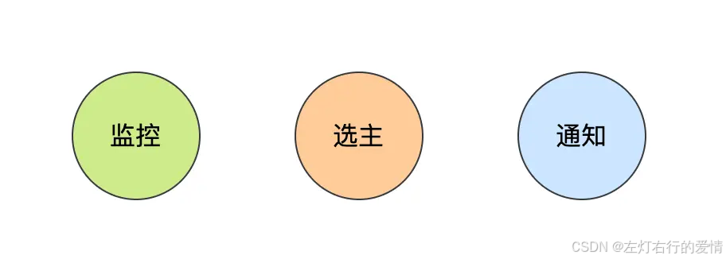

那么如何负责这些事情呢？

### 监控

哨兵会每隔 1 秒给所有主从节点发送 PING 命令，当主从节点收到 PING 命令后，会发送一个响应命令给哨兵，这样就可以判断它们是否在正常运行。

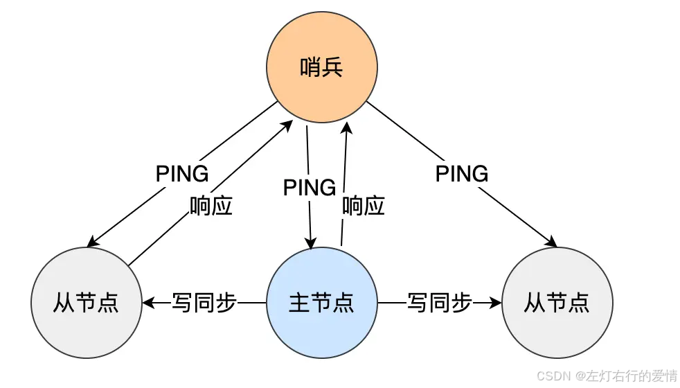

如果主节点或者从节点没有在规定的时间内响应哨兵的 PING 命令，哨兵就会将它们标记为「主观下线」。这个「规定的时间」是配置项 `down-after-milliseconds` 参数设定的，单位是毫秒。

#### 主观下线&&客观下线

客观下线只适用于主节点。之所以针对「主节点」设计「主观下线」和「客观下线」两个状态，因为有可能「主节点」其实并没有故障，只是因为主节点的系统压力比较大或者网络发送了拥塞，导致主节点没有在规定时间内响应哨兵的 PING 命令。为了减少误判的情况，哨兵在部署的时候不会只部署一个节点，而是用多个节点部署成哨兵集群（最少需要三台机器来部署哨兵集群），通过多个哨兵节点一起判断，就可以就可以避免单个哨兵因为自身网络状况不好，而误判主节点下线的情况。

同时，多个哨兵的网络同时不稳定的概率较小，由它们一起做决策，误判率也能降低。具体是怎么判定主节点为「客观下线」的呢？当一个哨兵判断主节点为「主观下线」后，就会向其他哨兵发起命令，其他哨兵收到这个命令后，就会根据自身和主节点的网络状况，做出赞成投票或者拒绝投票的响应。

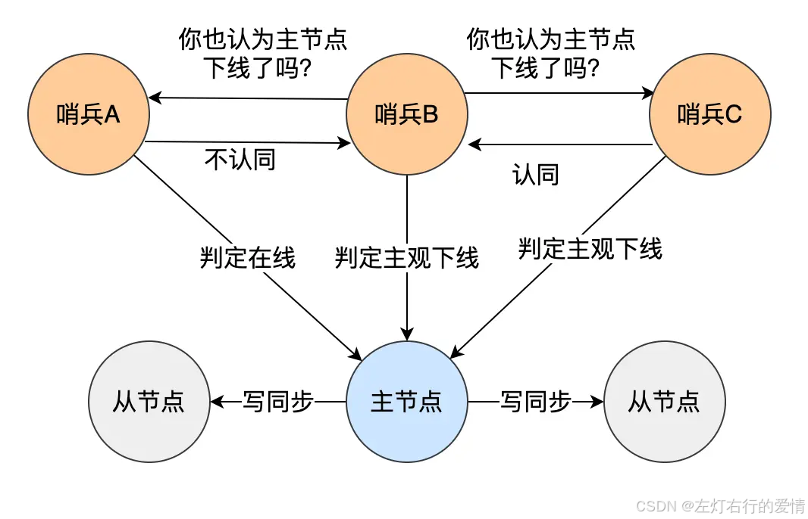

当这个哨兵的赞同票数达到哨兵配置文件中的quorum 配置项设定的值后，这时主节点就会被该哨兵标记为「客观下线」。例如，现在有 3 个哨兵，quorum 配置的是 2，那么一个哨兵需要 2 张赞成票，就可以标记主节点为“客观下线”了。这 2 张赞成票包括哨兵自己的一张赞成票和另外两个哨兵的赞成票。quorum 的值一般设置为哨兵个数的二分之一加 1，例如 3 个哨兵就设置 2。

哨兵判断完主节点客观下线后，哨兵就要开始在多个「从节点」中，选出一个从节点来做新主节点。

### 故障转移

前面说过，为了更加“客观”的判断主节点故障了，一般不会只由单个哨兵的检测结果来判断，而是多个哨兵一起判断，这样可以减少误判概率，所以哨兵是以哨兵集群的方式存在的。问题来了，由哨兵集群中的哪个节点进行主从故障转移呢？这时候需要在哨兵集群中选出一个 leader，让 leader 来执行主从切换。

#### 选leader规则

哪个哨兵节点判断主节点为「客观下线」，这个哨兵节点就是候选者，所谓的候选者就是想当 Leader 的哨兵。

假设有三个哨兵。当哨兵 B 先判断到主节点「主观下线后」，就会给其他实例发送 is-master-down-by-addr 命令。接着，其他哨兵会根据自己和主节点的网络连接情况，做出赞成投票或者拒绝投票的响应。

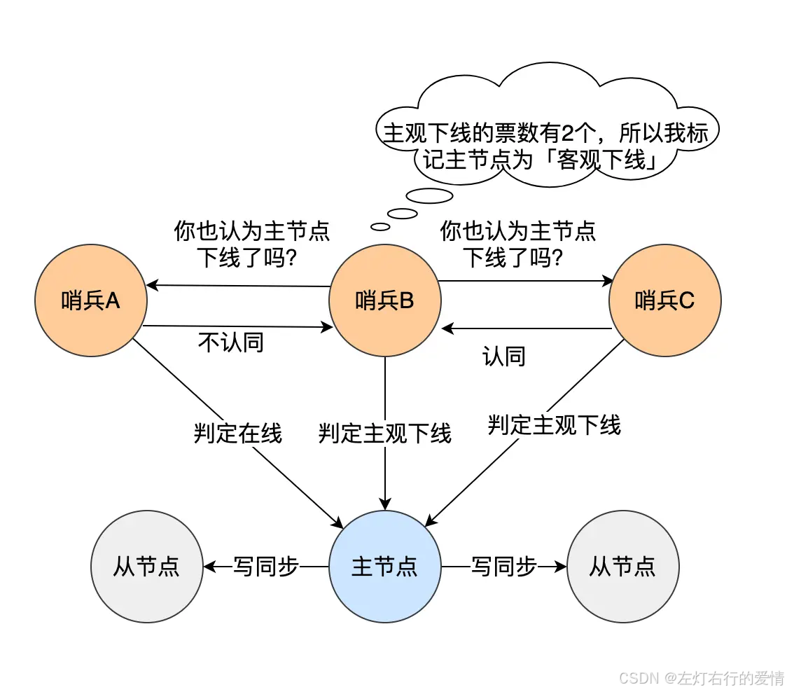

当哨兵 B 收到赞成票数达到哨兵配置文件中的 quorum 配置项设定的值后，就会将主节点标记为「客观下线」，此时的哨兵 B 就是一个 Leader 候选者。候选者会向其他哨兵发送命令，表明希望成为 Leader 来执行主从切换，并让所有其他哨兵对它进行投票。每个哨兵只有一次投票机会，如果用完后就不能参与投票了，可以投给自己或投给别人，但是只有候选者才能把票投给自己。

那么在投票过程中，任何一个「候选者」，要满足两个条件：

* 第一，拿到半数以上的赞成票；
* 第二，拿到的票数同时还需要大于等于哨兵配置文件中的 quorum 值。假设哨兵节点有 3 个，quorum 设置为 2，那么任何一个想成为 Leader 的哨兵只要拿到 2 张赞成票，就可以选举成功了。如果没有满足条件，就需要重新进行选举。

如果某个时间点，刚好有两个哨兵节点判断到主节点为客观下线，那这时不就有两个候选者了？这时该如何决定谁是 Leader 呢？  
 这也很简单：每位候选者都会先给自己投一票，然后向其他哨兵发起投票请求。如果投票者先收到「候选者 A」的投票请求，就会先投票给它，如果投票者用完投票机会后，收到「候选者 B」的投票请求后，就会拒绝投票。这时，候选者 A 先满足了上面的那两个条件，所以「候选者 A」就会被选举为 Leader。

#### 为什么哨兵节点至少要3个

如果哨兵集群中有个哨兵挂掉了，那么还剩下两个哨兵，如果这个哨兵想要成为 Leader，这时还是有机会达到 2 票的，所以还是可以选举成功的，不会导致无法进行主从节点切换。如果 3 个哨兵节点，挂了 2 个怎么办？这个时候得人为介入了，或者增加多一点哨兵节点。如果Redis 1 主 4 从，5 个哨兵，quorum 设置为 3，如果 2 个哨兵故障，当主节点宕机时，哨兵能否判断主节点“客观下线”？主从能否自动切换？  
 这里紧抓判定规则:**quorum 的值建议设置为哨兵个数的二分之一加 1.**  
 只要是按照这个规则来，就可以去判断是否可以判定节点客观下线或者主从切换。

#### 故障转移规则

选举出了哨兵 leader 后，就可以进行主从故障转移的过程了。  
 如图：

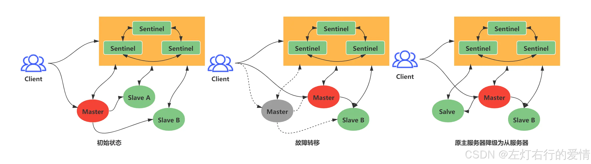

主从故障转移操作包含以下四个步骤：

* 在已下线主节点（旧主节点）属下的所有「从节点」里面，挑选出一个从节点，并将其转换为主节点。
* 让已下线主节点属下的所有「从节点」修改复制目标，修改为复制「新主节点」；
* 将新主节点的 IP 地址和信息，通过「发布者/订阅者机制」通知给客户端；
* 继续监视旧主节点，当这个旧主节点重新上线时，将它设置为新主节点的从节点；

##### 选出新主节点

在已下线主节点属下的所有「从节点」中，挑选出一个状态良好、数据完整的从节点，然后向这个「从节点」发送 SLAVEOF no one 命令，将这个「从节点」转换为「主节点」。那么多「从节点」，到底选择哪个从节点作为新主节点的？随机的方式好吗？随机的方式，实现起来很简单，但是如果选到一个网络状态不好的从节点作为新主节点，那么可能在将来不久又要做一次主从故障迁移。  
 **所以，我们首先要把网络状态不好的从节点给过滤掉。**  
 怎么判断从节点之前的网络连接状态不好呢？Redis 有个叫 `down-after-milliseconds * 10`的配置项，其 `down-after-milliseconds` 是主从节点断连的最大连接超时时间。如果在 `down-after-milliseconds` 毫秒内，主从节点都没有通过网络联系上，我们就可以认为主从节点断连了。如果发生断连的次数超过了 10 次，就说明这个从节点的网络状况不好，不适合作为新主节点。

至此，我们就把网络状态不好的从节点过滤掉了。接下来要对所有从节点进行三轮考察：优先级、复制进度、ID 号。在进行每一轮考察的时候，哪个从节点优先胜出，就选择其作为新主节点

* 第一轮考察：哨兵首先会根据从节点的优先级来进行排序，优先级越小排名越靠前，
* 第二轮考察：如果优先级相同，则查看复制的下标，哪个从「主节点」接收的复制数据多，哪个就靠前。
* 第三轮考察：如果优先级和下标都相同，就选择从节点 ID 较小的那个。

##### 优先级最高的节点胜出

Redis 有个叫 slave-priority 配置项，可以给从节点设置优先级。每一台从节点的服务器配置不一定是相同的，我们可以根据服务器性能配置来设置从节点的优先级。比如，如果「A 从节点」的物理内存是所有从节点中最大的，那么我们可以把「A 从节点」的优先级设置成最高。这样当哨兵进行第一轮考虑的时候，优先级最高的 A 从节点就会优先胜出，于是就会成为新主节点。

##### 复制进度最靠前的从节点胜出

如果在第一轮考察中，发现优先级最高的从节点有两个，那么就会进行第二轮考察，比较两个从节点哪个复制进度。主从架构中，主节点会将写操作同步给从节点，在这个过程中，主节点会用 `master_repl_offset` 记录当前的最新写操作在 repl\_backlog\_buffer 中的位置（如下图中的「主服务器已经写入的数据」的位置），而从节点会用 slave\_repl\_offset 这个值记录当前的复制进度（如下图中的「从服务器要读的位置」的位置）。

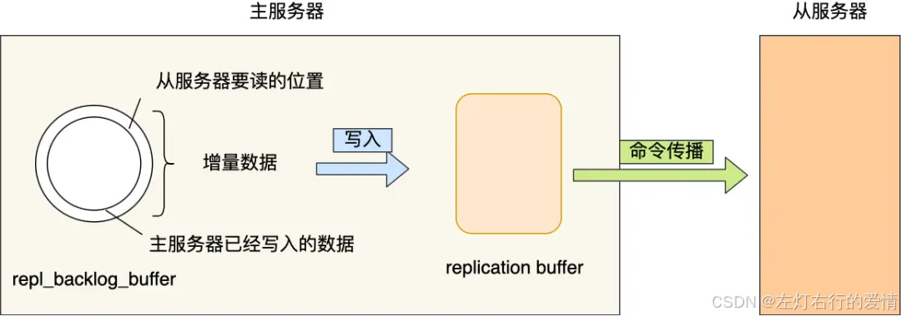

如果某个从节点的 slave\_repl\_offset 最接近 master\_repl\_offset，说明它的复制进度是最靠前的，于是就可以将它选为新主节点。

##### ID 号小的从节点胜出

如果在第二轮考察中，发现有两个从节点优先级和复制进度都是一样的，那么就会进行第三轮考察，比较两个从节点的 ID 号，ID 号小的从节点胜出。什么是 ID 号？每个从节点都有一个编号，这个编号就是 ID 号，是用来唯一标识从节点的。

##### 小结

到这里，选主的事情终于结束了。简单总结下：

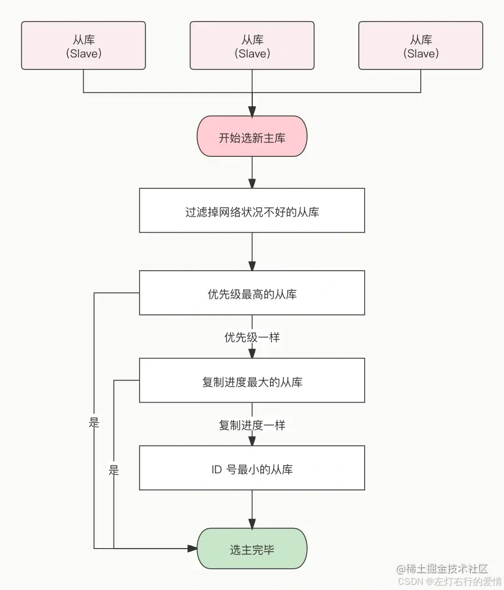

选举出从节点后，哨兵 leader 向被选中的从节点发送 SLAVEOF no one 命令，让这个从节点解除从节点的身份，将其变为新主节点。如下图，哨兵 leader 向被选中的从节点 server2 发送 `SLAVEOF no one` 命令，将该从节点升级为新主节点。

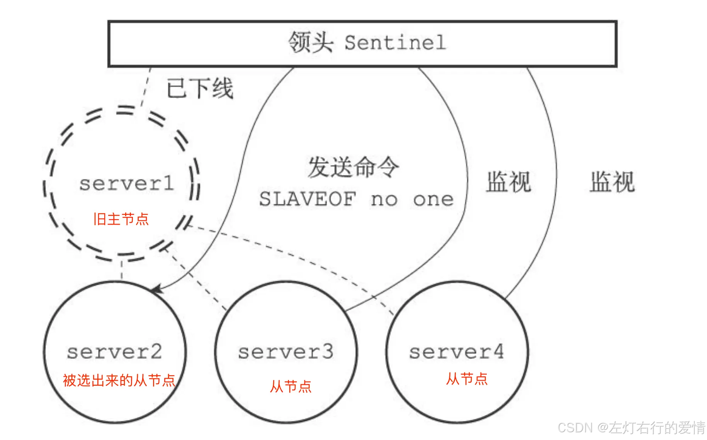

在发送 SLAVEOF no one 命令之后，哨兵 leader 会以每秒一次的频率向被升级的从节点发送 INFO 命令没进行故障转移之前，INFO 命令的频率是每十秒一次），并观察命令回复中的角色信息，当被升级节点的角色信息从原来的 slave 变为 master 时，哨兵 leader 就知道被选中的从节点已经顺利升级为主节点了。

如下图，选中的从节点 server2 升级成了新主节点：

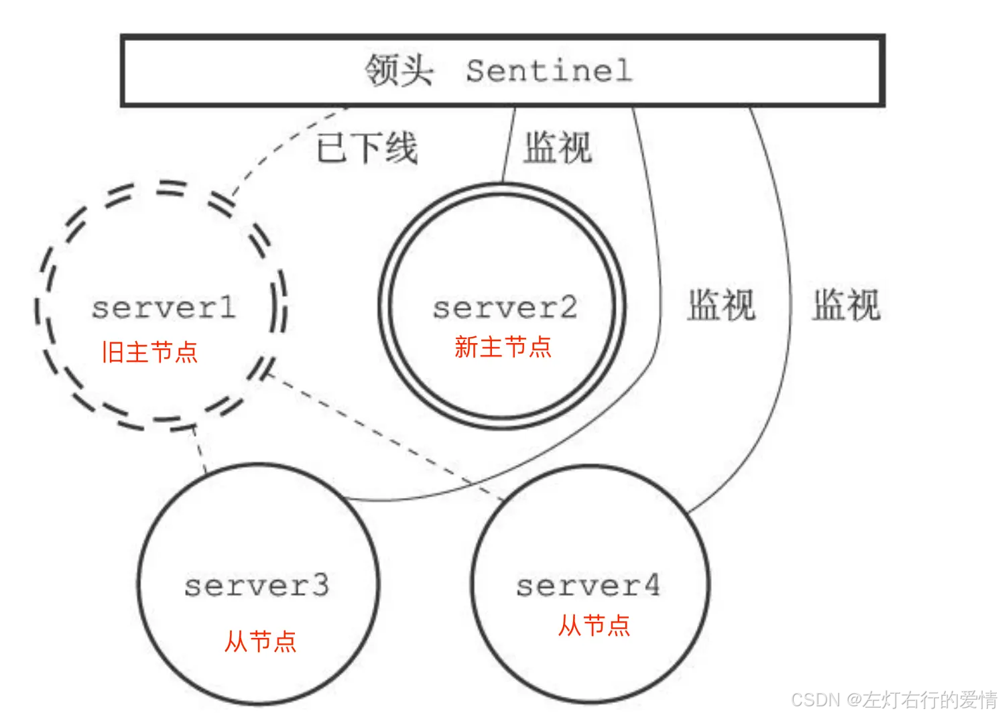

当新主节点出现之后，哨兵 leader 下一步要做的就是，让已下线主节点属下的所有「从节点」指向「新主节点」，这一动作可以通过向「从节点」发送 SLAVEOF 命令来实现。如下图，哨兵 leader 向所有从节点（server3 和 server4）发送 SLAVEOF，让它们成为新主节点的从节点。

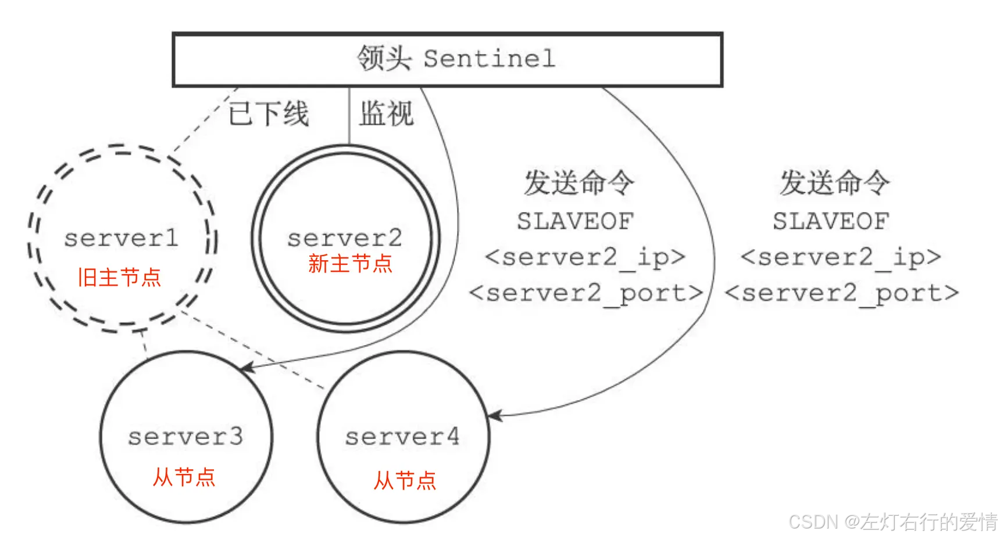

所有从节点指向新主节点后的拓扑图如下：

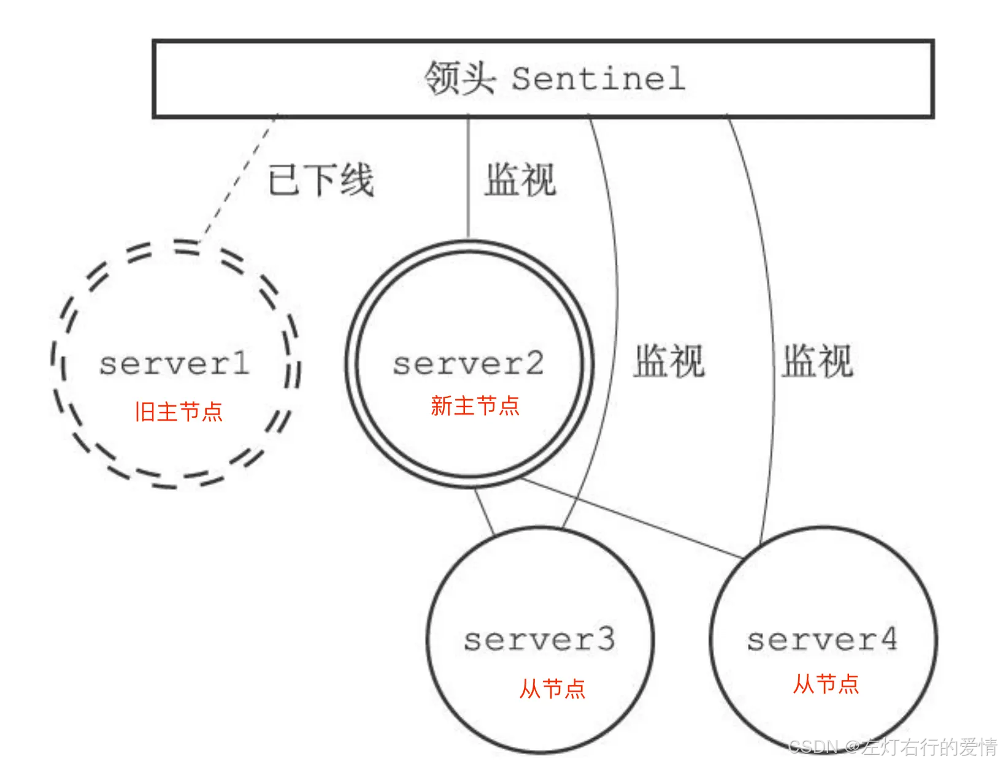

哨兵集群终于完成主从切换的工作，那么新主节点的信息要如何通知给客户端呢？这主要通过 **Redis 的发布者/订阅者机制**来实现的。每个哨兵节点提供发布者/订阅者机制，客户端可以从哨兵订阅消息。哨兵提供的消息订阅频道有很多，不同频道包含了主从节点切换过程中的不同关键事件，几个常见的事件如下：

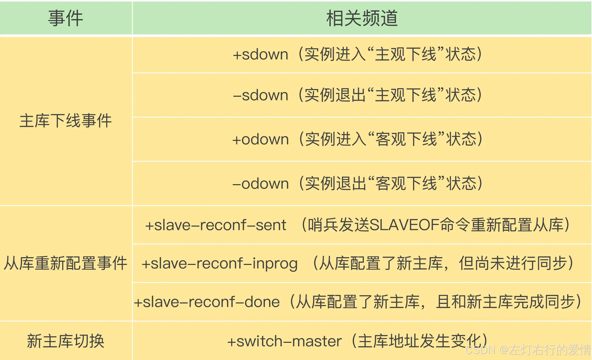

客户端和哨兵建立连接后，客户端会订阅哨兵提供的频道。主从切换完成后，哨兵就会向 +switch-master 频道发布新主节点的 IP 地址和端口的消息，这个时候客户端就可以收到这条信息，然后用这里面的新主节点的 IP 地址和端口进行通信了。有了这些事件通知，客户端不仅可以在主从切换后得到新主节点的连接信息，还可以监控到主从节点切换过程中发生的各个重要事件。

这样，客户端就可以知道主从切换进行到哪一步了，有助于了解切换进度。故障转移操作最后要做的是，继续监视旧主节点，当旧主节点重新上线时，哨兵集群就会向它发送 SLAVEOF 命令，让它成为新主节点的从节点，如下图：

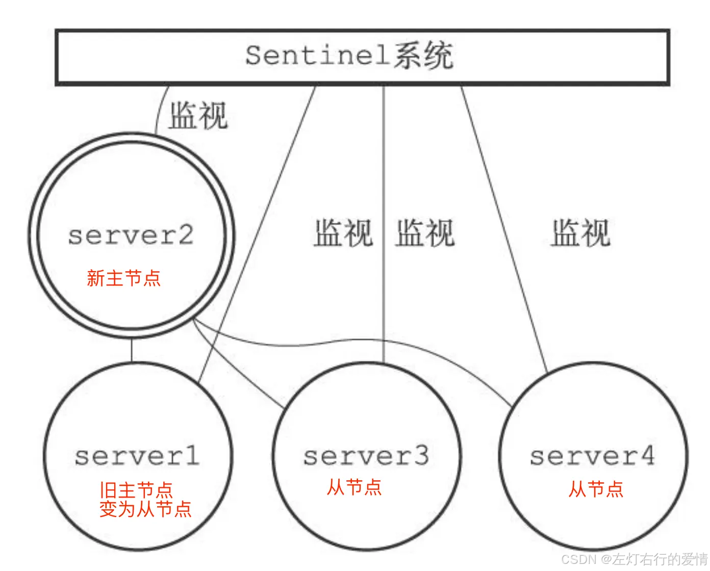

## 哨兵集群如何组成

在我第一次搭建哨兵集群的时候，当时觉得很诧异。因为在配置哨兵的信息时，竟然只需要填下面这几个参数，设置主节点名字、主节点的 IP 地址和端口号以及 quorum 值。  
 `sentinel monitor <master-name> <ip> <redis-port> <quorum>`   
 不需要填其他哨兵节点的信息，我就好奇它们是如何感知对方的，又是如何组成哨兵集群的？后面才了解到，**哨兵节点之间是通过 Redis 的发布者/订阅者机制来相互发现的**。在主从集群中，主节点上有一个名为\_\_sentinel\_\_:hello的频道，不同哨兵就是通过它来相互发现，实现互相通信的。在下图中，哨兵 A 把自己的 IP 地址和端口的信息发布到\_\_sentinel\_\_:hello 频道上，哨兵 B 和 C 订阅了该频道。那么此时，哨兵 B 和 C 就可以从这个频道直接获取哨兵 A 的 IP 地址和端口号。然后，哨兵 B、C 可以和哨兵 A 建立网络连接。

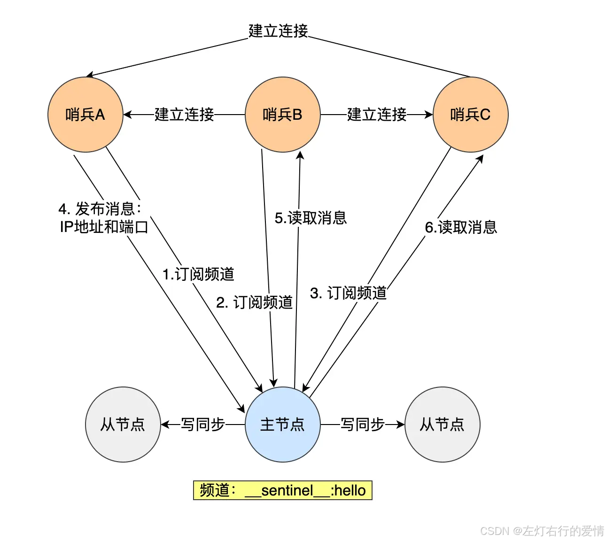

通过这个方式，哨兵 B 和 C 也可以建立网络连接，这样一来，哨兵集群就形成了。

**哨兵集群会对「从节点」的运行状态进行监控，那哨兵集群如何知道「从节点」的信息？**  
 主节点知道所有「从节点」的信息，所以哨兵会每 10 秒一次的频率向主节点发送 INFO 命令来获取所有「从节点」的信息。如下图所示，哨兵 B 给主节点发送 INFO 命令，主节点接受到这个命令后，就会把从节点列表返回给哨兵。接着，哨兵就可以根据从节点列表中的连接信息，和每个从节点建立连接，并在这个连接上持续地对从节点进行监控。哨兵 A 和 C 可以通过相同的方法和从节点建立连接。

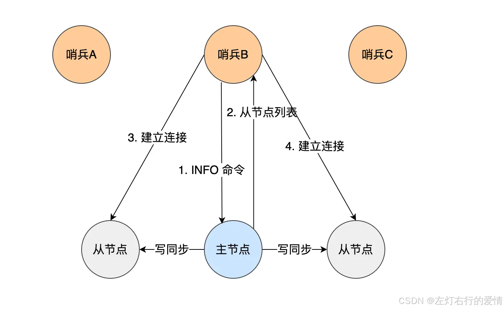

正是通过 Redis 的发布者/订阅者机制，哨兵之间可以相互感知，然后组成集群，同时，哨兵又通过 INFO 命令，在主节点里获得了所有从节点连接信息，于是就能和从节点建立连接，并进行监控了。

## 哨兵模式补充

> 本节合并自同主题的另一篇笔记，原文：[CSDN](https://blog.csdn.net/qq_45852626/article/details/146119441)。

### 哨兵模式

#### 什么是哨兵模式

Redis哨兵(Sentinel)是我认为Redis生态系统中最优雅的设计之一，它通过一种分布式监控和决策机制解决了Redis高可用性的核心问题。它主要提供四个核心功能：首先，它负责监控整个Redis主从集群的运行状态，实时检测主从节点是否正常工作。其次，当发现问题时，哨兵会通知系统管理员或其他应用程序，便于及时处理。

第三，也是最关键的功能，哨兵提供自动故障转移。当主节点不可用时，哨兵会自动选择一个从节点升级为新的主节点，确保服务持续可用。最后，哨兵作为配置提供者，客户端可以通过连接哨兵来获取当前主节点的地址，无需硬编码，也提高了系统弹性。

##### 本质与定位

从本质上看，哨兵是一个分布式的状态监控和自动故障处理系统。它不存储数据，而是专注于监控Redis实例的健康状态并在必要时采取行动。我理解哨兵的核心价值在于将人工运维转变为自动化运维，将故障恢复时间从分钟级缩短到秒级。它在Redis架构的定位是高可用保障层，它与主从复制机制协同工作，前者负责故障检测和恢复，后者负责数据冗余和读写分离。

##### 工作原理的深层理解

哨兵的工作原理体现了分布式系统设计的精髓：

* 共识机制  
   用类似Raft的共识算法，通过多数派投票机制确保在网络分区等复杂情况下做出正确决策。这种设计避免了"脑裂"问题，保证了系统的一致性。我认为这反映了分布式系统中的CAP理论权衡——在分区容忍性§和一致性©之间取得平衡。
* 自组织能力  
   哨兵集群能够自动发现彼此并维护集群拓扑视图，这种自组织能力大大降低了运维复杂度。我特别欣赏这种设计，它体现了"自治系统"的理念，系统能够自我管理、自我修复。
* 状态机转换  
   哨兵将节点状态和故障转移过程抽象为明确的状态转换，如主观下线→客观下线→故障转移。这种状态机设计使复杂流程变得清晰可控，也便于故障分析和问题定位。

##### 个人感悟

学习这个哨兵的时候感觉到一句话就是"简单胜于复杂"，它的设计理念和使用方式都相对简单并且直观，它通过精心设计的监控、决策和执行机制，一方面解决了Redis高可用的核心问题，同时保持了使用和维护的相对简单性，感觉Redis作者水平确实是很厉害。

#### 哨兵集群需要部署多少个节点比较合适

"Redis哨兵集群建议至少部署3个节点，且总数保持奇数，如3、5、7个节点。这样设计主要基于以下考虑：首先，哨兵采用多数派投票机制确认主节点故障，至少需要超过半数哨兵达成一致才能触发故障转移。3个节点时，需要2个哨兵同意；5个节点时，需要3个哨兵同意。其次，奇数个节点可以避免平票情况，提高决策效率，同时在相同容错能力下节省资源。例如，3个节点和4个节点都只能容忍1个节点故障，但3个节点更经济。

#### 请详细描述哨兵是如何检测主节点故障并完成故障转移的整个过程

Redis哨兵的故障检测和转移是一个多阶段过程，我可以从四个关键阶段详细说明：

* 第一阶段是主观下线检测。每个哨兵独立地通过PING命令监控Redis节点，如果在配置的down-after-milliseconds时间内（通常是30秒）没有收到有效回复，该哨兵会将节点标记为主观下线(SDOWN)。这是单个哨兵的判断，不会触发故障转移。
* 第二阶段是客观下线确认。当一个哨兵发现主节点主观下线后，会通过sentinel is-master-down-by-addr命令询问其他哨兵的意见。只有当达到配置的quorum数量的哨兵都认为主节点下线时，才会将状态升级为客观下线(ODOWN)。例如，在5个哨兵、quorum为3的配置中，需要至少3个哨兵同意才能确认客观下线。
* 第三阶段是领导者选举。确认客观下线后，哨兵们需要选出一个领导者来执行故障转移。这个过程使用了类似Raft的算法：每个哨兵都有一个随机超时时间，超时后请求其他哨兵投票。第一个获得多数派（N/2+1）投票的哨兵成为领导者。这确保了同一时间只有一个哨兵执行故障转移。
* 最后是故障转移执行阶段。领导者哨兵会从从节点中选择一个升级为新主节点，选择标准依次是：
  + 排除断线、主观下线、5秒内没有回复过哨兵INFO命令的从节点
  + 选择slave-priority（从节点优先级）最高的
  + 如果优先级相同，选择复制偏移量最大的（数据最完整）
  + 如果仍然相同，选择runid最小的从节点  
     选定后，领导者通过SLAVEOF NO ONE命令将其升级为主节点，然后通过SLAVEOF命令重新配置其他从节点指向新主节点，最后更新哨兵的监控配置。

#### 哨兵之间是如何通信的？它们如何发现和监控Redis实例

"Redis哨兵之间的通信主要通过Redis的发布/订阅机制实现，具体来说是通过\_\_sentinel\_\_:hello频道。每个哨兵都会定期（通常是2秒一次）在这个频道上发布自己的信息，同时也订阅这个频道来接收其他哨兵的信息。发布的信息包括哨兵自身的
IP
、端口、运行ID(runid)，以及它所监控的主节点信息，包括主节点的名称、地址、端口和配置版本号等。这种机制使得哨兵集群能够自动发现彼此，无需手动配置所有哨兵节点的连接信息。关于Redis实例的发现和监控，哨兵采用了一种自动发现机制：首先，我们只需在哨兵配置中指定主节点的信息。哨兵连接到主节点后，会通过INFO命令获取所有从节点的信息，从而自动发现整个主从架构。

其次，哨兵会定期（默认10秒一次）向每个被监控的Redis实例发送INFO命令，获取实例的角色（主/从）、复制状态、从节点列表等信息，从而持续监控整个集群的状态变化。最后，哨兵还会通过PING命令检测实例的可达性，并通过发布/订阅机制与其他哨兵交换信息，形成对集群状态的共识。

#### 什么是脑裂，为什么会有脑裂，如何解决

Redis脑裂是指在主从架构中，由于网络分区等原因导致哨兵集群分裂成多个独立部分，各自做出不同决策，最终造成同时存在多个主节点的现象。这种情况会导致数据写入冲突和不一致，是分布式系统中的一个典型挑战。

##### 脑裂产生的原因

脑裂主要由三类因素导致：首先是网络问题，如网络分区、交换机故障或防火墙配置变更；其次是性能问题，如主节点负载过高导致响应超时；最后是配置不当，如哨兵的down-after-milliseconds设置过短或quorum值不合理。

##### 脑裂的危害

脑裂的危害非常严重。最直接的是数据不一致，不同客户端可能连接到不同的’主节点’进行写入，当网络恢复后，这些写入无法合并。其次是可能导致数据丢失，因为最终只有一个节点会被认定为真正的主节点。此外，还会造成资源浪费和业务混乱。

##### 脑裂的解决方案

###### 哨兵配置层面

* quorum值是判断主节点是否故障所需的最少哨兵数量。
* down-after-milliseconds是哨兵判断节点不可用的时间阈值。

###### Redis主节点配置层面

* min-slaves-to-write指定主节点必须能够连接到的最小从节点数量，才能接受写入请求。
* min-slaves-max-lag指定从节点的最大允许延迟秒数。

这两个参数组合使用，形成了一道防护墙：当网络分区发生时，与大多数从节点失去连接的主节点会自动停止接受写入，避免了脑裂后的数据冲突。

#### 哨兵模式优缺点有哪些？

哨兵的好处在于可以保证系统的高可用，各个节点可以对故障自动转移。缺点是使用的主从模式，主节点单点风险高，主从
切换
过程可能出现丢失风险。
