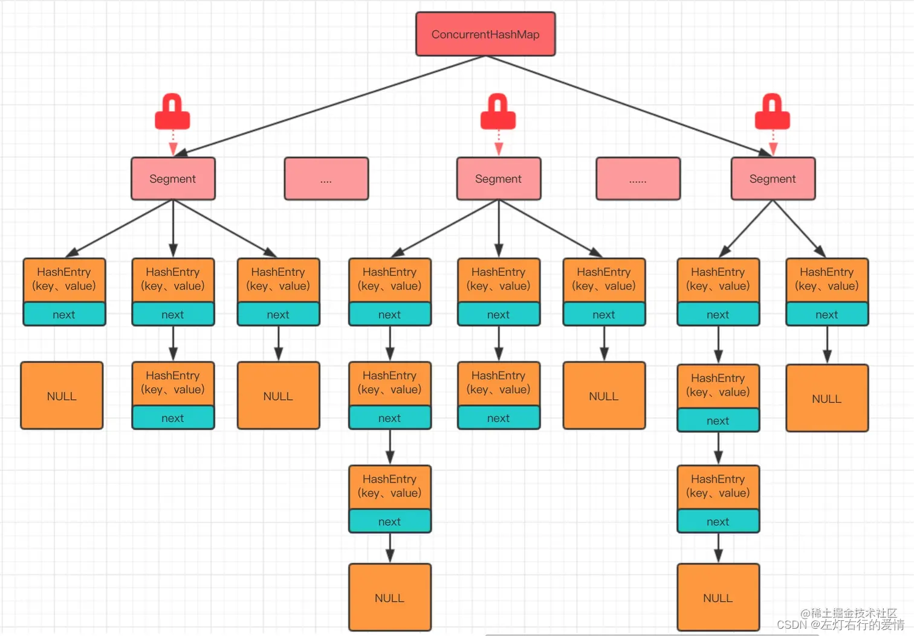
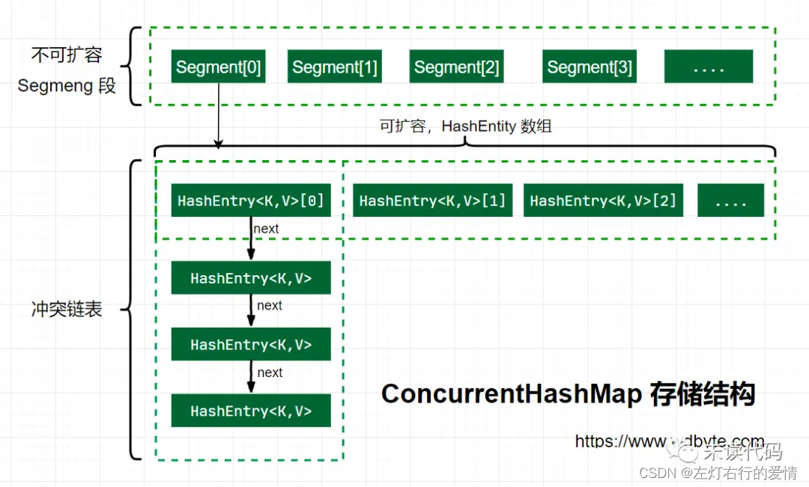

> 原文：[CSDN](https://blog.csdn.net/qq_45852626/article/details/126124080)

## 并发容器-ConcurrentHashMap
## 前言

之前我们在集合篇里聊完了HashMap和HashTable，我们又学习了并发编程的基本内容，现在我们来聊一聊Concurrent类下的重要容器，ConcurrentHashMap。  
 HashTable被逐渐废弃，离不开ConcurrentHashMap的出现，可以想象HashMap做为一个高频使用的集合框架，如果每次使用过程中都将整个方法synchronized，这样意味着全局加锁，肯定会导致并发的低效，所以ConcurrentHashMap的出现，改变了这种情况，接下来我们来看一看ConcurrentHashMap的神奇之处。

## 什么是ConcurrentHashMap

ConcurrentHashMap是Java并发包(java.util.concurrent)中提供的线程安全哈希表实现，它专门为并发环境优化设计。  
 与其他类似数据结构的对比：

| 特性 | HashMap | Hashtable | ConcurrentHashMap |
| --- | --- | --- | --- |
| 线程安全 | ❌ | ✅ | ✅ |
| 锁粒度 | 无锁 | 全表锁 | 分段锁/细粒度锁 |
| 允许null键 | ✅ | ❌ | ❌ |
| 允许null值 | ✅ | ❌ | 1.8后❌ |
| 并发性能 | 高(单线程) | 低 | 高 |

为什么需要ConcurrentHashMap？你可以想象一下：

* HashMap在并发环境下可能导致死循环或数据不一致
* Hashtable虽然线程安全，但锁住整个哈希表导致并发效率低下
* ConcurrentHashMap就像是一辆设计精良的多人自行车，每个人可以相对独立地踩自己的踏板，既保证了安全又保持了效率。

## 数据结构

### JDK1.7版本

ConcurrentHashMap在JDK1.7中,提供了一种颗粒度更细的加锁机制.  
 这种机制叫分段锁(Lock Sriping).  
 整个哈希表被分为了多个段,每个段都能独立锁定.

机制的优点:读取操作不需要锁,写入操作仅锁定相关的段.这减小了锁冲突的概率,从而提高了并发性能.  
 在并发环境下实现更高的吞吐量,在单线程环境下只损失非常小的性能.

* 默认分为16个Segment，每个Segment相当于一个小的Hashtable
* 每个Segment继承自ReentrantLock，可以独立上锁
* 结构为Segment数组 + HashEntry数组 + 链表

这种设计可以理解为"化整为零"的思想，就像一个小区有16个门，每个门都有独立的保安，居民只需要跟自己门的保安打交道，大大减少了排队等待的时间。  
   
 (图片转载自网络)

#### HashEntry

```java
static final class HashEntry<K,V> {
        final int hash;
        final K key;
        volatile V value;
        volatile HashEntry<K,V> next;

        HashEntry(int hash, K key, V value, HashEntry<K,V> next) {
            this.hash = hash;
            this.key = key;
            this.value = value;
            this.next = next;
        }


```

这个老朋友我们在介绍HashMap的时候应该非常熟悉它了.不太明白的朋友可以翻看一下HashMap那一章.

#### Segment

```java
static final class Segment<K,V> extends ReentrantLock implements Serializable {

        private static final long serialVersionUID = 2249069246763182397L;

        static final int MAX_SCAN_RETRIES =
            Runtime.getRuntime().availableProcessors() > 1 ? 64 : 1;
        transient volatile HashEntry<K,V>[] table;
        transient int count;
        transient int modCount;
        transient int threshold;
        final float loadFactor;
        Segment(float lf, int threshold, HashEntry<K,V>[] tab) {
            this.loadFactor = lf;
            this.threshold = threshold;
            this.table = tab;
        }
}


```

从上面代码可以看到,有一个volatile修饰的HashEntry数组  
 所以可以看出,Segment的结构和HashEntry是非常类似的,都是一种数据和链表相结合的结构.  
 即每个Segment守护着n个HashEntry,而每一个HashEntry本身可以当作一条链表连接n个HashEntry.

那么可以用图来表示一下segment和hashEntry的关系  
 

### JDK1.8版本

JDK 1.8的ConcurrentHashMap主要由以下部分组成：

```
+-------+    +------+    +------+
| table | -> | Node | -> | Node | -> ...
+-------+    +------+    +------+
   |
   v
+-------+    +------+    +------+
| Node  | -> | Node | -> | Node | -> ...
+-------+    +------+    +------+
   |
   v
+----------+
| TreeNode | -> ... (红黑树结构)
+----------+


```

* table：Node类型的数组，类似于HashMap的数组
* Node：存储键值对，包含key、value、hash和next指针
* TreeNode：红黑树节点，当链表过长时转换为红黑树
* ForwardingNode：特殊节点类型，在扩容时使用，指向新的table

#### 并发控制机制

JDK 1.8中的线程安全机制：

* CAS操作：无锁并发控制，用于首次添加节点、更新值等
* synchronized：只锁定必要的节点，粒度极细
* volatile：Node的val和next使用volatile修饰，保证可见性
* 分散热点：使用随机数减少不同线程之间的竞争

这种设计遵循了"能不加锁就不加锁，必须加锁时也要尽可能小范围加锁"的并发编程黄金法则。

### 初始化

```
public ConcurrentHashMap() {
        this(DEFAULT_INITIAL_CAPACITY, DEFAULT_LOAD_FACTOR, DEFAULT_CONCURRENCY_LEVEL);
    }


```

无参构造里面调用了有参构造,传入了三个参数的默认值,它们的值是:

```
// 默认初始化容量
static final int DEFAULT_INITIAL_CAPACITY = 16;

// 默认负载因子
static final float DEFAULT_LOAD_FACTOR = 0.75f;

// 默认并发级别
static final int DEFAULT_CONCURRENCY_LEVEL = 16;
我们可以看到,这个也是指segment数,默认是16.


```

```java
    @SuppressWarnings("unchecked")
    public ConcurrentHashMap(int initialCapacity,
                             float loadFactor, int concurrencyLevel) {
        //上来先做参数校验
        if (!(loadFactor > 0) || initialCapacity < 0 || concurrencyLevel <= 0)
            throw new IllegalArgumentException();
            //校验并发级别的大小,如果大于1<<16,重置为65536
        if (concurrencyLevel > MAX_SEGMENTS)
            concurrencyLevel = MAX_SEGMENTS;
        //2的多少次方
        int sshift = 0;
        int ssize = 1;
        //这个循环目的是可以找到concurrencyLevel之上最近的2的次方值
        while (ssize < concurrencyLevel) {
            ++sshift;
            ssize <<= 1;
        }
        //记录偏移量
        this.segmentShift = 32 - sshift;
        //记录段掩码
        this.segmentMask = ssize - 1;
        //设置容量,如果大于最大值,则设置为最大值
        if (initialCapacity > MAXIMUM_CAPACITY)
            initialCapacity = MAXIMUM_CAPACITY;
            //平摊到每个segment中可以分到的大小,如果initialCapacity为64,那么每个segment可以分到4个
            //计算每个segment中类似HashMap的容量
        int c = initialCapacity / ssize;
        //如果c*ssize<initialCapacity,说明上面除的时候有余数,下面给c++就好啦
        if (c * ssize < initialCapacity)
            ++c;
            //设置segment中最小的容量值,这里默认为2,确保插入一个不会扩容
        int cap = MIN_SEGMENT_TABLE_CAPACITY;
        //segment中类似于HashMap,容量至少为2或者2的倍数
        while (cap < c)
            cap <<= 1;
        // 创建 segments and segments[0]
        Segment<K,V> s0 =
            new Segment<K,V>(loadFactor, (int)(cap * loadFactor),
                             (HashEntry<K,V>[])new HashEntry[cap]);
        Segment<K,V>[] ss = (Segment<K,V>[])new Segment[ssize];
        /往数组中写入segment[0]
        UNSAFE.putOrderedObject(ss, SBASE, s0); // ordered write of segments[0]
        this.segments = ss;
    }


```

## 重要方法

### Put方法

```java
 public V put(K key, V value) {
        Segment<K,V> s;
        //校验传入的value是否为空
        if (value == null)
            throw new NullPointerException();
            //根据传入的key计算出hash值
        int hash = hash(key);
        //根据hash值找到segment数组中位置j
        //hash值是32位,无符号右移segmentShift位,剩下高四位.
        //然后和segmentMask(15)做一次与操作,也就说说j是hash值的高四位,也就说槽点数组下标
        int j = (hash >>> segmentShift) & segmentMask;
        //这里使用unsave类的getObject方法从segment数组中检索段.
        //(j是要检索的段段索引
        //SSHIFT用于计算偏移量的位移量
        //SBASE用于计算基本偏移的基本偏移量
        //这里判断是否位null.如果是null则调用ensureSegment对segment[j]进行初始化
        if (
        (s = (Segment<K,V>)UNSAFE.getObject(segments, (j << SSHIFT) + SBASE)) == null
        ) 
            s = ensureSegment(j);
            //插入新值到槽s中
        return s.put(key, hash, value, false);
    }


```

然后继续看下一层的put代码

```java
 final V put(K key, int hash, V value, boolean onlyIfAbsent) {
 //在往segment写入前,需要先获取该segment的独占锁
            HashEntry<K,V> node = tryLock() ? null : scanAndLockForPut(key, hash, value);
            V oldValue;
            try {
            //segment内部的数组
                HashEntry<K,V>[] tab = table;
                //利用hash值算出防止数组下标
                int index = (tab.length - 1) & hash;
                //first是数组该位置处链表的表头
                HashEntry<K,V> first = entryAt(tab, index);
                //这个for循环主要是考虑一些情况: 已经存在链表和没有任何元素这两种情况.
                for (HashEntry<K,V> e = first;;) {
                //此时e不为null
                    if (e != null) {
                        K k;
                        //复合赋值比较,用于检查当前节点的键是否与待插入键相同，并在比较的同时完成了一次赋值操作。
                        //前面成立（即引用相等）时，确实后面不需要再判断，逻辑上已经确定了键相等。但如果设计中考虑到可能有内容相等但引用不同的情况，后面的判断仍然是必要的逻辑完整性的一部分，确保所有相等的情况都被正确处理。
                        //扩展
/**引用相等：(k = e.key) == key 判断的是传入的键 key 和链表中节点的键 e.key 是否是同一个对象实例。如果它们是同一个对象（引用相同），那么直接就可以确认键相等，无需进一步比较。

内容相等：但是，如果键是根据内容定义相等而不是引用（比如自定义的键类重写了 .equals() 方法），那么即使 == 返回 false，键的内容仍然可能相等（通过 .equals() 判断）。因此，(e.hash == hash && key.equals(k)) 部分是用来处理这种情况的，它确保即使两个键不是同一个实例，如果它们的内容相等（通过 .equals() 方法判断），也被视为相同的键。**/
                        if ((k = e.key) == key || (e.hash == hash && key.equals(k))) 
                            oldValue = e.value;
                            if (!onlyIfAbsent) {
                            //覆盖
                                e.value = value;
                                ++modCount;
                            }
                            break;
                        }
                        e = e.next;
                    }
                    else {
                    //如果不为null,那么就把插入的值设置为链表表头(头插法)
                        if (node != null)
                        //这里设置一下引用节点
                            node.setNext(first);
                            //如果为null,初始化并设置为链表表头
                        else
                            node = new HashEntry<K,V>(hash, key, value, first);
                        int c = count + 1;
                        //如果超过segment的阈值,这个segment需要扩容
                        if (c > threshold && tab.length < MAXIMUM_CAPACITY)
                            rehash(node);
                        else
                        //如果没有达到阈值,将node放到数组tab的index位置
                        //换句话说将新的节点设置为原链表的表头
                            setEntryAt(tab, index, node);
                        ++modCount;
                        count = c;
                        oldValue = null;
                        break;
                    }
                }
            } finally {
                unlock();
            }
            return oldValue;
        }


```

#### 扩容rehash方法

```java
  private void rehash(HashEntry<K,V> node) {
            HashEntry<K,V>[] oldTable = table;
             //旧容量
            int oldCapacity = oldTable.length;
            //新容量,扩大2倍
            int newCapacity = oldCapacity << 1;
            //计算新的扩容阈值
            threshold = (int)(newCapacity * loadFactor);
            //创建新的数组
            HashEntry<K,V>[] newTable =
                (HashEntry<K,V>[]) new HashEntry[newCapacity];
                //计算新掩码 容量-1
            int sizeMask = newCapacity - 1;
           //遍历老数据
            for (int i = 0; i < oldCapacity ; i++) {
                HashEntry<K,V> e = oldTable[i];
                //如何能拿到值
                if (e != null) {
                    HashEntry<K,V> next = e.next;
                    //计算新位置,新位置只有两种情况:不变或者老位置+老容量
                    int idx = e.hash & sizeMask;
                    if (next == null)   //  Single node on list
                    //当前位置不是链表只是元素,直接赋值
                        newTable[idx] = e;
                    else { // Reuse consecutive sequence at same slot
                    //如果是链表
                        HashEntry<K,V> lastRun = e;
                        int lastIdx = idx;
                        //这里的for循环目的是:找到一个特殊节点,这个节点后所有next节点的新位置都是相同的
                        /**
                        这块我再解释一下,容器扩容前后是只会有两个位置,一个新位置,一个旧位置,这里的计算是把放在新位置的索引的链表找出来啦,然后新位置的链表都是要放一起的.
                        **/
                        for (HashEntry<K,V> last = next;
                             last != null;
                             last = last.next) {
                            int k = last.hash & sizeMask;
                            if (k != lastIdx) {
                                lastIdx = k;
                                lastRun = last;
                            }
                        }
                        //将lastRun及其之后的所有节点组成的链表放在lastIdx这个位置
                        newTable[lastIdx] = lastRun;
                        // 下面操作处理lastRun之前的节点
                        //这些节点可能分配在另外一个链表上,也有可能分配到上面那个链表中
                        for (HashEntry<K,V> p = e; p != lastRun; p = p.next) {
                            V v = p.value;
                            int h = p.hash;
                            int k = h & sizeMask;
                            HashEntry<K,V> n = newTable[k];
                            newTable[k] = new HashEntry<K,V>(h, p.key, v, n);
                        }
                    }
                }
            }
            //新来的node放在新数组中刚刚两根链表之一的头部
            int nodeIndex = node.hash & sizeMask; // add the new node
            node.setNext(newTable[nodeIndex]);
            newTable[nodeIndex] = node;
            table = newTable;
        }


```

## 问题

### 为什么放弃分段锁？

JDK 1.8放弃分段锁的原因：

1. 锁粒度优化：从段级别细化到节点级别
2. synchronized性能提升：JDK 1.6后引入偏向锁、轻量级锁等优化
3. 架构简化：减少内存占用，代码更简洁
4. 红黑树结构：需要配合新的数据结构提供更好性能

## ConcurrentHashMap 专题补充

> 本节合并自同主题的另一篇笔记，原文：[CSDN](https://blog.csdn.net/qq_45852626/article/details/146809247)。

### 1. 基础概念

#### 1.1 什么是ConcurrentHashMap

ConcurrentHashMap是Java并发包(java.util.concurrent)中提供的一个线程安全的
哈希表 
实现，专门为并发环境设计。它允许多个线程同时进行读写操作，并且在设计上避免了全表锁定，提供了远高于Hashtable的并发性能。

ConcurrentHashMap的核心设计目标是在保证线程安全的同时，提供尽可能高的并发性能。它通过精细的锁粒度和无锁技术，实现了高效的并发访问，是Java
并发编程 
中最常用的线程安全集合之一。

#### 1.2 ConcurrentHashMap与HashMap和Hashtable的区别

为了更好地理解ConcurrentHashMap的特点，我们将其与Java中的其他两个常见Map实现进行对比：

| 特性 | ConcurrentHashMap | HashMap | Hashtable |
| --- | --- | --- | --- |
| 线程安全性 | 线程安全 | 非线程安全 | 线程安全 |
| 锁粒度 | 分段锁(JDK 1.7)/CAS+synchronized(JDK 1.8+) | 无锁 | 全表锁(synchronized方法) |
| 并发性能 | 高 | 单线程性能最高 | 低 |
| 允许null键值 | 不允许null键，JDK 1.8前值可以为null，1.8后值也不允许为null | 允许null键和null值 | 不允许null键和null值 |
| 迭代器 | 弱一致性 | fail-fast | fail-fast |
| 适用场景 | 并发环境 | 单线程环境 | 简单的多线程环境 |

从上表可以看出，ConcurrentHashMap结合了HashMap的高性能和Hashtable的线程安全性，同时通过更细粒度的锁控制，提供了更好的并发性能。

#### 1.3 适用场景分析

根据ConcurrentHashMap的特性，以下场景特别适合使用它：

1. **高并发读写场景**：当多个线程需要同时读写共享的映射数据时，ConcurrentHashMap能提供优异的并发性能。
2. **缓存实现**：作为应用程序的缓存，需要支持多线程并发访问和更新。
3. **计数器和统计场景**：如统计在线用户数、访问次数等，需要线程安全的计数操作。
4. **并发集合操作**：需要在多线程环境下对集合进行添加、删除、查询等操作。
5. **大规模数据处理**：处理大量数据时，需要多线程并行处理，同时需要共享结果。

具体应用场景包括：

* 网站访问统计
* 用户会话管理
* 并发缓存系统
* 多线程数据共享
* 高并发服务器应用

### 2. 内部实现原理

#### 2.1 JDK 1.7与JDK 1.8实现对比

ConcurrentHashMap在JDK 1.7和JDK 1.8中有着显著不同的实现方式，这反映了Java并发编程思想的演进。

##### JDK 1.7实现：

1. **分段锁设计**：

   * 采用分段锁(Segment)机制，继承自ReentrantLock
   * 默认分为16个Segment，每个Segment相当于一个小的Hashtable
   * 每个Segment独立上锁，互不影响，提高并发性
2. **数据结构**：

   * 结构为Segment数组 + HashEntry数组 + 链表
   * 每个Segment维护一个HashEntry数组
   * 哈希冲突通过链表解决
3. **并发控制**：

   * 读操作不加锁，通过volatile保证可见性
   * 写操作需要获取Segment锁
   * 不同Segment之间的写操作可以并行执行
4. **扩容机制**：

   * 每个Segment独立扩容
   * 扩容时只锁定当前Segment，不影响其他Segment

##### JDK 1.8实现：

1. **锁设计**：

   * 抛弃了分段锁设计，采用CAS + synchronized实现
   * 锁粒度更细，只锁定链表或红黑树的首节点
   * 首次添加元素时使用CAS操作，冲突时才使用synchronized加锁
2. **数据结构**：

   * 结构为Node数组 + 链表 + 红黑树
   * 当链表长度超过阈值(默认8)且数组长度超过64时，会转换为红黑树结构
   * 当红黑树节点数小于6时，会转回链表
3. **并发控制**：

   * 读操作不加锁
   * 写操作使用CAS尝试无锁更新，失败则使用synchronized锁定
   * 使用volatile保证可见性
4. **扩容机制**：

   * 支持多线程协作扩容
   * 使用ForwardingNode标记正在迁移的节点
   * 扩容过程中遇到ForwardingNode的线程会帮助迁移

##### 对比总结：

| 特性 | JDK 1.7 | JDK 1.8 |
| --- | --- | --- |
| 锁机制 | 分段锁(Segment) | CAS + synchronized |
| 锁粒度 | Segment级别 | 链表/红黑树首节点级别 |
| 数据结构 | Segment + HashEntry + 链表 | Node + 链表 + 红黑树 |
| 哈希冲突 | 链表 | 链表 + 红黑树 |
| 扩容方式 | 单线程扩容(每个Segment) | 多线程协作扩容 |
| 内存占用 | 较高(Segment对象) | 较低 |
| 并发度 | 受Segment数量限制 | 理论上可达到数组大小 |

JDK 1.8的实现相比JDK 1.7有显著改进，不仅提高了并发性能，还优化了空间利用率和查询性能。

#### 2.2 CAS+synchronized并发控制机制

JDK 1.8中的ConcurrentHashMap采用了CAS和synchronized相结合的并发控制机制，这是其高性能的关键所在。

##### CAS(Compare-And-Swap)操作：

CAS是一种无锁算法，它通过原子性地比较和替换内存值来实现并发控制：

```
// CAS操作示例
boolean casTabAt(Node<K,V>[] tab, int i, Node<K,V> c, Node<K,V> v) {
    return U.compareAndSwapObject(tab, ((long)i << ASHIFT) + ABASE, c, v);
}


```

CAS操作在ConcurrentHashMap中主要用于：

* 初始化数组
* 添加新节点到空桶
* 更新节点的值
* 更新控制变量(如sizeCtl)

CAS的优势在于它是非阻塞的，线程可以立即知道操作是否成功，不需要等待锁释放。但CAS也有"ABA问题"和"自旋开销"等缺点。

##### synchronized锁：

当CAS操作失败或需要操作链表/红黑树时，ConcurrentHashMap会使用synchronized锁定具体的节点：

```
synchronized (f) {
    // 操作链表或红黑树
}


```

synchronized在JDK 1.6后引入了偏向锁、轻量级锁、自旋锁等优化，性能得到了显著提升，这也是JDK 1.8的ConcurrentHashMap选择使用synchronized而非ReentrantLock的原因之一。

##### 两者结合的优势：

1. **低竞争下的高性能**：大多数情况下，CAS操作可以成功，避免了锁的开销。
2. **细粒度锁定**：即使需要加锁，也只锁定具体的链表或红黑树，而不是整个哈希表。
3. **读操作无锁**：读操作完全不需要加锁，提供了很高的并发读取性能。
4. **适应性强**：在不同的并发场景下，能够自动选择最合适的并发控制机制。

这种"乐观锁优先，悲观锁兜底"的策略，使得ConcurrentHashMap在各种并发场景下都能提供优异的性能。

#### 2.3 红黑树转换机制

JDK 1.8的ConcurrentHashMap引入了红黑树来优化哈希冲突严重时的性能，其转换机制如下：

##### 链表转红黑树条件：

1. 链表长度达到或超过阈值TREEIFY\_THRESHOLD (默认为8)
2. 数组长度达到或超过MIN\_TREEIFY\_CAPACITY (默认为64)

如果链表长度达到8，但数组长度小于64，会优先扩容而不是转红黑树。这是因为在数组较小时，哈希冲突概率较高，扩容可能比转红黑树更有效。

##### 转换过程：

```java
private final void treeifyBin(Node<K,V>[] tab, int index) {
    Node<K,V> b; int n, sc;
    if (tab != null) {
        // 如果数组长度小于MIN_TREEIFY_CAPACITY，优先扩容
        if ((n = tab.length) < MIN_TREEIFY_CAPACITY)
            tryPresize(n << 1);
        // 否则将链表转换为红黑树
        else if ((b = tabAt(tab, index)) != null && b.hash >= 0) {
            synchronized (b) {
                if (tabAt(tab, index) == b) {
                    TreeNode<K,V> hd = null, tl = null;
                    // 将链表节点转换为树节点
                    for (Node<K,V> e = b; e != null; e = e.next) {
                        TreeNode<K,V> p = new TreeNode<K,V>(e.hash, e.key, e.val, null, null);
                        if ((p.prev = tl) == null)
                            hd = p;
                        else
                            tl.next = p;
                        tl = p;
                    }
                    // 构建红黑树
                    setTabAt(tab, index, new TreeBin<K,V>(hd));
                }
            }
        }
    }
}


```

##### 红黑树转链表条件：

当红黑树节点数量减少到UNTREEIFY\_THRESHOLD (默认为6)以下时，会转回链表。这种双向转换机制平衡了性能和内存占用。

##### 红黑树的优势：

1. **查询性能**：在哈希冲突严重时，红黑树的查询时间复杂度为O(log n)，而链表为O(n)。
2. **平衡性能**：红黑树是一种自平衡的二叉搜索树，能够保证最坏情况下的性能。
3. **抵御攻击**：能够有效防御哈希冲突攻击(如DOS攻击)，避免性能急剧下降。

红黑树转换机制是JDK 1.8 ConcurrentHashMap的重要优化，它使得ConcurrentHashMap在各种场景下都能提供稳定的性能。

#### 2.4 并发扩容原理

JDK 1.8的ConcurrentHashMap实现了多线程协作扩容，这是其高并发性能的重要保证。

##### 扩容触发条件：

1. 添加新节点后，如果数组中的节点数达到阈值(数组长度的0.75倍)
2. 链表长度达到8，但数组长度小于64时

##### 扩容过程：

1. **准备阶段**：

   * 设置sizeCtl为负值，标记正在扩容
   * 创建新数组，大小为原数组的2倍
   * 计算每个线程的任务范围(stride)
2. **数据迁移**：

   * 从数组尾部开始，按stride大小的区间进行任务分配
   * 对每个非空的桶，将节点迁移到新数组
   * 迁移完成后，用ForwardingNode替换原桶，标记该桶已处理
3. **协作机制**：

   * 当线程遇到ForwardingNode节点时，会帮助进行扩容
   * 通过transferIndex变量控制任务分配
   * 所有桶处理完毕后，将新数组赋值给table字段

##### 关键代码 分析：

```java
// transfer方法的核心部分
private final void transfer(Node<K,V>[] tab, Node<K,V>[] nextTab) {
    int n = tab.length, stride;
    // 计算每个线程的任务范围
    if ((stride = (NCPU > 1) ? (n >>> 3) / NCPU : n) < MIN_TRANSFER_STRIDE)
        stride = MIN_TRANSFER_STRIDE;
        
    // 创建新数组
    if (nextTab == null) {
        try {
            @SuppressWarnings("unchecked")
            Node<K,V>[] nt = (Node<K,V>[])new Node<?,?>[n << 1];
            nextTab = nt;
        } catch (Throwable ex) {
            sizeCtl = Integer.MAX_VALUE;
            return;
        }
        nextTable = nextTab;
        transferIndex = n;
    }
    
    int nextn = nextTab.length;
    // 创建ForwardingNode，用于标记已处理的桶
    ForwardingNode<K,V> fwd = new ForwardingNode<K,V>(nextTab);
    boolean advance = true;
    boolean finishing = false;
    
    // 迁移循环
    for (int i = 0, bound = 0;;) {
        Node<K,V> f; int fh;
        // 控制任务分配
        while (advance) {
            // ... 任务分配逻辑 ...
        }
        
        // 处理当前桶
        if (i < 0 || i >= n || i + n >= nextn) {
            // 扩容结束
            if (finishing) {
                nextTable = null;
                table = nextTab;
                sizeCtl = (n << 1) - (n >>> 1); // 设置新的阈值
                return;
            }
            // ... 完成检查逻辑 ...
        }
        else if ((f = tabAt(tab, i)) == null) {
            // 空桶，放置ForwardingNode
            if (casTabAt(tab, i, null, fwd))
                advance = true;
        }
        else if ((fh = f.hash) == MOVED) {
            // 已经是ForwardingNode，说明该桶已被处理
            advance = true;
        }
        else {
            // 处理非空桶
            synchronized (f) {
                if (tabAt(tab, i) == f) {
                    // 链表或红黑树节点的迁移逻辑
                    // ... 节点迁移代码 ...
                }
            }
        }
    }
}


```

##### 多线程协作的优势：

1. **并行处理**：多个线程可以同时参与扩容，加速扩容过程。
2. **负载均衡**：通过stride参数控制任务分配，使每个线程的工作量大致相当。
3. **资源利用**：充分利用多核CPU的计算能力，提高系统整体效率。
4. **无阻塞设计**：线程可以自主选择是否参与扩容，不会因扩容而阻塞。

并发扩容机制是JDK 1.8 ConcurrentHashMap的一大创新，它解决了传统哈希表扩容时的性能瓶颈，使得ConcurrentHashMap在高并发环境下也能保持稳定的性能。

### 3. 核心方法源码分析

#### 3.1 构造方法

ConcurrentHashMap提供了多个构造方法，以适应不同的初始化需求：

```java
// 默认构造方法
public ConcurrentHashMap() {
}

// 指定初始容量的构造方法
public ConcurrentHashMap(int initialCapacity) {
    if (initialCapacity < 0)
        throw new IllegalArgumentException();
    int cap = ((initialCapacity >= (MAXIMUM_CAPACITY >>> 1)) ?
               MAXIMUM_CAPACITY :
               tableSizeFor(initialCapacity + (initialCapacity >>> 1) + 1));
    this.sizeCtl = cap;
}

// 从已有Map构造
public ConcurrentHashMap(Map<? extends K, ? extends V> m) {
    this.sizeCtl = DEFAULT_CAPACITY;
    putAll(m);
}

// 指定初始容量和负载因子的构造方法
public ConcurrentHashMap(int initialCapacity, float loadFactor) {
    this(initialCapacity, loadFactor, 1);
}

// 指定初始容量、负载因子和并发级别的构造方法
public ConcurrentHashMap(int initialCapacity,
                         float loadFactor, int concurrencyLevel) {
    if (!(loadFactor > 0.0f) || initialCapacity < 0 || concurrencyLevel <= 0)
        throw new IllegalArgumentException();
    if (initialCapacity < concurrencyLevel)
        initialCapacity = concurrencyLevel;
    long size = (long)(1.0 + (long)initialCapacity / loadFactor);
    int cap = (size >= (long)MAXIMUM_CAPACITY) ?
        MAXIMUM_CAPACITY : tableSizeFor((int)size);
    this.sizeCtl = cap;
}


```

**源码分析**：

1. 默认构造方法不做任何初始化，表示使用默认参数
2. 可以指定初始容量、负载因子和并发级别（JDK 1.8中并发级别参数实际上只用于计算初始容量）
3. sizeCtl是一个控制变量，在初始化前表示初始容量，初始化后表示扩容阈值
4. tableSizeFor方法用于计算大于等于给定值的最小2的幂
5. 所有构造方法都是延迟初始化的，只有在第一次添加元素时才会创建数组

构造方法的设计体现了ConcurrentHashMap的懒加载思想，只有在真正需要时才分配资源，这有助于减少内存占用。

#### 3.2 put方法

put方法是ConcurrentHashMap的核心写操作，它实现了并发安全的元素添加：

```java
public V put(K key, V value) {
    return putVal(key, value, false);
}

final V putVal(K key, V value, boolean onlyIfAbsent) {
    if (key == null || value == null) throw new NullPointerException();
    // 计算hash值
    int hash = spread(key.hashCode());
    int binCount = 0;
    // 无限循环，直到成功添加
    for (Node<K,V>[] tab = table;;) {
        Node<K,V> f; int n, i, fh;
        // 如果表为空，初始化表
        if (tab == null || (n = tab.length) == 0)
            tab = initTable();
        // 如果桶为空，直接CAS插入
        else if ((f = tabAt(tab, i = (n - 1) & hash)) == null) {
            if (casTabAt(tab, i, null, new Node<K,V>(hash, key, value, null)))
                break;  // 成功插入，跳出循环
        }
        // 如果正在扩容，帮助扩容
        else if ((fh = f.hash) == MOVED)
            tab = helpTransfer(tab, f);
        // 否则，需要同步处理
        else {
            V oldVal = null;
            // 锁定首节点
            synchronized (f) {
                if (tabAt(tab, i) == f) {
                    // 链表
                    if (fh >= 0) {
                        binCount = 1;
                        // 遍历链表
                        for (Node<K,V> e = f;; ++binCount) {
                            K ek;
                            // 找到相同的key，更新值
                            if (e.hash == hash &&
                                ((ek = e.key) == key ||
                                 (ek != null && key.equals(ek)))) {
                                oldVal = e.val;
                                if (!onlyIfAbsent)
                                    e.val = value;
                                break;
                            }
                            Node<K,V> pred = e;
                            // 到达链表末尾，添加新节点
                            if ((e = e.next) == null) {
                                pred.next = new Node<K,V>(hash, key, value, null);
                                break;
                            }
                        }
                    }
                    // 红黑树
                    else if (f instanceof TreeBin) {
                        Node<K,V> p;
                        binCount = 2;
                        // 调用红黑树的putTreeVal方法
                        if ((p = ((TreeBin<K,V>)f).putTreeVal(hash, key, value)) != null) {
                            oldVal = p.val;
                            if (!onlyIfAbsent)
                                p.val = value;
                        }
                    }
                }
            }
            // 检查是否需要转换为红黑树
            if (binCount != 0) {
                if (binCount >= TREEIFY_THRESHOLD)
                    treeifyBin(tab, i);
                if (oldVal != null)
                    return oldVal;
                break;
            }
        }
    }
    // 增加计数并检查是否需要扩容
    addCount(1L, binCount);
    return null;
}


```

**源码分析**：

1. 首先检查key和value不为null，计算hash值
2. 使用无限循环，直到成功添加元素
3. 如果表为空，调用initTable初始化表
4. 如果目标桶为空，使用CAS操作直接插入新节点
5. 如果正在扩容（遇到ForwardingNode），帮助扩容
6. 否则，锁定首节点，根据情况处理：
   * 如果是链表，遍历查找相同key，找到则更新值，否则添加新节点
   * 如果是红黑树，调用putTreeVal方法添加节点
7. 检查是否需要将链表转换为红黑树
8. 最后调用addCount增加计数并检查是否需要扩容

put方法的实现体现了ConcurrentHashMap的几个关键设计思想：

* 使用CAS操作处理无竞争情况
* 只在必要时使用synchronized锁定
* 细粒度锁定，只锁定具体的链表或红黑树
* 帮助扩容，提高并发效率

#### 3.3 get方法

get方法是ConcurrentHashMap的核心读操作，它不需要加锁，是一个纯读操作：

```java
public V get(Object key) {
    Node<K,V>[] tab; Node<K,V> e, p; int n, eh; K ek;
    // 计算hash值
    int h = spread(key.hashCode());
    // 如果表不为空且对应桶不为空
    if ((tab = table) != null && (n = tab.length) > 0 &&
        (e = tabAt(tab, (n - 1) & h)) != null) {
        // 检查首节点
        if ((eh = e.hash) == h) {
            if ((ek = e.key) == key || (ek != null && key.equals(ek)))
                return e.val;
        }
        // hash小于0表示特殊节点（如ForwardingNode、TreeBin）
        else if (eh < 0)
            return (p = e.find(h, key)) != null ? p.val : null;
        // 遍历链表
        while ((e = e.next) != null) {
            if (e.hash == h &&
                ((ek = e.key) == key || (ek != null && key.equals(ek))))
                return e.val;
        }
    }
    return null;
}


```

**源码分析**：

1. 计算hash值
2. 检查表是否为空，以及对应的桶是否为空
3. 检查首节点是否匹配
4. 如果首节点是特殊节点（hash小于0），调用其find方法查找
5. 否则，遍历链表查找匹配的节点
6. 如果找到匹配的节点，返回其值；否则返回null

get方法的实现非常简洁，它不需要加锁，因为：

* Node的key、hash是final的，不会变化
* Node的val和next使用volatile修饰，保证可见性
* 即使在遍历过程中有其他线程修改了链表结构，也不会影响当前遍历的正确性

这种无锁读取设计使得ConcurrentHashMap的读操作性能极高，特别是在读多写少的场景下。

#### 3.4 size方法

size方法用于获取ConcurrentHashMap中的元素数量，在并发环境下实现准确计数是一个挑战：

```java
public int size() {
    long n = sumCount();
    return ((n < 0L) ? 0 :
            (n > (long)Integer.MAX_VALUE) ? Integer.MAX_VALUE :
            (int)n);
}

final long sumCount() {
    CounterCell[] as = counterCells; CounterCell a;
    long sum = baseCount;
    if (as != null) {
        for (int i = 0; i < as.length; ++i) {
            if ((a = as[i]) != null)
                sum += a.value;
        }
    }
    return sum;
}


```

**源码分析**：

1. size方法调用sumCount计算元素总数，然后进行范围检查
2. sumCount方法计算baseCount和所有CounterCell的值的总和
3. CounterCell是一种类似于LongAdder的计数单元，用于分散计数压力

ConcurrentHashMap使用分离计数器的设计来避免高并发下对单一计数器的竞争：

* baseCount作为基础计数器
* 当多线程更新baseCount发生冲突时，会创建CounterCell分散更新压力
* 这种设计类似于JDK 7中的LongAdder，是一种"热点分散"策略

size方法的实现体现了并发编程中的一个重要思想：通过分散热点，可以显著提高并发性能。但需要注意的是，在高并发环境下，size方法返回的是一个估计值，可能不包括最近的修改。

#### 3.5 helpTransfer方法

helpTransfer方法用于帮助进行并发扩容，当线程发现要操作的桶被标记为ForwardingNode时（说明该桶正在被迁移），会调用此方法协助扩容过程：

```
final Node<K,V>[] helpTransfer(Node<K,V>[] tab, Node<K,V> f) {
    Node<K,V>[] nextTab; int sc;
    // 检查是否是ForwardingNode，确认正在扩容
    if (tab != null && (f instanceof ForwardingNode) &&
        (nextTab = ((ForwardingNode<K,V>)f).nextTable) != null) {
        int rs = resizeStamp(tab.length);
        // 检查扩容状态，确认扩容仍在进行中
        while (nextTab == nextTable && table == tab &&
               (sc = sizeCtl) < 0) {
            if ((sc >>> RESIZE_STAMP_SHIFT) != rs || sc == rs + 1 ||
                sc == rs + MAX_RESIZERS || transferIndex <= 0)
                break;
            // 尝试参与扩容
            if (U.compareAndSwapInt(this, SIZECTL, sc, sc + 1)) {
                transfer(tab, nextTab);
                break;
            }
        }
        return nextTab;
    }
    return table;
}


```

**源码分析**：

1. 首先检查是否是ForwardingNode，确认正在扩容
2. 检查扩容状态，确认扩容仍在进行中
3. 尝试增加扩容线程计数（更新sizeCtl）
4. 如果成功，调用transfer方法参与扩容
5. 返回新表或当前表

helpTransfer方法体现了ConcurrentHashMap的"线程互助"机制，遇到扩容时不是等待，而是主动参与，加速扩容过程。这种设计将"阻塞"转变为"协作"，提高了整体效率。

### 4. 性能特性

#### 4.1 时间复杂度 分析

ConcurrentHashMap的各操作时间复杂度如下：

| 操作 | 时间复杂度 | 说明 |
| --- | --- | --- |
| get(Object key) | O(1) | 平均情况下是常数时间，最坏情况下是O(log n)（红黑树） |
| put(K key, V value) | O(1) | 平均情况下是常数时间，最坏情况下是O(log n)（红黑树） |
| remove(Object key) | O(1) | 平均情况下是常数时间，最坏情况下是O(log n)（红黑树） |
| containsKey(Object key) | O(1) | 与get操作类似 |
| size() | O(1) | 计算所有计数器的总和，常数时间 |
| clear() | O(n) | 需要遍历所有桶 |
| keySet/values/entrySet | O(1) | 创建视图是常数时间操作 |
| 迭代操作 | O(n) | 遍历n个元素需要线性时间 |

从时间复杂度来看，ConcurrentHashMap的核心操作（get、put、remove）在平均情况下都是O(1)的，这使得它在高频率的读写操作中表现优异。

红黑树的引入使得最坏情况下的性能从O(n)提升到了O(log n)，这对于抵御哈希冲突攻击非常重要。

#### 4.2 并发性能分析

ConcurrentHashMap的并发性能特点：

1. **读操作性能**：

   * 完全无锁，多线程可以同时读取
   * 读性能随线程数线性扩展
   * 不会被写操作阻塞
2. **写操作性能**：

   * JDK 1.7：分段锁设计，不同段可以并行写入
   * JDK 1.8：CAS+synchronized设计，锁粒度更细
   * 高并发下写性能优于Hashtable，但低于非线程安全的HashMap
3. **扩容性能**：

   * JDK 1.7：每个段独立扩容，其他段不受影响
   * JDK 1.8：多线程协作扩容，扩容速度随线程数增加而提升
4. **空间效率**：

   * JDK 1.7：Segment对象增加了内存开销
   * JDK 1.8：移除了Segment，内存效率更高
5. **哈希冲突处理**：

   * JDK 1.7：链表，最坏情况下查询性能为O(n)
   * JDK 1.8：链表+红黑树，最坏情况下查询性能为O(log n)

总体来说，ConcurrentHashMap在并发性能方面表现优异，特别是在读多写少的场景下。JDK 1.8的实现相比JDK 1.7有显著改进，不仅提高了并发性能，还优化了空间利用率和查询性能。

#### 4.3 适用场景和不适用场景

**适用场景**：

1. **高并发读写场景**：当多个线程需要同时读写共享的映射数据时，ConcurrentHashMap能提供优异的并发性能。
2. **读多写少场景**：ConcurrentHashMap的无锁读取设计使其在读多写少的场景下表现极佳。
3. **需要线程安全但对一致性要求不严格的场景**：ConcurrentHashMap提供弱一致性保证，适合对实时一致性要求不高的应用。
4. **缓存实现**：作为应用程序的缓存，需要支持多线程并发访问和更新。
5. **大规模数据处理**：处理大量数据时，需要多线程并行处理，同时需要共享结果。

**不适用场景**：

1. **需要强一致性保证的场景**：ConcurrentHashMap的size()方法和迭代器提供的是弱一致性保证，可能看不到最新的修改。
2. **需要有序性的场景**：ConcurrentHashMap不保证元素顺序，如果需要有序性，应使用ConcurrentSkipListMap。
3. **需要锁定整个Map的场景**：ConcurrentHashMap不支持锁定整个Map进行操作，如果需要原子性地执行一系列操作，需要额外的同步措施。
4. **单线程环境**：在单线程环境下，HashMap的性能更好，不需要ConcurrentHashMap的并发控制开销。
5. **需要null键或值的场景**：ConcurrentHashMap不允许null键，JDK 1.8后也不允许null值。

### 5. 最佳实践

#### 5.1 常见使用模式

1. **线程安全的缓存**：

   ```java
   private final ConcurrentHashMap<String, Object> cache = new ConcurrentHashMap<>();

   // 获取缓存，不存在则计算并存储
   public Object getFromCache(String key) {
       return cache.computeIfAbsent(key, k -> calculateValue(k));
   }

   // 更新缓存
   public void updateCache(String key, Object value) {
       cache.put(key, value);
   }

   // 移除缓存
   public void removeFromCache(String key) {
       cache.remove(key);
   }


   ```

2. **计数器和统计**：

   ```java
   private final ConcurrentHashMap<String, LongAdder> counters = new ConcurrentHashMap<>();

   // 增加计数
   public void increment(String key) {
       counters.computeIfAbsent(key, k -> new LongAdder()).increment();
   }

   // 获取计数
   public long getCount(String key) {
       LongAdder adder = counters.get(key);
       return adder == null ? 0 : adder.sum();
   }

   // 获取所有计数
   public Map<String, Long> getAllCounts() {
       Map<String, Long> result = new HashMap<>();
       counters.forEach((key, adder) -> result.put(key, adder.sum()));
       return result;
   }


   ```

3. **并发任务处理**：

   ```java
   private final ConcurrentHashMap<String, Task> tasks = new ConcurrentHashMap<>();
   private final ExecutorService executor = Executors.newFixedThreadPool(10);

   // 提交任务
   public void submitTask(String id, Task task) {
       tasks.put(id, task);
       executor.submit(() -> {
           try {
               task.execute();
               task.setStatus(Status.COMPLETED);
           } catch (Exception e) {
               task.setStatus(Status.FAILED);
               task.setError(e);
           }
       });
   }

   // 获取任务状态
   public Status getTaskStatus(String id) {
       Task task = tasks.get(id);
       return task == null ? Status.UNKNOWN : task.getStatus();
   }

   // 取消任务
   public boolean cancelTask(String id) {
       Task task = tasks.get(id);
       if (task != null && task.getStatus() == Status.RUNNING) {
           task.cancel();
           return true;
       }
       return false;
   }


   ```

4. **分段处理大数据**：

   ```java
   private final ConcurrentHashMap<Integer, List<Record>> segments = new ConcurrentHashMap<>();

   // 分段存储数据
   public void addRecord(Record record) {
       int segmentId = record.hashCode() % NUM_SEGMENTS;
       segments.computeIfAbsent(segmentId, k -> new ArrayList<>()).add(record);
   }

   // 并行处理所有数据
   public void processAllRecords() {
       segments.forEach((segmentId, records) -> {
           executor.submit(() -> {
               for (Record record : records) {
                   processRecord(record);
               }
           });
       });
   }


   ```

#### 5.2 注意事项和陷阱

1. **弱一致性语义**：

   * ConcurrentHashMap的迭代器是弱一致性的，可能看不到迭代过程中的并发修改
   * size()、isEmpty()等方法返回的是估计值，可能不包括最近的修改
   * 如果需要强一致性视图，需要额外的同步措施
2. **复合操作的原子性**：

   * 单个方法调用是线程安全的，但多个方法调用的组合不保证原子性
   * 使用compute、merge等复合操作方法代替读取-修改-写入模式
   * 例如，使用`map.compute(key, (k, v) -> v == null ? 1 : v + 1)`代替`if (!map.containsKey(key)) map.put(key, 1); else map.put(key, map.get(key) + 1);`
3. **null值限制**：

   * ConcurrentHashMap不允许null键，JDK 1.8后也不允许null值
   * 这是为了避免歧义：get方法返回null可能表示键不存在，也可能表示键存在但值为null
   * 如果需要表示"不存在"的概念，考虑使用Optional或特殊的标记值
4. **初始容量设置**：

   * 合理设置初始容量可以减少扩容次数，提高性能
   * 初始容量设置过小会导致频繁扩容，设置过大会浪费内存
   * 如果预先知道大致元素数量，可以设置为`(expectedSize / loadFactor) + 1`
5. **内存占用**：

   * ConcurrentHashMap比HashMap占用更多内存，因为需要额外的字段支持并发操作
   * 在内存受限的环境中，谨慎使用大型ConcurrentHashMap
   * 考虑使用弱引用键或值，允许垃圾回收不再使用的条目
6. **性能监控**：

   * 在生产环境中监控ConcurrentHashMap的性能
   * 关注负载因子、冲突率、扩容频率等指标
   * 如果发现性能问题，考虑调整参数或使用其他数据结构
7. **版本差异**：

   * JDK 1.7和JDK 1.8的ConcurrentHashMap实现有显著差异
   * 升级JDK版本时，需要注意可能的行为变化
   * 特别是对null值的处理、并发度参数的含义等

### 6. 总结

ConcurrentHashMap是Java并发包中提供的一个线程安全的哈希表实现，专门为并发环境设计。它通过精细的锁粒度和无锁技术，实现了高效的并发访问，是Java并发编程中最常用的线程安全集合之一。

**核心特点**：

* 线程安全：支持多线程并发读写，无需外部同步
* 高并发性能：通过细粒度锁定和无锁技术，提供优异的并发性能
* 弱一致性：迭代器和size()方法提供弱一致性保证，不会抛出ConcurrentModificationException
* 不允许null：不允许null键，JDK 1.8后也不允许null值
* 红黑树优化：JDK 1.8引入红黑树优化哈希冲突，提高查询性能
* 多线程扩容：JDK 1.8支持多线程协作扩容，提高扩容效率

**设计思想**：

* 分离锁设计：JDK 1.7使用分段锁，JDK 1.8使用更细粒度的锁
* 无锁优先：优先使用CAS等无锁技术，只在必要时使用synchronized
* 读写分离：读操作完全无锁，写操作使用细粒度锁定
* 帮助机制：线程在操作过程中帮助完成其他线程的未完成工作，提高整体效率
* 弱一致性模型：在一致性和性能之间做出权衡，提供更好的并发性能

ConcurrentHashMap的设计体现了现代并发编程的重要思想：通过精心设计的
数据结构
和算法，可以在保证线程安全的同时，提供接近非线程安全集合的性能。它特别适合高并发读写场景，如缓存实现、计数器和统计、并发任务处理等。

理解ConcurrentHashMap的工作原理和适用场景，可以帮助我们在合适的地方使用它，充分发挥其优势，同时避免其局限性带来的问题。
