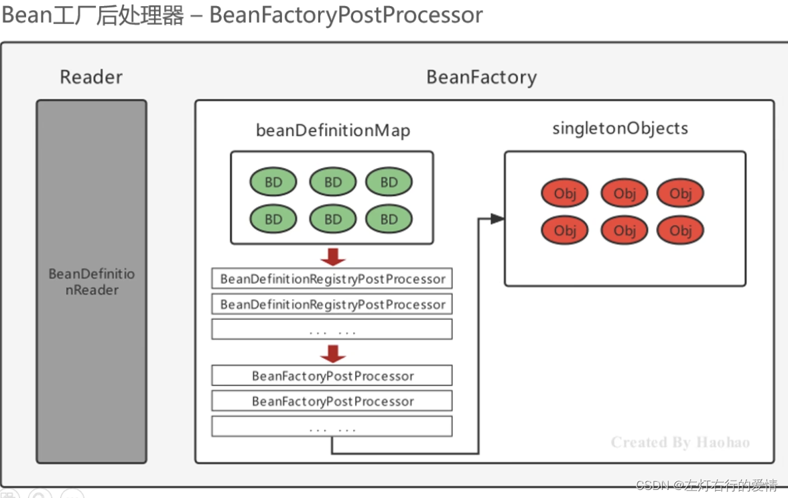
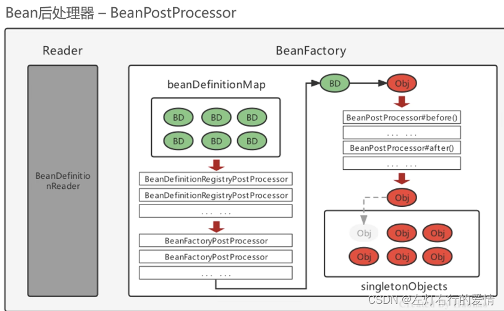

> 原文：[CSDN](https://blog.csdn.net/qq_45852626/article/details/153681145)

## 前言

Spring的后处理器(PostProcessor)是Spring
框架 
对外开放的最重要扩展点之一,它允许我们深度介入到Bean的整个生命周期中,实现动态注册BeanDefinition、动态修改BeanDefinition以及动态修改Bean实例等强大功能。

本文将通过**大量核心源码分析**和**详细的流程图**,深入剖析Spring三大核心PostProcessor的执行原理。

> 如果你对BeanDefinition不太熟悉,建议先阅读:[Spring核心模块解析—BeanDefinition](https://blog.csdn.net/qq_45852626/article/details/128748042)

---

## 📚 知识体系概览

```
Spring PostProcessor体系
    │
    ├─ BeanFactoryPostProcessor (工厂后处理器)
    │   │
    │   └─ BeanDefinitionRegistryPostProcessor (注册后处理器)
    │       │
    │       └─ ConfigurationClassPostProcessor ⭐ (最重要的实现)
    │
    └─ BeanPostProcessor (Bean后处理器)
        │
        ├─ InstantiationAwareBeanPostProcessor
        ├─ DestructionAwareBeanPostProcessor
        ├─ MergedBeanDefinitionPostProcessor
        └─ AutowiredAnnotationBeanPostProcessor ⭐ (依赖注入)


```

---

## 一、BeanFactoryPostProcessor (工厂后处理器)

### 1.1 基本介绍

`BeanFactoryPostProcessor` 是Spring提供的第一个核心扩展点,它允许我们在**所有BeanDefinition加载完成之后,Bean实例化之前**对BeanDefinition进行修改。

#### 🔍 核心 接口源码

```java
@FunctionalInterface
public interface BeanFactoryPostProcessor {

    /**
     * 在标准的BeanFactory初始化之后调用,此时所有的BeanDefinition已经加载但Bean还未实例化
     *
     * @param beanFactory 可以修改的BeanFactory
     * @throws BeansException 发生错误时抛出
     */
    void postProcessBeanFactory(ConfigurableListableBeanFactory beanFactory) throws BeansException;
}


```

### 1.2 执行时机

```
Spring容器启动
    ↓
【阶段1】扫描并加载BeanDefinition
    ├─ 解析@Component注解
    ├─ 解析XML配置
    └─ 注册到BeanDefinitionRegistry
    ↓
【阶段2】执行BeanFactoryPostProcessor.postProcessBeanFactory() ← 我们在这里
    ├─ 可以修改已存在的BeanDefinition
    ├─ 可以添加属性值
    └─ ❌ 不能注册新的BeanDefinition (这是关键区别)
    ↓
【阶段3】开始实例化Bean
    └─ 根据BeanDefinition创建Bean实例


```

流程图:

是


否


是


否


开始: invokeBeanFactoryPostProcessors


beanFactory是否为
  
BeanDefinitionRegistry?


第一部分: 处理BeanDefinitionRegistryPostProcessor


直接执行参数传入的
  
BeanFactoryPostProcessor


遍历参数传入的beanFactoryPostProcessors


是否为
  
BeanDefinitionRegistryPostProcessor?


立即执行postProcessBeanDefinitionRegistry
  
并加入registryProcessors列表


加入regularPostProcessors列表
  
普通BeanFactoryPostProcessor


从容器中查找
  
BeanDefinitionRegistryPostProcessor类型的Bean


第1优先级: PriorityOrdered


排序并执行
  
postProcessBeanDefinitionRegistry


第2优先级: Ordered


排序并执行
  
postProcessBeanDefinitionRegistry


第3优先级: 无优先级接口


循环执行直到没有新的
  
postProcessBeanDefinitionRegistry


执行所有BeanDefinitionRegistryPostProcessor
  
的postProcessBeanFactory方法


执行参数传入的regularPostProcessors
  
的postProcessBeanFactory方法


第二部分: 处理普通BeanFactoryPostProcessor


从容器中查找BeanFactoryPostProcessor
  
排除已处理的


分为3个优先级列表


1. PriorityOrdered类型


2. Ordered类型


3. 无优先级类型


排序并执行postProcessBeanFactory


排序并执行postProcessBeanFactory


执行postProcessBeanFactory


清除元数据缓存


结束

### 1.3 核心源码分析

#### AbstractApplicationContext.refresh() 方法中的调用

```java
public abstract class AbstractApplicationContext extends DefaultResourceLoader
        implements ConfigurableApplicationContext {

    @Override
    public void refresh() throws BeansException, IllegalStateException {
        synchronized (this.startupShutdownMonitor) {
            // ... 前置准备工作

            try {
                // 1. 创建BeanFactory
                ConfigurableListableBeanFactory beanFactory = obtainFreshBeanFactory();

                // 2. 准备BeanFactory (注册一些系统级的BeanPostProcessor)
                prepareBeanFactory(beanFactory);

                // 3. 允许子类对BeanFactory进行后置处理
                postProcessBeanFactory(beanFactory);

                // ⭐⭐⭐ 4. 执行所有BeanFactoryPostProcessor
                // 这是核心入口!
                invokeBeanFactoryPostProcessors(beanFactory);

                // 5. 注册BeanPostProcessor
                registerBeanPostProcessors(beanFactory);

                // ... 后续步骤

                // 11. 实例化所有非懒加载的单例Bean
                finishBeanFactoryInitialization(beanFactory);
            }
            catch (BeansException ex) {
                // 异常处理
                throw ex;
            }
        }
    }

    /**
     * ⭐ 核心方法: 执行所有的BeanFactoryPostProcessor
     */
    protected void invokeBeanFactoryPostProcessors(ConfigurableListableBeanFactory beanFactory) {
        // 委托给PostProcessorRegistrationDelegate进行实际执行
        PostProcessorRegistrationDelegate.invokeBeanFactoryPostProcessors(beanFactory, getBeanFactoryPostProcessors());

        // 如果是LoadTimeWeaver相关的,添加额外处理
        if (beanFactory.getTempClassLoader() == null && beanFactory.containsBean(LOAD_TIME_WEAVER_BEAN_NAME)) {
            beanFactory.addBeanPostProcessor(new LoadTimeWeaverAwareProcessor(beanFactory));
            beanFactory.setTempClassLoader(new ContextTypeMatchClassLoader(beanFactory.getBeanClassLoader()));
        }
    }
}


```

#### PostProcessorRegistrationDelegate 执行细节

```java
final class PostProcessorRegistrationDelegate {

    public static void invokeBeanFactoryPostProcessors(
            ConfigurableListableBeanFactory beanFactory,
            List<BeanFactoryPostProcessor> beanFactoryPostProcessors) {

        // 已处理的PostProcessor名称集合,防止重复执行
        Set<String> processedBeans = new HashSet<>();

        // ==================== 第一部分: 处理BeanDefinitionRegistryPostProcessor ====================
        if (beanFactory instanceof BeanDefinitionRegistry) {
            BeanDefinitionRegistry registry = (BeanDefinitionRegistry) beanFactory;

            // 存储普通的BeanFactoryPostProcessor
            List<BeanFactoryPostProcessor> regularPostProcessors = new ArrayList<>();
            // 存储BeanDefinitionRegistryPostProcessor
            List<BeanDefinitionRegistryPostProcessor> registryProcessors = new ArrayList<>();

            // 1. 先处理手动添加的BeanFactoryPostProcessor
            for (BeanFactoryPostProcessor postProcessor : beanFactoryPostProcessors) {
                if (postProcessor instanceof BeanDefinitionRegistryPostProcessor) {
                    BeanDefinitionRegistryPostProcessor registryProcessor =
                            (BeanDefinitionRegistryPostProcessor) postProcessor;
                    // 调用postProcessBeanDefinitionRegistry方法
                    registryProcessor.postProcessBeanDefinitionRegistry(registry);
                    registryProcessors.add(registryProcessor);
                }
                else {
                    regularPostProcessors.add(postProcessor);
                }
            }

            // 临时存储当前要处理的BeanDefinitionRegistryPostProcessor
            List<BeanDefinitionRegistryPostProcessor> currentRegistryProcessors = new ArrayList<>();

            // ⭐⭐⭐ 2. 首先执行实现了PriorityOrdered接口的BeanDefinitionRegistryPostProcessor
            // 这里会执行ConfigurationClassPostProcessor! (最重要的一个)
            String[] postProcessorNames = beanFactory.getBeanNamesForType(
                    BeanDefinitionRegistryPostProcessor.class, true, false);

            for (String ppName : postProcessorNames) {
                if (beanFactory.isTypeMatch(ppName, PriorityOrdered.class)) {
                    currentRegistryProcessors.add(
                        beanFactory.getBean(ppName, BeanDefinitionRegistryPostProcessor.class));
                    processedBeans.add(ppName);
                }
            }

            // 排序
            sortPostProcessors(currentRegistryProcessors, beanFactory);
            registryProcessors.addAll(currentRegistryProcessors);

            // ⭐ 执行postProcessBeanDefinitionRegistry方法
            invokeBeanDefinitionRegistryPostProcessors(currentRegistryProcessors, registry);
            currentRegistryProcessors.clear();

            // 3. 接下来执行实现了Ordered接口的BeanDefinitionRegistryPostProcessor
            postProcessorNames = beanFactory.getBeanNamesForType(
                    BeanDefinitionRegistryPostProcessor.class, true, false);

            for (String ppName : postProcessorNames) {
                if (!processedBeans.contains(ppName) &&
                    beanFactory.isTypeMatch(ppName, Ordered.class)) {
                    currentRegistryProcessors.add(
                        beanFactory.getBean(ppName, BeanDefinitionRegistryPostProcessor.class));
                    processedBeans.add(ppName);
                }
            }

            sortPostProcessors(currentRegistryProcessors, beanFactory);
            registryProcessors.addAll(currentRegistryProcessors);
            invokeBeanDefinitionRegistryPostProcessors(currentRegistryProcessors, registry);
            currentRegistryProcessors.clear();

            // 4. 最后执行没有实现任何优先级接口的BeanDefinitionRegistryPostProcessor
            boolean reiterate = true;
            while (reiterate) {
                reiterate = false;
                postProcessorNames = beanFactory.getBeanNamesForType(
                        BeanDefinitionRegistryPostProcessor.class, true, false);

                for (String ppName : postProcessorNames) {
                    if (!processedBeans.contains(ppName)) {
                        currentRegistryProcessors.add(
                            beanFactory.getBean(ppName, BeanDefinitionRegistryPostProcessor.class));
                        processedBeans.add(ppName);
                        reiterate = true;
                    }
                }

                sortPostProcessors(currentRegistryProcessors, beanFactory);
                registryProcessors.addAll(currentRegistryProcessors);
                invokeBeanDefinitionRegistryPostProcessors(currentRegistryProcessors, registry);
                currentRegistryProcessors.clear();
            }

            // ⭐ 5. 调用所有BeanDefinitionRegistryPostProcessor的postProcessBeanFactory方法
            // (因为它继承了BeanFactoryPostProcessor接口)
            invokeBeanFactoryPostProcessors(registryProcessors, beanFactory);
            invokeBeanFactoryPostProcessors(regularPostProcessors, beanFactory);
        }
        else {
            // 如果BeanFactory不支持BeanDefinitionRegistry,直接执行
            invokeBeanFactoryPostProcessors(beanFactoryPostProcessors, beanFactory);
        }

        // ==================== 第二部分: 处理普通的BeanFactoryPostProcessor ====================

        // 获取所有BeanFactoryPostProcessor的名称
        String[] postProcessorNames = beanFactory.getBeanNamesForType(
                BeanFactoryPostProcessor.class, true, false);

        // 按照优先级分类
        List<BeanFactoryPostProcessor> priorityOrderedPostProcessors = new ArrayList<>();
        List<String> orderedPostProcessorNames = new ArrayList<>();
        List<String> nonOrderedPostProcessorNames = new ArrayList<>();

        for (String ppName : postProcessorNames) {
            if (processedBeans.contains(ppName)) {
                // 已经处理过,跳过
            }
            else if (beanFactory.isTypeMatch(ppName, PriorityOrdered.class)) {
                priorityOrderedPostProcessors.add(
                    beanFactory.getBean(ppName, BeanFactoryPostProcessor.class));
            }
            else if (beanFactory.isTypeMatch(ppName, Ordered.class)) {
                orderedPostProcessorNames.add(ppName);
            }
            else {
                nonOrderedPostProcessorNames.add(ppName);
            }
        }

        // 1. 先执行实现了PriorityOrdered的BeanFactoryPostProcessor
        sortPostProcessors(priorityOrderedPostProcessors, beanFactory);
        invokeBeanFactoryPostProcessors(priorityOrderedPostProcessors, beanFactory);

        // 2. 再执行实现了Ordered的BeanFactoryPostProcessor
        List<BeanFactoryPostProcessor> orderedPostProcessors = new ArrayList<>(orderedPostProcessorNames.size());
        for (String postProcessorName : orderedPostProcessorNames) {
            orderedPostProcessors.add(
                beanFactory.getBean(postProcessorName, BeanFactoryPostProcessor.class));
        }
        sortPostProcessors(orderedPostProcessors, beanFactory);
        invokeBeanFactoryPostProcessors(orderedPostProcessors, beanFactory);

        // 3. 最后执行没有优先级的BeanFactoryPostProcessor
        List<BeanFactoryPostProcessor> nonOrderedPostProcessors = new ArrayList<>(nonOrderedPostProcessorNames.size());
        for (String postProcessorName : nonOrderedPostProcessorNames) {
            nonOrderedPostProcessors.add(
                beanFactory.getBean(postProcessorName, BeanFactoryPostProcessor.class));
        }
        invokeBeanFactoryPostProcessors(nonOrderedPostProcessors, beanFactory);

        // 清除元数据缓存
        beanFactory.clearMetadataCache();
    }

    /**
     * 执行BeanDefinitionRegistryPostProcessor的postProcessBeanDefinitionRegistry方法
     */
    private static void invokeBeanDefinitionRegistryPostProcessors(
            Collection<? extends BeanDefinitionRegistryPostProcessor> postProcessors,
            BeanDefinitionRegistry registry) {

        for (BeanDefinitionRegistryPostProcessor postProcessor : postProcessors) {
            postProcessor.postProcessBeanDefinitionRegistry(registry);
        }
    }

    /**
     * 执行BeanFactoryPostProcessor的postProcessBeanFactory方法
     */
    private static void invokeBeanFactoryPostProcessors(
            Collection<? extends BeanFactoryPostProcessor> postProcessors,
            ConfigurableListableBeanFactory beanFactory) {

        for (BeanFactoryPostProcessor postProcessor : postProcessors) {
            postProcessor.postProcessBeanFactory(beanFactory);
        }
    }
}


```

### 1.4 能力与限制

| 能力 | 支持 | 说明 |
| --- | --- | --- |
| 修改BeanDefinition属性 | ✅ | 可以修改scope、lazyInit等 |
| 修改BeanDefinition的属性值 | ✅ | 可以通过MutablePropertyValues修改 |
| 获取BeanDefinition | ✅ | 通过beanFactory.getBeanDefinition() |
| **注册新的BeanDefinition** | ❌ | **这是关键限制!** |
| 实例化Bean | ❌ | 此时Bean还未开始实例化 |

### 1.5 经典应用场景

#### 场景1: 属性占位符替换

Spring内置的 `PropertySourcesPlaceholderConfigurer` 就是一个典型的 `BeanFactoryPostProcessor` 实现。

```java
/**
 * Spring内置实现: 解析${...}占位符
 */
public class PropertySourcesPlaceholderConfigurer extends PlaceholderConfigurerSupport
        implements EnvironmentAware {

    @Override
    public void postProcessBeanFactory(ConfigurableListableBeanFactory beanFactory)
            throws BeansException {

        if (this.propertySources == null) {
            this.propertySources = new MutablePropertySources();
            if (this.environment != null) {
                // 添加环境中的PropertySource
                this.propertySources.addLast(
                    new PropertySource<Environment>(ENVIRONMENT_PROPERTIES_PROPERTY_SOURCE_NAME,
                                                    this.environment) {
                        @Override
                        @Nullable
                        public String getProperty(String key) {
                            return this.source.getProperty(key);
                        }
                    }
                );
            }
        }

        // ⭐ 核心: 处理所有BeanDefinition中的占位符
        processProperties(beanFactory, new PropertySourcesPropertyResolver(this.propertySources));
    }

    /**
     * 遍历所有BeanDefinition,替换占位符
     */
    protected void processProperties(ConfigurableListableBeanFactory beanFactoryToProcess,
                                     final ConfigurablePropertyResolver propertyResolver) {

        // 设置占位符的前缀和后缀
        propertyResolver.setPlaceholderPrefix(this.placeholderPrefix);
        propertyResolver.setPlaceholderSuffix(this.placeholderSuffix);
        propertyResolver.setValueSeparator(this.valueSeparator);

        // 创建值解析器
        StringValueResolver valueResolver = strVal -> {
            String resolved = propertyResolver.resolvePlaceholders(strVal);
            if (this.trimValues) {
                resolved = resolved.trim();
            }
            return (resolved.equals(this.nullValue) ? null : resolved);
        };

        // ⭐ 遍历所有BeanDefinition并处理占位符
        doProcessProperties(beanFactoryToProcess, valueResolver);
    }

    protected void doProcessProperties(ConfigurableListableBeanFactory beanFactoryToProcess,
                                      StringValueResolver valueResolver) {

        // 创建BeanDefinition访问器
        BeanDefinitionVisitor visitor = new BeanDefinitionVisitor(valueResolver);

        // 获取所有BeanDefinition的名称
        String[] beanNames = beanFactoryToProcess.getBeanDefinitionNames();

        for (String curName : beanNames) {
            // 检查是否是内部Bean或已处理的Bean
            if (!(curName.startsWith(BeanFactory.FACTORY_BEAN_PREFIX) &&
                  beanFactoryToProcess.containsBeanDefinition(curName.substring(BeanFactory.FACTORY_BEAN_PREFIX.length())))) {

                BeanDefinition bd = beanFactoryToProcess.getBeanDefinition(curName);
                try {
                    // ⭐ 访问并替换BeanDefinition中的占位符
                    visitor.visitBeanDefinition(bd);
                }
                catch (Exception ex) {
                    throw new BeanDefinitionStoreException(bd.getResourceDescription(), curName, ex.getMessage(), ex);
                }
            }
        }

        // 处理别名中的占位符
        beanFactoryToProcess.resolveAliases(valueResolver);

        // 添加嵌入式值解析器用于注解属性
        beanFactoryToProcess.addEmbeddedValueResolver(valueResolver);
    }
}


```

**使用示例:**

```java
@Configuration
public class AppConfig {

    @Bean
    public static PropertySourcesPlaceholderConfigurer propertyConfigurer() {
        return new PropertySourcesPlaceholderConfigurer();
    }

    @Bean
    public DataSource dataSource(
            @Value("${db.url}") String url,
            @Value("${db.username}") String username,
            @Value("${db.password}") String password) {

        HikariDataSource dataSource = new HikariDataSource();
        dataSource.setJdbcUrl(url);        // 从application.properties读取
        dataSource.setUsername(username);   // ${db.username} 被替换为实际值
        dataSource.setPassword(password);
        return dataSource;
    }
}


```

#### 场景2: 自定义修改BeanDefinition

```java
/**
 * 自定义BeanFactoryPostProcessor: 批量修改Bean的作用域
 */
@Component
public class CustomScopeModifier implements BeanFactoryPostProcessor {

    @Override
    public void postProcessBeanFactory(ConfigurableListableBeanFactory beanFactory)
            throws BeansException {

        System.out.println("========== CustomScopeModifier 执行 ==========");

        // 获取所有BeanDefinition的名称
        String[] beanNames = beanFactory.getBeanDefinitionNames();

        for (String beanName : beanNames) {
            BeanDefinition beanDefinition = beanFactory.getBeanDefinition(beanName);

            // 如果是我们自己的业务Bean (通过包名判断)
            if (beanDefinition.getBeanClassName() != null &&
                beanDefinition.getBeanClassName().startsWith("com.example.service")) {

                // 修改作用域为prototype
                if (BeanDefinition.SCOPE_SINGLETON.equals(beanDefinition.getScope())) {
                    System.out.println("修改Bean [" + beanName + "] 的作用域: singleton -> prototype");
                    beanDefinition.setScope(BeanDefinition.SCOPE_PROTOTYPE);
                }

                // 添加属性值
                MutablePropertyValues pvs = beanDefinition.getPropertyValues();
                pvs.add("timestamp", System.currentTimeMillis());

                // 设置为懒加载
                beanDefinition.setLazyInit(true);
            }
        }
    }
}


```

---

## 二、BeanDefinitionRegistryPostProcessor (注册后处理器) ⭐⭐⭐

### 2.1 基本介绍

`BeanDefinitionRegistryPostProcessor` 是 `BeanFactoryPostProcessor` 的子接口,它在父接口的基础上**新增了一个更早执行的方法**,允许我们**动态注册新的BeanDefinition**。

这是Spring中**最强大的扩展点之一**!

#### 🔍 核心接口源码

```java
public interface BeanDefinitionRegistryPostProcessor extends BeanFactoryPostProcessor {

    /**
     * ⭐⭐⭐ 核心方法: 在所有Bean定义加载之后,标准BeanFactoryPostProcessor执行之前调用
     *
     * 在这个方法中可以注册新的BeanDefinition!
     *
     * @param registry BeanDefinition注册中心
     * @throws BeansException 发生错误时抛出
     */
    void postProcessBeanDefinitionRegistry(BeanDefinitionRegistry registry) throws BeansException;

    // 继承自BeanFactoryPostProcessor的方法
    // void postProcessBeanFactory(ConfigurableListableBeanFactory beanFactory);
}


```

### 2.2 执行时机对比

```java
Spring容器启动
    ↓
【阶段1】加载初始BeanDefinition (扫描@Component、解析XML等)
    ↓
【阶段2】执行 BeanDefinitionRegistryPostProcessor.postProcessBeanDefinitionRegistry()
    ↓                    ⬆ 我们在这里可以注册新的BeanDefinition
    │                    │
    │   ┌────────────────┴────────────────┐
    │   │  ConfigurationClassPostProcessor │
    │   │  在这里执行! 它会:                 │
    │   │  ├─ 解析@Configuration           │
    │   │  ├─ 处理@ComponentScan            │
    │   │  ├─ 处理@Import (自动装配!)       │
    │   │  ├─ 处理@Bean方法                 │
    │   │  └─ 注册新的BeanDefinition        │
    │   └─────────────────────────────────┘
    ↓
【阶段3】执行 BeanDefinitionRegistryPostProcessor.postProcessBeanFactory()
    ↓                    (因为它继承了BeanFactoryPostProcessor)
【阶段4】执行 BeanFactoryPostProcessor.postProcessBeanFactory()
    ↓
【阶段5】开始实例化Bean


```

**关键理解:**

1. `BeanDefinitionRegistryPostProcessor` 有**两个方法**
2. `postProcessBeanDefinitionRegistry()` **先执行** → 可以注册新BeanDefinition
3. `postProcessBeanFactory()` **后执行** → 可以修改BeanDefinition

### 2.3 ConfigurationClassPostProcessor 源码深度剖析 ⭐⭐⭐

这是Spring中**最重要的一个PostProcessor**,它负责处理:

* `@Configuration` 类
* `@ComponentScan` 扫描
* `@Import` 导入 (自动装配的核心!)
* `@Bean` 方法

#### 类 定义

```java
public class ConfigurationClassPostProcessor implements BeanDefinitionRegistryPostProcessor,
        PriorityOrdered, ResourceLoaderAware, BeanClassLoaderAware, EnvironmentAware {

    /**
     * ⭐⭐⭐ 核心方法: 处理配置类并注册BeanDefinition
     */
    @Override
    public void postProcessBeanDefinitionRegistry(BeanDefinitionRegistry registry) {
        // 生成一个注册ID,用于标识处理过程
        int registryId = System.identityHashCode(registry);

        // 防止重复处理
        if (this.registriesPostProcessed.contains(registryId)) {
            throw new IllegalStateException(
                "postProcessBeanDefinitionRegistry already called on this post-processor against " + registry);
        }
        if (this.factoriesPostProcessed.contains(registryId)) {
            throw new IllegalStateException(
                "postProcessBeanFactory already called on this post-processor against " + registry);
        }

        this.registriesPostProcessed.add(registryId);

        // ⭐⭐⭐ 核心入口: 处理配置Bean定义
        processConfigBeanDefinitions(registry);
    }

    /**
     * ⭐⭐⭐ 最核心的方法: 处理配置类
     */
    public void processConfigBeanDefinitions(BeanDefinitionRegistry registry) {
        List<BeanDefinitionHolder> configCandidates = new ArrayList<>();

        // 1. 获取所有已注册的BeanDefinition名称
        String[] candidateNames = registry.getBeanDefinitionNames();

        // 2. 遍历所有BeanDefinition,找出配置类
        for (String beanName : candidateNames) {
            BeanDefinition beanDef = registry.getBeanDefinition(beanName);

            // 检查是否已经处理过
            if (beanDef.getAttribute(ConfigurationClassUtils.CONFIGURATION_CLASS_ATTRIBUTE) != null) {
                if (logger.isDebugEnabled()) {
                    logger.debug("Bean definition has already been processed as a configuration class: " + beanDef);
                }
            }
            // ⭐ 检查是否是配置类 (@Configuration、@Component、@Import等)
            else if (ConfigurationClassUtils.checkConfigurationClassCandidate(beanDef, this.metadataReaderFactory)) {
                configCandidates.add(new BeanDefinitionHolder(beanDef, beanName));
            }
        }

        // 如果没有配置类,直接返回
        if (configCandidates.isEmpty()) {
            return;
        }

        // 3. 按照@Order排序配置类
        configCandidates.sort((bd1, bd2) -> {
            int i1 = ConfigurationClassUtils.getOrder(bd1.getBeanDefinition());
            int i2 = ConfigurationClassUtils.getOrder(bd2.getBeanDefinition());
            return Integer.compare(i1, i2);
        });

        // 4. 检测是否有自定义的BeanNameGenerator
        SingletonBeanRegistry sbr = null;
        if (registry instanceof SingletonBeanRegistry) {
            sbr = (SingletonBeanRegistry) registry;
            if (!this.localBeanNameGeneratorSet) {
                BeanNameGenerator generator = (BeanNameGenerator) sbr.getSingleton(
                    AnnotationConfigUtils.CONFIGURATION_BEAN_NAME_GENERATOR);
                if (generator != null) {
                    this.componentScanBeanNameGenerator = generator;
                    this.importBeanNameGenerator = generator;
                }
            }
        }

        if (this.environment == null) {
            this.environment = new StandardEnvironment();
        }

        // ⭐⭐⭐ 5. 创建配置类解析器
        ConfigurationClassParser parser = new ConfigurationClassParser(
                this.metadataReaderFactory, this.problemReporter, this.environment,
                this.resourceLoader, this.componentScanBeanNameGenerator, registry);

        Set<BeanDefinitionHolder> candidates = new LinkedHashSet<>(configCandidates);
        Set<ConfigurationClass> alreadyParsed = new HashSet<>(configCandidates.size());

        // 6. 循环处理配置类 (因为处理过程中可能会发现新的配置类)
        do {
            // ⭐⭐⭐ 解析配置类
            parser.parse(candidates);
            parser.validate();

            Set<ConfigurationClass> configClasses = new LinkedHashSet<>(parser.getConfigurationClasses());
            configClasses.removeAll(alreadyParsed);

            // 读取模型并创建Bean定义
            if (this.reader == null) {
                this.reader = new ConfigurationClassBeanDefinitionReader(
                        registry, this.sourceExtractor, this.resourceLoader, this.environment,
                        this.importBeanNameGenerator, parser.getImportRegistry());
            }

            // ⭐⭐⭐ 将解析出的配置类加载为BeanDefinition
            this.reader.loadBeanDefinitions(configClasses);
            alreadyParsed.addAll(configClasses);

            candidates.clear();

            // ⭐ 检查是否有新的BeanDefinition被注册
            // 如果有,继续下一轮处理
            if (registry.getBeanDefinitionCount() > candidateNames.length) {
                String[] newCandidateNames = registry.getBeanDefinitionNames();
                Set<String> oldCandidateNames = new HashSet<>(Arrays.asList(candidateNames));
                Set<String> alreadyParsedClasses = new HashSet<>();
                for (ConfigurationClass configurationClass : alreadyParsed) {
                    alreadyParsedClasses.add(configurationClass.getMetadata().getClassName());
                }

                // 找出新注册的BeanDefinition
                for (String candidateName : newCandidateNames) {
                    if (!oldCandidateNames.contains(candidateName)) {
                        BeanDefinition bd = registry.getBeanDefinition(candidateName);
                        if (ConfigurationClassUtils.checkConfigurationClassCandidate(bd, this.metadataReaderFactory) &&
                                !alreadyParsedClasses.contains(bd.getBeanClassName())) {
                            candidates.add(new BeanDefinitionHolder(bd, candidateName));
                        }
                    }
                }
                candidateNames = newCandidateNames;
            }
        }
        while (!candidates.isEmpty());

        // 注册ImportRegistry作为Bean,以支持ImportAware
        if (sbr != null && !sbr.containsSingleton(IMPORT_REGISTRY_BEAN_NAME)) {
            sbr.registerSingleton(IMPORT_REGISTRY_BEAN_NAME, parser.getImportRegistry());
        }

        if (this.metadataReaderFactory instanceof CachingMetadataReaderFactory) {
            ((CachingMetadataReaderFactory) this.metadataReaderFactory).clearCache();
        }
    }

    /**
     * 实现BeanFactoryPostProcessor的方法
     */
    @Override
    public void postProcessBeanFactory(ConfigurableListableBeanFactory beanFactory) {
        int factoryId = System.identityHashCode(beanFactory);
        if (this.factoriesPostProcessed.contains(factoryId)) {
            throw new IllegalStateException(
                "postProcessBeanFactory already called on this post-processor against " + beanFactory);
        }
        this.factoriesPostProcessed.add(factoryId);

        if (!this.registriesPostProcessed.contains(factoryId)) {
            processConfigBeanDefinitions((BeanDefinitionRegistry) beanFactory);
        }

        // ⭐ 增强@Configuration类 (通过CGLIB代理)
        enhanceConfigurationClasses(beanFactory);

        // 添加ImportAwareBeanPostProcessor
        beanFactory.addBeanPostProcessor(new ImportAwareBeanPostProcessor(beanFactory));
    }

    /**
     * 对@Configuration类进行CGLIB增强
     * 目的: 确保@Bean方法的单例语义
     */
    public void enhanceConfigurationClasses(ConfigurableListableBeanFactory beanFactory) {
        Map<String, AbstractBeanDefinition> configBeanDefs = new LinkedHashMap<>();

        for (String beanName : beanFactory.getBeanDefinitionNames()) {
            BeanDefinition beanDef = beanFactory.getBeanDefinition(beanName);
            Object configClassAttr = beanDef.getAttribute(
                ConfigurationClassUtils.CONFIGURATION_CLASS_ATTRIBUTE);

            // 如果是full配置类 (@Configuration)
            if (ConfigurationClassUtils.CONFIGURATION_CLASS_FULL.equals(configClassAttr)) {
                if (!(beanDef instanceof AbstractBeanDefinition)) {
                    throw new BeanDefinitionStoreException("Cannot enhance @Configuration bean definition '" +
                            beanName + "' since it is not stored in an AbstractBeanDefinition subclass");
                }
                else if (logger.isInfoEnabled() && beanFactory.containsSingleton(beanName)) {
                    logger.info("Cannot enhance @Configuration bean definition '" + beanName +
                            "' since its singleton instance has been created too early. The typical cause " +
                            "is a non-static @Bean method with a BeanDefinitionRegistryPostProcessor " +
                            "return type: Consider declaring such methods as 'static'.");
                }
                configBeanDefs.put(beanName, (AbstractBeanDefinition) beanDef);
            }
        }

        if (configBeanDefs.isEmpty()) {
            return;
        }

        // ⭐ 创建CGLIB增强器
        ConfigurationClassEnhancer enhancer = new ConfigurationClassEnhancer();

        for (Map.Entry<String, AbstractBeanDefinition> entry : configBeanDefs.entrySet()) {
            AbstractBeanDefinition beanDef = entry.getValue();
            beanDef.setAttribute(AutoProxyUtils.PRESERVE_TARGET_CLASS_ATTRIBUTE, Boolean.TRUE);

            try {
                Class<?> configClass = beanDef.resolveBeanClass(this.beanClassLoader);
                if (configClass != null) {
                    // ⭐ 生成增强后的子类
                    Class<?> enhancedClass = enhancer.enhance(configClass, this.beanClassLoader);
                    if (configClass != enhancedClass) {
                        beanDef.setBeanClass(enhancedClass);
                    }
                }
            }
            catch (Throwable ex) {
                throw new IllegalStateException("Cannot load configuration class: " +
                    beanDef.getBeanClassName(), ex);
            }
        }
    }

    @Override
    public int getOrder() {
        return Ordered.LOWEST_PRECEDENCE;  // 虽然是最低优先级,但它是PriorityOrdered!
    }
}


```

#### ConfigurationClassParser 解析逻辑

```java
class ConfigurationClassParser {

    /**
     * 解析配置类
     */
    public void parse(Set<BeanDefinitionHolder> configCandidates) {
        for (BeanDefinitionHolder holder : configCandidates) {
            BeanDefinition bd = holder.getBeanDefinition();
            try {
                if (bd instanceof AnnotatedBeanDefinition) {
                    // ⭐ 解析注解元数据
                    parse(((AnnotatedBeanDefinition) bd).getMetadata(), holder.getBeanName());
                }
                else if (bd instanceof AbstractBeanDefinition && ((AbstractBeanDefinition) bd).hasBeanClass()) {
                    parse(((AbstractBeanDefinition) bd).getBeanClass(), holder.getBeanName());
                }
                else {
                    parse(bd.getBeanClassName(), holder.getBeanName());
                }
            }
            catch (BeanDefinitionStoreException ex) {
                throw ex;
            }
            catch (Throwable ex) {
                throw new BeanDefinitionStoreException(
                    "Failed to parse configuration class [" + bd.getBeanClassName() + "]", ex);
            }
        }

        // ⭐⭐⭐ 处理延迟导入的选择器 (DeferredImportSelector)
        this.deferredImportSelectorHandler.process();
    }

    protected final void parse(AnnotationMetadata metadata, String beanName) throws IOException {
        processConfigurationClass(new ConfigurationClass(metadata, beanName), DEFAULT_EXCLUSION_FILTER);
    }

    /**
     * ⭐⭐⭐ 核心方法: 处理配置类
     */
    protected void processConfigurationClass(ConfigurationClass configClass,
                                            Predicate<String> filter) throws IOException {

        // 1. 条件评估 (@Conditional)
        if (this.conditionEvaluator.shouldSkip(configClass.getMetadata(), ConfigurationPhase.PARSE_CONFIGURATION)) {
            return;
        }

        // 2. 检查是否已存在
        ConfigurationClass existingClass = this.configurationClasses.get(configClass);
        if (existingClass != null) {
            if (configClass.isImported()) {
                if (existingClass.isImported()) {
                    existingClass.mergeImportedBy(configClass);
                }
                return;
            }
            else {
                this.configurationClasses.remove(configClass);
                this.knownSuperclasses.values().removeIf(configClass::equals);
            }
        }

        // ⭐⭐⭐ 3. 递归处理配置类及其父类
        SourceClass sourceClass = asSourceClass(configClass, filter);
        do {
            sourceClass = doProcessConfigurationClass(configClass, sourceClass, filter);
        }
        while (sourceClass != null);

        this.configurationClasses.put(configClass, configClass);
    }

    /**
     * ⭐⭐⭐ 最核心的方法: 处理配置类的各种注解
     */
    @Nullable
    protected final SourceClass doProcessConfigurationClass(
            ConfigurationClass configClass, SourceClass sourceClass, Predicate<String> filter)
            throws IOException {

        // 1. 处理@Component注解 (递归处理成员类)
        if (configClass.getMetadata().isAnnotated(Component.class.getName())) {
            processMemberClasses(configClass, sourceClass, filter);
        }

        // ⭐⭐⭐ 2. 处理@PropertySource注解
        for (AnnotationAttributes propertySource : AnnotationConfigUtils.attributesForRepeatable(
                sourceClass.getMetadata(), PropertySources.class,
                org.springframework.context.annotation.PropertySource.class)) {
            if (this.environment instanceof ConfigurableEnvironment) {
                processPropertySource(propertySource);
            }
        }

        // ⭐⭐⭐ 3. 处理@ComponentScan注解 (包扫描)
        Set<AnnotationAttributes> componentScans = AnnotationConfigUtils.attributesForRepeatable(
                sourceClass.getMetadata(), ComponentScans.class, ComponentScan.class);
        if (!componentScans.isEmpty() &&
                !this.conditionEvaluator.shouldSkip(sourceClass.getMetadata(), ConfigurationPhase.REGISTER_BEAN)) {
            for (AnnotationAttributes componentScan : componentScans) {
                // ⭐ 执行组件扫描,立即注册BeanDefinition
                Set<BeanDefinitionHolder> scannedBeanDefinitions =
                        this.componentScanParser.parse(componentScan, sourceClass.getMetadata().getClassName());

                // 检查扫描出的Bean是否也是配置类
                for (BeanDefinitionHolder holder : scannedBeanDefinitions) {
                    BeanDefinition bdCand = holder.getBeanDefinition().getOriginatingBeanDefinition();
                    if (bdCand == null) {
                        bdCand = holder.getBeanDefinition();
                    }
                    if (ConfigurationClassUtils.checkConfigurationClassCandidate(bdCand, this.metadataReaderFactory)) {
                        // 递归处理
                        parse(bdCand.getBeanClassName(), holder.getBeanName());
                    }
                }
            }
        }

        // ⭐⭐⭐ 4. 处理@Import注解 (自动装配的核心!)
        processImports(configClass, sourceClass, getImports(sourceClass), filter, true);

        // ⭐⭐⭐ 5. 处理@ImportResource注解 (导入XML配置)
        AnnotationAttributes importResource =
                AnnotationConfigUtils.attributesFor(sourceClass.getMetadata(), ImportResource.class);
        if (importResource != null) {
            String[] resources = importResource.getStringArray("locations");
            Class<? extends BeanDefinitionReader> readerClass = importResource.getClass("reader");
            for (String resource : resources) {
                String resolvedResource = this.environment.resolveRequiredPlaceholders(resource);
                configClass.addImportedResource(resolvedResource, readerClass);
            }
        }

        // ⭐⭐⭐ 6. 处理@Bean方法
        Set<MethodMetadata> beanMethods = retrieveBeanMethodMetadata(sourceClass);
        for (MethodMetadata methodMetadata : beanMethods) {
            configClass.addBeanMethod(new BeanMethod(methodMetadata, configClass));
        }

        // 7. 处理接口上的默认方法
        processInterfaces(configClass, sourceClass);

        // 8. 处理父类 (如果有)
        if (sourceClass.getMetadata().hasSuperClass()) {
            String superclass = sourceClass.getMetadata().getSuperClassName();
            if (superclass != null && !superclass.startsWith("java") &&
                    !this.knownSuperclasses.containsKey(superclass)) {
                this.knownSuperclasses.put(superclass, configClass);
                // 返回父类,继续处理
                return sourceClass.getSuperClass();
            }
        }

        // 没有父类,处理完成
        return null;
    }

    /**
     * ⭐⭐⭐ 处理@Import注解 (这是自动装配的入口!)
     */
    private void processImports(ConfigurationClass configClass, SourceClass currentSourceClass,
                               Collection<SourceClass> importCandidates, Predicate<String> exclusionFilter,
                               boolean checkForCircularImports) {

        if (importCandidates.isEmpty()) {
            return;
        }

        // 检查循环导入
        if (checkForCircularImports && isChainedImportOnStack(configClass)) {
            this.problemReporter.error(new CircularImportProblem(configClass, this.importStack));
        }
        else {
            this.importStack.push(configClass);
            try {
                for (SourceClass candidate : importCandidates) {
                    // ⭐⭐⭐ Case 1: ImportSelector (自动装配使用这个!)
                    if (candidate.isAssignable(ImportSelector.class)) {
                        Class<?> candidateClass = candidate.loadClass();
                        ImportSelector selector = ParserStrategyUtils.instantiateClass(
                            candidateClass, ImportSelector.class,
                            this.environment, this.resourceLoader, this.registry);

                        Predicate<String> selectorFilter = selector.getExclusionFilter();
                        if (selectorFilter != null) {
                            exclusionFilter = exclusionFilter.or(selectorFilter);
                        }

                        // ⭐ DeferredImportSelector延迟处理 (AutoConfigurationImportSelector就是这个类型!)
                        if (selector instanceof DeferredImportSelector) {
                            this.deferredImportSelectorHandler.handle(configClass,
                                (DeferredImportSelector) selector);
                        }
                        else {
                            // 立即获取要导入的类名
                            String[] importClassNames = selector.selectImports(currentSourceClass.getMetadata());
                            Collection<SourceClass> importSourceClasses = asSourceClasses(importClassNames, exclusionFilter);
                            // 递归处理
                            processImports(configClass, currentSourceClass, importSourceClasses, exclusionFilter, false);
                        }
                    }
                    // ⭐⭐⭐ Case 2: ImportBeanDefinitionRegistrar
                    else if (candidate.isAssignable(ImportBeanDefinitionRegistrar.class)) {
                        Class<?> candidateClass = candidate.loadClass();
                        ImportBeanDefinitionRegistrar registrar = ParserStrategyUtils.instantiateClass(
                            candidateClass, ImportBeanDefinitionRegistrar.class,
                            this.environment, this.resourceLoader, this.registry);
                        // 暂存,稍后统一处理
                        configClass.addImportBeanDefinitionRegistrar(registrar, currentSourceClass.getMetadata());
                    }
                    // ⭐⭐⭐ Case 3: 普通类或@Configuration类
                    else {
                        this.importStack.registerImport(
                            currentSourceClass.getMetadata(), candidate.getMetadata().getClassName());
                        // 作为@Configuration类处理
                        processConfigurationClass(candidate.asConfigClass(configClass), exclusionFilter);
                    }
                }
            }
            catch (BeanDefinitionStoreException ex) {
                throw ex;
            }
            catch (Throwable ex) {
                throw new BeanDefinitionStoreException(
                    "Failed to process import candidates for configuration class [" +
                    configClass.getMetadata().getClassName() + "]", ex);
            }
            finally {
                this.importStack.pop();
            }
        }
    }
}


```

### 2.4 执行流程图

是


否


Spring容器启动


扫描初始BeanDefinition


执行BeanDefinitionRegistryPostProcessor


按优先级分类


PriorityOrdered组


Ordered组


普通组


ConfigurationClassPostProcessor执行


processConfigBeanDefinitions


ConfigurationClassParser.parse


处理各种注解


@ComponentScan扫描包


@Import导入


@Bean方法


@PropertySource


Import类型判断


ImportSelector


ImportBeanDefinitionRegistrar


普通Configuration


selectImports返回类名


递归处理返回的类


暂存Registrar稍后执行


作为配置类递归处理


注册扫描到的BeanDefinition


注册@Bean方法的BeanDefinition


添加PropertySource到Environment


继续解析


是否有新的配置类？


loadBeanDefinitions


执行postProcessBeanFactory


增强@Configuration类（CGLIB）


开始实例化Bean

### 2.5 实战示例

#### 示例1: 动态注册BeanDefinition

```java
/**
 * 自定义BeanDefinitionRegistryPostProcessor
 * 场景: 根据配置文件动态注册数据源Bean
 */
@Component
public class DynamicDataSourceRegistrar implements BeanDefinitionRegistryPostProcessor, EnvironmentAware {

    private static final String PREFIX = "custom.datasources";

    private Environment environment;

    @Override
    public void setEnvironment(Environment environment) {
        this.environment = environment;
    }

    @Override
    public void postProcessBeanDefinitionRegistry(BeanDefinitionRegistry registry)
            throws BeansException {

        System.out.println("========== DynamicDataSourceRegistrar 开始注册数据源 ==========");

        // 假设配置文件中有:
        // custom.datasources.ds1.url=jdbc:mysql://localhost:3306/db1
        // custom.datasources.ds1.username=root
        // custom.datasources.ds2.url=jdbc:mysql://localhost:3306/db2
        // custom.datasources.ds2.username=admin

        // 获取所有数据源名称 (这里简化处理)
        String[] dataSourceNames = {"ds1", "ds2"};

        for (String dsName : dataSourceNames) {
            String url = environment.getProperty(PREFIX + "." + dsName + ".url");
            String username = environment.getProperty(PREFIX + "." + dsName + ".username");
            String password = environment.getProperty(PREFIX + "." + dsName + ".password");

            if (url != null) {
                // ⭐ 动态创建BeanDefinition
                BeanDefinitionBuilder builder = BeanDefinitionBuilder
                    .genericBeanDefinition(HikariDataSource.class);

                builder.addPropertyValue("jdbcUrl", url);
                builder.addPropertyValue("username", username);
                builder.addPropertyValue("password", password);
                builder.addPropertyValue("driverClassName", "com.mysql.cj.jdbc.Driver");
                builder.setInitMethodName("init");
                builder.setDestroyMethodName("close");

                AbstractBeanDefinition beanDefinition = builder.getBeanDefinition();

                // ⭐⭐⭐ 注册到容器
                registry.registerBeanDefinition("dataSource_" + dsName, beanDefinition);

                System.out.println("注册数据源: dataSource_" + dsName + " -> " + url);
            }
        }
    }

    @Override
    public void postProcessBeanFactory(ConfigurableListableBeanFactory beanFactory)
            throws BeansException {
        // 这个方法也会被调用,可以在这里做额外的修改
        System.out.println("========== DynamicDataSourceRegistrar.postProcessBeanFactory ==========");
    }
}


```

#### 示例2: 自定义注解扫描器

```java
/**
 * 自定义注解: 标记需要特殊处理的类
 */
@Target(ElementType.TYPE)
@Retention(RetentionPolicy.RUNTIME)
@Documented
public @interface MyComponent {
    String value() default "";
    String scope() default "singleton";
}

/**
 * 自定义扫描器: 扫描@MyComponent注解
 */
@Component
public class MyComponentScanner implements BeanDefinitionRegistryPostProcessor,
        ResourceLoaderAware, EnvironmentAware {

    private ResourceLoader resourceLoader;
    private Environment environment;

    @Override
    public void setResourceLoader(ResourceLoader resourceLoader) {
        this.resourceLoader = resourceLoader;
    }

    @Override
    public void setEnvironment(Environment environment) {
        this.environment = environment;
    }

    @Override
    public void postProcessBeanDefinitionRegistry(BeanDefinitionRegistry registry)
            throws BeansException {

        System.out.println("========== MyComponentScanner 开始扫描 ==========");

        // ⭐ 创建ClassPathBeanDefinitionScanner
        ClassPathBeanDefinitionScanner scanner = new ClassPathBeanDefinitionScanner(registry, false);

        // 设置资源加载器
        scanner.setResourceLoader(resourceLoader);
        scanner.setEnvironment(environment);

        // ⭐ 添加自定义过滤器: 只扫描@MyComponent注解
        scanner.addIncludeFilter(new AnnotationTypeFilter(MyComponent.class));

        // ⭐⭐⭐ 执行扫描
        String basePackage = "com.example";
        int count = scanner.scan(basePackage);

        System.out.println("扫描到 " + count + " 个@MyComponent类");

        // ⭐ 后处理: 根据注解属性修改BeanDefinition
        String[] beanNames = registry.getBeanDefinitionNames();
        for (String beanName : beanNames) {
            BeanDefinition bd = registry.getBeanDefinition(beanName);

            // 检查是否有@MyComponent注解
            if (bd instanceof AnnotatedBeanDefinition) {
                AnnotatedBeanDefinition abd = (AnnotatedBeanDefinition) bd;
                AnnotationMetadata metadata = abd.getMetadata();

                if (metadata.hasAnnotation(MyComponent.class.getName())) {
                    Map<String, Object> attributes = metadata.getAnnotationAttributes(
                        MyComponent.class.getName());

                    // 应用注解属性
                    String scope = (String) attributes.get("scope");
                    bd.setScope(scope);

                    System.out.println("处理@MyComponent: " + beanName + ", scope=" + scope);
                }
            }
        }
    }

    @Override
    public void postProcessBeanFactory(ConfigurableListableBeanFactory beanFactory)
            throws BeansException {
        // 可选的后处理
    }
}


```

---

## 三、BeanPostProcessor (Bean后处理器)

### 3.1 基本介绍

`BeanPostProcessor` 是在**Bean实例化之后,初始化前后**执行的后处理器。它操作的是**已经创建好的Bean实例**,而不是BeanDefinition。

#### 🔍 核心接口源码

```java
public interface BeanPostProcessor {

    /**
     * 在Bean初始化之前调用 (在InitializingBean.afterPropertiesSet或自定义init方法之前)
     *
     * @param bean 新创建的Bean实例
     * @param beanName Bean的名称
     * @return 返回的Bean实例 (可以是原Bean,也可以是代理对象)
     * @throws BeansException 发生错误时抛出
     */
    @Nullable
    default Object postProcessBeforeInitialization(Object bean, String beanName)
            throws BeansException {
        return bean;
    }

    /**
     * 在Bean初始化之后调用 (在InitializingBean.afterPropertiesSet或自定义init方法之后)
     *
     * ⭐ AOP代理在这里生成!
     *
     * @param bean 新创建的Bean实例
     * @param beanName Bean的名称
     * @return 返回的Bean实例 (可以是原Bean,也可以是代理对象)
     * @throws BeansException 发生错误时抛出
     */
    @Nullable
    default Object postProcessAfterInitialization(Object bean, String beanName)
            throws BeansException {
        return bean;
    }
}


```

### 3.2 执行时机

```
Bean生命周期
    ↓
【1】实例化Bean (调用构造函数)
    ↓
【2】属性填充 (依赖注入)
    ↓
【3】Aware接口回调
    ├─ BeanNameAware.setBeanName()
    ├─ BeanFactoryAware.setBeanFactory()
    └─ ApplicationContextAware.setApplicationContext()
    ↓
【4】BeanPostProcessor.postProcessBeforeInitialization() ← 初始化前
    ↓        ⬆ @PostConstruct在这里执行!
    ↓
【5】初始化
    ├─ InitializingBean.afterPropertiesSet()
    └─ 自定义init-method
    ↓
【6】BeanPostProcessor.postProcessAfterInitialization() ← 初始化后
    ↓        ⬆ AOP代理在这里生成!
    ↓
【7】Bean就绪,可以使用
    ↓
【8】容器关闭时销毁
    ├─ @PreDestroy
    ├─ DisposableBean.destroy()
    └─ 自定义destroy-method


```

### 3.3 核心源码分析

#### AbstractAutowireCapableBeanFactory 中的调用

```java
public abstract class AbstractAutowireCapableBeanFactory extends AbstractBeanFactory
        implements AutowireCapableBeanFactory {

    /**
     * ⭐⭐⭐ 核心方法: 初始化Bean
     */
    protected Object initializeBean(String beanName, Object bean, @Nullable RootBeanDefinition mbd) {
        if (System.getSecurityManager() != null) {
            AccessController.doPrivileged((PrivilegedAction<Object>) () -> {
                invokeAwareMethods(beanName, bean);
                return null;
            }, getAccessControlContext());
        }
        else {
            // ⭐ 1. 调用Aware接口方法
            invokeAwareMethods(beanName, bean);
        }

        Object wrappedBean = bean;
        if (mbd == null || !mbd.isSynthetic()) {
            // ⭐⭐⭐ 2. 调用所有BeanPostProcessor的postProcessBeforeInitialization方法
            wrappedBean = applyBeanPostProcessorsBeforeInitialization(wrappedBean, beanName);
        }

        try {
            // ⭐ 3. 调用初始化方法
            invokeInitMethods(beanName, wrappedBean, mbd);
        }
        catch (Throwable ex) {
            throw new BeanCreationException(
                (mbd != null ? mbd.getResourceDescription() : null),
                beanName, "Invocation of init method failed", ex);
        }

        if (mbd == null || !mbd.isSynthetic()) {
            // ⭐⭐⭐ 4. 调用所有BeanPostProcessor的postProcessAfterInitialization方法
            wrappedBean = applyBeanPostProcessorsAfterInitialization(wrappedBean, beanName);
        }

        return wrappedBean;
    }

    /**
     * 调用Aware接口
     */
    private void invokeAwareMethods(String beanName, Object bean) {
        if (bean instanceof Aware) {
            if (bean instanceof BeanNameAware) {
                ((BeanNameAware) bean).setBeanName(beanName);
            }
            if (bean instanceof BeanClassLoaderAware) {
                ClassLoader bcl = getBeanClassLoader();
                if (bcl != null) {
                    ((BeanClassLoaderAware) bean).setBeanClassLoader(bcl);
                }
            }
            if (bean instanceof BeanFactoryAware) {
                ((BeanFactoryAware) bean).setBeanFactory(AbstractAutowireCapableBeanFactory.this);
            }
        }
    }

    /**
     * ⭐⭐⭐ 应用所有BeanPostProcessor的postProcessBeforeInitialization方法
     */
    @Override
    public Object applyBeanPostProcessorsBeforeInitialization(Object existingBean, String beanName)
            throws BeansException {

        Object result = existingBean;

        // 遍历所有BeanPostProcessor
        for (BeanPostProcessor processor : getBeanPostProcessors()) {
            // 调用postProcessBeforeInitialization
            Object current = processor.postProcessBeforeInitialization(result, beanName);
            if (current == null) {
                return result;
            }
            result = current;
        }

        return result;
    }

    /**
     * 调用初始化方法
     */
    protected void invokeInitMethods(String beanName, Object bean, @Nullable RootBeanDefinition mbd)
            throws Throwable {

        // 1. 如果实现了InitializingBean接口
        boolean isInitializingBean = (bean instanceof InitializingBean);
        if (isInitializingBean && (mbd == null || !mbd.isExternallyManagedInitMethod("afterPropertiesSet"))) {
            if (System.getSecurityManager() != null) {
                try {
                    AccessController.doPrivileged((PrivilegedExceptionAction<Object>) () -> {
                        ((InitializingBean) bean).afterPropertiesSet();
                        return null;
                    }, getAccessControlContext());
                }
                catch (PrivilegedActionException pae) {
                    throw pae.getException();
                }
            }
            else {
                ((InitializingBean) bean).afterPropertiesSet();
            }
        }

        // 2. 如果指定了自定义init方法
        if (mbd != null && bean.getClass() != NullBean.class) {
            String initMethodName = mbd.getInitMethodName();
            if (StringUtils.hasLength(initMethodName) &&
                    !(isInitializingBean && "afterPropertiesSet".equals(initMethodName)) &&
                    !mbd.isExternallyManagedInitMethod(initMethodName)) {
                invokeCustomInitMethod(beanName, bean, mbd);
            }
        }
    }

    /**
     * ⭐⭐⭐ 应用所有BeanPostProcessor的postProcessAfterInitialization方法
     */
    @Override
    public Object applyBeanPostProcessorsAfterInitialization(Object existingBean, String beanName)
            throws BeansException {

        Object result = existingBean;

        // 遍历所有BeanPostProcessor
        for (BeanPostProcessor processor : getBeanPostProcessors()) {
            // 调用postProcessAfterInitialization
            Object current = processor.postProcessAfterInitialization(result, beanName);
            if (current == null) {
                return result;
            }
            result = current;
        }

        return result;
    }
}


```

### 3.4 重要的BeanPostProcessor实现

#### 1. AutowiredAnnotationBeanPostProcessor (处理@Autowired)

```java
public class AutowiredAnnotationBeanPostProcessor extends InstantiationAwareBeanPostProcessorAdapter
        implements MergedBeanDefinitionPostProcessor, PriorityOrdered, BeanFactoryAware {

    /**
     * ⭐⭐⭐ 处理@Autowired、@Value、@Inject注解
     */
    @Override
    public PropertyValues postProcessProperties(PropertyValues pvs, Object bean, String beanName) {
        // 1. 查找需要注入的元数据
        InjectionMetadata metadata = findAutowiringMetadata(beanName, bean.getClass(), pvs);

        try {
            // ⭐ 2. 执行注入
            metadata.inject(bean, beanName, pvs);
        }
        catch (BeanCreationException ex) {
            throw ex;
        }
        catch (Throwable ex) {
            throw new BeanCreationException(beanName, "Injection of autowired dependencies failed", ex);
        }

        return pvs;
    }

    /**
     * 查找自动装配的元数据
     */
    private InjectionMetadata findAutowiringMetadata(String beanName, Class<?> clazz,
                                                     @Nullable PropertyValues pvs) {
        // 缓存key
        String cacheKey = (StringUtils.hasLength(beanName) ? beanName : clazz.getName());

        // 先从缓存获取
        InjectionMetadata metadata = this.injectionMetadataCache.get(cacheKey);

        if (InjectionMetadata.needsRefresh(metadata, clazz)) {
            synchronized (this.injectionMetadataCache) {
                metadata = this.injectionMetadataCache.get(cacheKey);
                if (InjectionMetadata.needsRefresh(metadata, clazz)) {
                    if (metadata != null) {
                        metadata.clear(pvs);
                    }
                    // ⭐ 构建注入元数据
                    metadata = buildAutowiringMetadata(clazz);
                    this.injectionMetadataCache.put(cacheKey, metadata);
                }
            }
        }

        return metadata;
    }

    /**
     * 构建自动装配元数据
     */
    private InjectionMetadata buildAutowiringMetadata(final Class<?> clazz) {
        if (!AnnotationUtils.isCandidateClass(clazz, this.autowiredAnnotationTypes)) {
            return InjectionMetadata.EMPTY;
        }

        List<InjectionMetadata.InjectedElement> elements = new ArrayList<>();
        Class<?> targetClass = clazz;

        do {
            final List<InjectionMetadata.InjectedElement> currElements = new ArrayList<>();

            // ⭐ 处理字段上的@Autowired
            ReflectionUtils.doWithLocalFields(targetClass, field -> {
                MergedAnnotation<?> ann = findAutowiredAnnotation(field);
                if (ann != null) {
                    if (Modifier.isStatic(field.getModifiers())) {
                        return;
                    }
                    boolean required = determineRequiredStatus(ann);
                    currElements.add(new AutowiredFieldElement(field, required));
                }
            });

            // ⭐ 处理方法上的@Autowired
            ReflectionUtils.doWithLocalMethods(targetClass, method -> {
                Method bridgedMethod = BridgeMethodResolver.findBridgedMethod(method);
                if (!BridgeMethodResolver.isVisibilityBridgeMethodPair(method, bridgedMethod)) {
                    return;
                }
                MergedAnnotation<?> ann = findAutowiredAnnotation(bridgedMethod);
                if (ann != null && method.equals(ClassUtils.getMostSpecificMethod(method, clazz))) {
                    if (Modifier.isStatic(method.getModifiers())) {
                        return;
                    }
                    boolean required = determineRequiredStatus(ann);
                    PropertyDescriptor pd = BeanUtils.findPropertyForMethod(bridgedMethod, clazz);
                    currElements.add(new AutowiredMethodElement(method, required, pd));
                }
            });

            elements.addAll(0, currElements);
            targetClass = targetClass.getSuperclass();
        }
        while (targetClass != null && targetClass != Object.class);

        return InjectionMetadata.forElements(elements, clazz);
    }
}


```

#### 2. AbstractAutoProxyCreator (AOP代理生成)

```java
public abstract class AbstractAutoProxyCreator extends ProxyProcessorSupport
        implements SmartInstantiationAwareBeanPostProcessor, BeanFactoryAware {

    /**
     * ⭐⭐⭐ 在Bean初始化后创建代理
     */
    @Override
    public Object postProcessAfterInitialization(@Nullable Object bean, String beanName) {
        if (bean != null) {
            Object cacheKey = getCacheKey(bean.getClass(), beanName);
            if (this.earlyProxyReferences.remove(cacheKey) != bean) {
                // ⭐ 如果需要代理,则包装Bean
                return wrapIfNecessary(bean, beanName, cacheKey);
            }
        }
        return bean;
    }

    /**
     * 如果需要,则包装Bean为代理
     */
    protected Object wrapIfNecessary(Object bean, String beanName, Object cacheKey) {
        if (StringUtils.hasLength(beanName) && this.targetSourcedBeans.contains(beanName)) {
            return bean;
        }
        if (Boolean.FALSE.equals(this.advisedBeans.get(cacheKey))) {
            return bean;
        }
        if (isInfrastructureClass(bean.getClass()) || shouldSkip(bean.getClass(), beanName)) {
            this.advisedBeans.put(cacheKey, Boolean.FALSE);
            return bean;
        }

        // ⭐⭐⭐ 1. 获取所有适用的Advisor (增强器)
        Object[] specificInterceptors = getAdvicesAndAdvisorsForBean(bean.getClass(), beanName, null);

        if (specificInterceptors != DO_NOT_PROXY) {
            this.advisedBeans.put(cacheKey, Boolean.TRUE);

            // ⭐⭐⭐ 2. 创建代理对象
            Object proxy = createProxy(
                    bean.getClass(), beanName, specificInterceptors, new SingletonTargetSource(bean));
            this.proxyTypes.put(cacheKey, proxy.getClass());

            // ⭐ 返回代理对象,而不是原始Bean!
            return proxy;
        }

        this.advisedBeans.put(cacheKey, Boolean.FALSE);
        return bean;
    }

    /**
     * 创建代理对象
     */
    protected Object createProxy(Class<?> beanClass, @Nullable String beanName,
                                 @Nullable Object[] specificInterceptors, TargetSource targetSource) {

        if (this.beanFactory instanceof ConfigurableListableBeanFactory) {
            AutoProxyUtils.exposeTargetClass((ConfigurableListableBeanFactory) this.beanFactory, beanName, beanClass);
        }

        // ⭐ 创建ProxyFactory
        ProxyFactory proxyFactory = new ProxyFactory();
        proxyFactory.copyFrom(this);

        if (!proxyFactory.isProxyTargetClass()) {
            if (shouldProxyTargetClass(beanClass, beanName)) {
                proxyFactory.setProxyTargetClass(true);
            }
            else {
                evaluateProxyInterfaces(beanClass, proxyFactory);
            }
        }

        Advisor[] advisors = buildAdvisors(beanName, specificInterceptors);
        proxyFactory.addAdvisors(advisors);
        proxyFactory.setTargetSource(targetSource);
        customizeProxyFactory(proxyFactory);

        proxyFactory.setFrozen(this.freezeProxy);
        if (advisorsPreFiltered()) {
            proxyFactory.setPreFiltered(true);
        }

        // ⭐⭐⭐ 获取代理对象 (JDK动态代理或CGLIB)
        return proxyFactory.getProxy(getProxyClassLoader());
    }
}


```

#### 3. CommonAnnotationBeanPostProcessor (处理@PostConstruct和@PreDestroy)

```java
public class CommonAnnotationBeanPostProcessor extends InitDestroyAnnotationBeanPostProcessor
        implements InstantiationAwareBeanPostProcessor, BeanFactoryAware, Serializable {

    public CommonAnnotationBeanPostProcessor() {
        // 设置初始化注解
        setInitAnnotationType(PostConstruct.class);
        // 设置销毁注解
        setDestroyAnnotationType(PreDestroy.class);
        ignoreResourceType("javax.xml.ws.WebServiceContext");
    }

    /**
     * ⭐ 在Bean初始化前调用@PostConstruct方法
     */
    @Override
    public Object postProcessBeforeInitialization(Object bean, String beanName) throws BeansException {
        // 查找生命周期元数据
        LifecycleMetadata metadata = findLifecycleMetadata(bean.getClass());
        try {
            // ⭐ 调用初始化方法 (即@PostConstruct标注的方法)
            metadata.invokeInitMethods(bean, beanName);
        }
        catch (InvocationTargetException ex) {
            throw new BeanCreationException(beanName, "Invocation of init method failed", ex.getTargetException());
        }
        catch (Throwable ex) {
            throw new BeanCreationException(beanName, "Failed to invoke init method", ex);
        }
        return bean;
    }
}


```

### 3.5 实战示例

#### 示例1: 日志增强

```java
/**
 * 自定义BeanPostProcessor: 为Bean添加日志功能
 *
 * 场景: 在Bean的方法执行前后打印日志
 */
@Component
public class LoggingBeanPostProcessor implements BeanPostProcessor {

    /**
     * 在Bean初始化后创建代理,添加日志功能
     */
    @Override
    public Object postProcessAfterInitialization(Object bean, String beanName)
            throws BeansException {

        // 只处理我们自己的业务Bean
        if (!bean.getClass().getName().startsWith("com.example.service")) {
            return bean;
        }

        System.out.println("为Bean [" + beanName + "] 添加日志增强");

        // ⭐⭐⭐ 使用JDK动态代理创建代理对象
        return Proxy.newProxyInstance(
            bean.getClass().getClassLoader(),
            bean.getClass().getInterfaces(),
            (proxy, method, args) -> {
                // 方法执行前
                System.out.println("┌─ [" + LocalDateTime.now() + "] 开始执行: " +
                    method.getName());
                System.out.println("│  参数: " + Arrays.toString(args));

                long startTime = System.currentTimeMillis();

                try {
                    // 执行原始方法
                    Object result = method.invoke(bean, args);

                    // 方法执行后
                    long endTime = System.currentTimeMillis();
                    System.out.println("│  返回值: " + result);
                    System.out.println("└─ 执行完成,耗时: " + (endTime - startTime) + "ms");

                    return result;
                }
                catch (Exception e) {
                    System.out.println("└─ 执行异常: " + e.getMessage());
                    throw e;
                }
            }
        );
    }
}


```

#### 示例2: 性能监控

```java
/**
 * 自定义BeanPostProcessor: 性能监控
 *
 * 场景: 监控Bean方法的执行时间,如果超过阈值则告警
 */
@Component
public class PerformanceMonitorBeanPostProcessor implements BeanPostProcessor {

    private static final long THRESHOLD = 1000; // 1秒阈值

    @Override
    public Object postProcessAfterInitialization(Object bean, String beanName)
            throws BeansException {

        // 只监控标注了@Monitored注解的Bean
        if (!bean.getClass().isAnnotationPresent(Monitored.class)) {
            return bean;
        }

        return Proxy.newProxyInstance(
            bean.getClass().getClassLoader(),
            bean.getClass().getInterfaces(),
            new InvocationHandler() {
                @Override
                public Object invoke(Object proxy, Method method, Object[] args)
                        throws Throwable {

                    long startTime = System.currentTimeMillis();
                    Object result = method.invoke(bean, args);
                    long endTime = System.currentTimeMillis();

                    long duration = endTime - startTime;

                    // ⭐ 如果超过阈值,记录告警
                    if (duration > THRESHOLD) {
                        System.err.println("⚠️  性能告警: " + beanName + "." + method.getName() +
                            " 执行时间过长: " + duration + "ms (阈值: " + THRESHOLD + "ms)");

                        // 这里可以发送告警邮件、记录到监控系统等
                        sendAlert(beanName, method.getName(), duration);
                    }

                    return result;
                }

                private void sendAlert(String beanName, String methodName, long duration) {
                    // 发送告警逻辑
                    System.out.println("发送告警到监控系统: " + beanName + "." + methodName +
                        " = " + duration + "ms");
                }
            }
        );
    }
}

/**
 * 标记需要监控的Bean
 */
@Target(ElementType.TYPE)
@Retention(RetentionPolicy.RUNTIME)
@interface Monitored {
}


```

#### 示例3: Bean验证

```java
/**
 * 自定义BeanPostProcessor: Bean属性验证
 *
 * 场景: 在Bean初始化前验证必需的属性是否已设置
 */
@Component
public class BeanValidationPostProcessor implements BeanPostProcessor {

    @Override
    public Object postProcessBeforeInitialization(Object bean, String beanName)
            throws BeansException {

        // 使用反射检查所有标注了@Required的字段
        Class<?> clazz = bean.getClass();

        for (Field field : clazz.getDeclaredFields()) {
            if (field.isAnnotationPresent(Required.class)) {
                field.setAccessible(true);
                try {
                    Object value = field.get(bean);

                    // ⭐ 验证必需字段是否为null
                    if (value == null) {
                        throw new BeanInitializationException(
                            "Bean [" + beanName + "] 的必需属性 [" + field.getName() + "] 未设置!");
                    }

                    // ⭐ 如果是String类型,还可以验证是否为空
                    if (value instanceof String && ((String) value).trim().isEmpty()) {
                        throw new BeanInitializationException(
                            "Bean [" + beanName + "] 的必需属性 [" + field.getName() + "] 不能为空字符串!");
                    }

                    System.out.println("✓ Bean [" + beanName + "] 属性 [" + field.getName() + "] 验证通过");
                }
                catch (IllegalAccessException e) {
                    throw new BeanInitializationException("无法访问字段: " + field.getName(), e);
                }
            }
        }

        return bean;
    }
}

/**
 * 标记必需的字段
 */
@Target(ElementType.FIELD)
@Retention(RetentionPolicy.RUNTIME)
@interface Required {
}


```

---

## 四、三大PostProcessor执行顺序总结

### 4.1 完整执行流程图

Application


ApplicationContext


PostProcessorRegistrationDelegate


BeanDefinitionRegistryPostProcessor


BeanFactoryPostProcessor


BeanFactory


BeanPostProcessor


Bean实例


SpringApplication.run()


refresh()


阶段1：准备BeanFactory

obtainFreshBeanFactory()


prepareBeanFactory()


阶段2：执行BeanFactoryPostProcessor

invokeBeanFactoryPostProcessors()


2.1 执行BeanDefinitionRegistryPostProcessor

PriorityOrdered组.postProcessBeanDefinitionRegistry()


ConfigurationClassPostProcessor在这里执行!\n处理@Import、@ComponentScan等

注册新的BeanDefinition


Ordered组.postProcessBeanDefinitionRegistry()


注册新的BeanDefinition


普通组.postProcessBeanDefinitionRegistry()


注册新的BeanDefinition


2.2 执行postProcessBeanFactory()

BeanDefinitionRegistryPostProcessor.postProcessBeanFactory()


BeanFactoryPostProcessor.postProcessBeanFactory()


修改BeanDefinition


阶段3：注册BeanPostProcessor

registerBeanPostProcessors()


实例化并注册所有BeanPostProcessor


阶段4：实例化Bean

finishBeanFactoryInitialization()


实例化Bean（构造函数）


属性填充（依赖注入）


Aware接口回调


postProcessBeforeInitialization()


@PostConstruct在这里执行

返回Bean（可能是增强后的）


初始化（InitializingBean, init-method）


postProcessAfterInitialization()


AOP代理在这里生成

返回Bean（可能是代理）


Bean就绪


loop


["遍历所有BeanDefinition"]


阶段5：完成刷新

finishRefresh()


容器启动完成


Application


ApplicationContext


PostProcessorRegistrationDelegate


BeanDefinitionRegistryPostProcessor


BeanFactoryPostProcessor


BeanFactory


BeanPostProcessor


Bean实例

### 4.2 关键时间点对比表

| 时间点 | PostProcessor | 调用方法 | 操作对象 | 能力 |
| --- | --- | --- | --- | --- |
| **T1** | BeanDefinitionRegistryPostProcessor | postProcessBeanDefinitionRegistry() | BeanDefinitionRegistry | ✅注册新BD ✅修改BD |
| **T2** | BeanDefinitionRegistryPostProcessor | postProcessBeanFactory() | BeanFactory | ✅修改BD ❌注册新BD |
| **T3** | BeanFactoryPostProcessor | postProcessBeanFactory() | BeanFactory | ✅修改BD ❌注册新BD |
| **T4** | BeanPostProcessor | postProcessBeforeInitialization() | Bean实例 | ✅修改Bean ✅返回代理 |
| **T5** | BeanPostProcessor | postProcessAfterInitialization() | Bean实例 | ✅修改Bean ✅返回代理 |

### 4.3 优先级规则

```
执行顺序 = 接口类型 + 优先级接口

1. BeanDefinitionRegistryPostProcessor
   ├─ PriorityOrdered组 (最先)
   │   └─ 按getOrder()值排序
   ├─ Ordered组
   │   └─ 按getOrder()值排序
   └─ 普通组 (最后)

2. BeanFactoryPostProcessor
   ├─ PriorityOrdered组
   ├─ Ordered组
   └─ 普通组

3. BeanPostProcessor
   ├─ PriorityOrdered组
   ├─ Ordered组
   └─ 普通组


```

**示例代码:**

```java
// ConfigurationClassPostProcessor的优先级
public class ConfigurationClassPostProcessor
        implements BeanDefinitionRegistryPostProcessor, PriorityOrdered {

    @Override
    public int getOrder() {
        return Ordered.LOWEST_PRECEDENCE;  // Integer.MAX_VALUE
    }
}

// 为什么它最先执行?
// 因为它实现了PriorityOrdered!
// 即使order值很大,但它在PriorityOrdered组,所以优先于所有Ordered组和普通组


```

### 4.4 实际运行示例

```java
@SpringBootApplication
public class Application {
    public static void main(String[] args) {
        SpringApplication.run(Application.class, args);
    }
}

// ========== PostProcessor 1 ==========
@Component
class MyBeanDefinitionRegistryPostProcessor
        implements BeanDefinitionRegistryPostProcessor, PriorityOrdered {

    @Override
    public void postProcessBeanDefinitionRegistry(BeanDefinitionRegistry registry) {
        System.out.println("【1】MyBeanDefinitionRegistryPostProcessor.postProcessBeanDefinitionRegistry");

        // 注册一个新的Bean
        BeanDefinition bd = BeanDefinitionBuilder
            .genericBeanDefinition(MyService.class)
            .getBeanDefinition();
        registry.registerBeanDefinition("myService", bd);
    }

    @Override
    public void postProcessBeanFactory(ConfigurableListableBeanFactory beanFactory) {
        System.out.println("【2】MyBeanDefinitionRegistryPostProcessor.postProcessBeanFactory");
    }

    @Override
    public int getOrder() {
        return 0;
    }
}

// ========== PostProcessor 2 ==========
@Component
class MyBeanFactoryPostProcessor implements BeanFactoryPostProcessor, Ordered {

    @Override
    public void postProcessBeanFactory(ConfigurableListableBeanFactory beanFactory) {
        System.out.println("【3】MyBeanFactoryPostProcessor.postProcessBeanFactory");

        // 修改myService的作用域
        BeanDefinition bd = beanFactory.getBeanDefinition("myService");
        bd.setScope("prototype");
    }

    @Override
    public int getOrder() {
        return 0;
    }
}

// ========== PostProcessor 3 ==========
@Component
class MyBeanPostProcessor implements BeanPostProcessor {

    @Override
    public Object postProcessBeforeInitialization(Object bean, String beanName) {
        if (bean instanceof MyService) {
            System.out.println("【4】MyBeanPostProcessor.postProcessBeforeInitialization: " + beanName);
        }
        return bean;
    }

    @Override
    public Object postProcessAfterInitialization(Object bean, String beanName) {
        if (bean instanceof MyService) {
            System.out.println("【5】MyBeanPostProcessor.postProcessAfterInitialization: " + beanName);
        }
        return bean;
    }
}

// ========== 业务Bean ==========
class MyService {
    public MyService() {
        System.out.println("【中间】MyService构造函数执行");
    }
}


```

**控制台输出:**

```
【1】MyBeanDefinitionRegistryPostProcessor.postProcessBeanDefinitionRegistry
【2】MyBeanDefinitionRegistryPostProcessor.postProcessBeanFactory
【3】MyBeanFactoryPostProcessor.postProcessBeanFactory
【中间】MyService构造函数执行
【4】MyBeanPostProcessor.postProcessBeforeInitialization: myService
【5】MyBeanPostProcessor.postProcessAfterInitialization: myService


```

---

## 五、常见面试题解析

### Q1: BeanFactoryPostProcessor和BeanPostProcessor的区别?

**回答:**

| 维度 | BeanFactoryPostProcessor | BeanPostProcessor |
| --- | --- | --- |
| **执行时机** | Bean定义加载完成后,Bean实例化之前 | Bean实例化之后,初始化前后 |
| **操作对象** | BeanDefinition (设计图) | Bean实例 (成品对象) |
| **方法数量** | 1个 (postProcessBeanFactory) | 2个 (Before/After) |
| **典型应用** | 属性占位符替换、修改Bean作用域 | AOP代理、依赖注入 |
| **能否注册BD** | 不能 (子接口可以) | 不能 |

**核心区别:**

* **Factory**PostProcessor在Bean**实例化之前**,修改**定义**
* **Bean**PostProcessor在Bean**实例化之后**,修改**实例**

### Q2: 为什么ConfigurationClassPostProcessor最先执行?

**回答:**

虽然`ConfigurationClassPostProcessor`的`getOrder()`返回`LOWEST_PRECEDENCE` (最低优先级),但它仍然最先执行,原因是:

```java
public class ConfigurationClassPostProcessor
        implements BeanDefinitionRegistryPostProcessor, PriorityOrdered {

    @Override
    public int getOrder() {
        return Ordered.LOWEST_PRECEDENCE;  // Integer.MAX_VALUE
    }
}


```

**关键点:**

1. 它实现了`PriorityOrdered`接口
2. Spring的执行顺序: **PriorityOrdered组 > Ordered组 > 普通组**
3. `getOrder()`只在**同组内**排序
4. 即使order值很大,只要是`PriorityOrdered`,就优先于所有`Ordered`

**类比:**

```
VIP客户 (PriorityOrdered)
  ├─ VIP编号100 (order=100)  ← 即使编号大
  └─ VIP编号1 (order=1)

普通客户 (Ordered)
  ├─ 普通编号1 (order=1)    ← 也要排在VIP后面
  └─ 普通编号10 (order=10)


```

### Q3: @Autowired是在哪个阶段注入的?

**回答:**

`@Autowired`注入发生在**Bean实例化之后,初始化之前**,具体是在`AutowiredAnnotationBeanPostProcessor`的`postProcessProperties()`方法中。

**完整流程:**

```java
1. 实例化Bean (构造函数)
    ↓
2. ⭐ AutowiredAnnotationBeanPostProcessor.postProcessProperties()
    ├─ 扫描@Autowired、@Value、@Inject注解
    ├─ 从容器获取依赖的Bean
    └─ 通过反射注入到字段或方法
    ↓
3. Aware接口回调
    ↓
4. @PostConstruct执行
    ↓
5. InitializingBean.afterPropertiesSet()


```

**源码:**

```java
public class AutowiredAnnotationBeanPostProcessor
        extends InstantiationAwareBeanPostProcessorAdapter {

    @Override
    public PropertyValues postProcessProperties(PropertyValues pvs,
                                                Object bean, String beanName) {
        // ⭐ 在这里执行注入
        InjectionMetadata metadata = findAutowiringMetadata(beanName, bean.getClass(), pvs);
        metadata.inject(bean, beanName, pvs);
        return pvs;
    }
}


```

### Q4: AOP代理是在什么时候生成的?

**回答:**

AOP代理在**Bean初始化之后**生成,具体在`AbstractAutoProxyCreator.postProcessAfterInitialization()`方法中。

**时序:**

```
1. Bean实例化
    ↓
2. 属性填充
    ↓
3. 初始化前 (postProcessBeforeInitialization)
    ↓
4. 初始化 (afterPropertiesSet, init-method)
    ↓
5. ⭐ 初始化后 (postProcessAfterInitialization)
    └─ AbstractAutoProxyCreator在这里判断是否需要代理
        ├─ 如果需要: 创建代理对象并返回
        └─ 如果不需要: 返回原始Bean


```

**为什么在初始化后?**

因为需要等Bean完全初始化完成,所有属性都设置好,才能安全地创建代理。

### Q5: 如何自定义一个starter的自动装配?

**回答:**

**步骤1:** 创建自动配置类

```java
@Configuration
@ConditionalOnClass(MyService.class)
@EnableConfigurationProperties(MyProperties.class)
public class MyAutoConfiguration {

    @Bean
    @ConditionalOnMissingBean
    public MyService myService(MyProperties properties) {
        return new MyService(properties);
    }
}


```

**步骤2:** 创建`spring.factories`

```
# src/main/resources/META-INF/spring.factories
org.springframework.boot.autoconfigure.EnableAutoConfiguration=\
com.example.starter.MyAutoConfiguration


```

**步骤3:** 创建配置属性类

```java
@ConfigurationProperties(prefix = "my.service")
public class MyProperties {
    private String name;
    private int timeout = 30;
    // getter/setter
}


```

**步骤4:** 使用

```xml
<dependency>
    <groupId>com.example</groupId>
    <artifactId>my-spring-boot-starter</artifactId>
    <version>1.0.0</version>
</dependency>


```

```properties
# application.properties
my.service.name=test
my.service.timeout=60


```

**原理:**

```
@SpringBootApplication
    ↓
@EnableAutoConfiguration
    ↓
@Import(AutoConfigurationImportSelector.class)
    ↓
selectImports()读取所有jar的spring.factories
    ↓
找到MyAutoConfiguration
    ↓
根据@Conditional条件决定是否生效
    ↓
注册MyService的BeanDefinition
    ↓
实例化MyService


```

---

## 六、总结与最佳实践

### 6.1 核心要点回顾

```
三大PostProcessor的本质:

BeanDefinitionRegistryPostProcessor
    ├─ 时机: 最早 (Bean定义注册阶段)
    ├─ 能力: 注册新BD + 修改BD
    └─ 应用: 自动装配、包扫描

BeanFactoryPostProcessor
    ├─ 时机: 中等 (Bean定义加载完成后)
    ├─ 能力: 修改BD
    └─ 应用: 属性占位符替换

BeanPostProcessor
    ├─ 时机: 最晚 (Bean实例化后)
    ├─ 能力: 修改Bean实例、返回代理
    └─ 应用: AOP、依赖注入、初始化回调


```

### 6.2 使用建议

#### 1️⃣ 选择合适的PostProcessor

```java
需求                          选择
─────────────────────────────────────────
注册新的Bean                  BeanDefinitionRegistryPostProcessor
修改Bean的作用域/属性          BeanFactoryPostProcessor
为Bean添加代理                BeanPostProcessor
处理@Autowired               BeanPostProcessor (Spring内置)
实现自动装配                  BeanDefinitionRegistryPostProcessor
                             + ImportSelector


```

#### 2️⃣ 性能优化

```java
// ❌ 不好的做法: 每次都遍历所有Bean
@Component
public class BadBeanPostProcessor implements BeanPostProcessor {
    @Override
    public Object postProcessAfterInitialization(Object bean, String beanName) {
        // 这个方法会被每个Bean调用!
        // 如果容器有1000个Bean,这个方法会执行1000次
        if (bean instanceof MyService) {
            return createProxy(bean);
        }
        return bean;
    }
}

// ✅ 好的做法: 提前过滤
@Component
public class GoodBeanPostProcessor implements BeanPostProcessor {

    private final Set<String> targetBeanNames = new HashSet<>();

    @PostConstruct
    public void init() {
        // 提前找出需要处理的Bean名称
        targetBeanNames.add("myService");
        targetBeanNames.add("userService");
    }

    @Override
    public Object postProcessAfterInitialization(Object bean, String beanName) {
        // 快速判断,避免不必要的处理
        if (!targetBeanNames.contains(beanName)) {
            return bean;
        }
        return createProxy(bean);
    }
}


```

#### 3️⃣ 避免循环依赖

```java
// ❌ 不好的做法: BeanPostProcessor依赖其他Bean
@Component
public class BadBeanPostProcessor implements BeanPostProcessor {

    @Autowired
    private SomeService someService;  // 可能导致循环依赖!

    @Override
    public Object postProcessAfterInitialization(Object bean, String beanName) {
        someService.doSomething();  // 危险!
        return bean;
    }
}

// ✅ 好的做法: 延迟获取依赖
@Component
public class GoodBeanPostProcessor implements BeanPostProcessor, BeanFactoryAware {

    private BeanFactory beanFactory;
    private SomeService someService;

    @Override
    public void setBeanFactory(BeanFactory beanFactory) {
        this.beanFactory = beanFactory;
    }

    @Override
    public Object postProcessAfterInitialization(Object bean, String beanName) {
        // 延迟获取,避免循环依赖
        if (someService == null) {
            someService = beanFactory.getBean(SomeService.class);
        }
        someService.doSomething();
        return bean;
    }
}


```

#### 4️⃣ 正确处理代理

```java
@Component
public class MyBeanPostProcessor implements BeanPostProcessor {

    @Override
    public Object postProcessAfterInitialization(Object bean, String beanName) {
        if (needProxy(bean)) {
            // ⭐ 正确: 返回代理对象
            return createProxy(bean);
        }
        // ⭐ 正确: 不需要代理时返回原始Bean
        return bean;
    }

    private Object createProxy(Object bean) {
        return Proxy.newProxyInstance(
            bean.getClass().getClassLoader(),
            bean.getClass().getInterfaces(),
            (proxy, method, args) -> {
                // 增强逻辑
                System.out.println("方法执行前");
                Object result = method.invoke(bean, args);
                System.out.println("方法执行后");
                return result;
            }
        );
    }
}


```

## 结语

希望本文能帮助你深入理解Spring的核心机制!如果有任何疑问,欢迎留言讨论。🙏

---

**推荐阅读:**

* [Spring核心模块解析—BeanDefinition](https://blog.csdn.net/qq_45852626/article/details/128748042)
* Spring启动与自动装配核心知识体系
* [Spring Bean生命周期完整解析](https://blog.csdn.net/qq_45852626/article/details/129154492)

**参考资料:**

* Spring Framework官方文档
* Spring源码 (5.3.x)
* 《Spring源码深度解析》

## 三大核心 PostProcessor 速览

> 本节合并自同主题的另一篇笔记，原文：[CSDN](https://blog.csdn.net/qq_45852626/article/details/129154666)。

### 前言

Spring的后处理器是Spring对外开发的重要扩展点，允许我们介入到Bean的整个实例化流程中来，以达到动态注册BeanDefinition，动态修改BeanDefinition，以及动态修改Bean的作用。  
 如果你不太清楚BeanDefinition是干嘛的，推进你看看我写的另外一篇文章，相信可以帮助到你：[Spring核心模块解析—BeanDifinition。](https://blog.csdn.net/qq_45852626/article/details/128748042)

#### Spring的后处理器

Sping的后处理器是Spring对外开发的重要扩展点，允许我们介入到Bean的整个实例化流程中来，以达到动态注册BeanDefinition，以及动态修改Bean的作用，那么Spring主要有两种后处理器，下面我们分别进行介绍他们的基本概念和业务场景。希望你可以更好的理解。

#### BeanFactoryPostProcessor（工厂后处理器）

##### 执行节点

在BeanDefinitDefinitionMap填充完毕，Bean实例化之前执行。

##### 作用

1.允许我们在**Spring容器加载Bean定义之后**，对Bean定义进行修改，从而影响到容器中实际实例化的Bean。  
 2.主要用途是应用程序上下文准备就绪前，修改或添加Bean定义。  
 3.也可以用来执行自定义的Bean验证或Bean初始化逻辑。

##### 基本信息

beanFactoryPostProcessor是一个接口规范，实现了该接口的
类 
只要交由Spring容器管理的话，那么Spring就会回调该接口的方法，用于对**BeanDefinition注册和修改的功能**。

我们先来关注一下接口里面方法的参数：`ConfigurableListableBeanFactory`  
 本质来说，这个参数其实是BeanFacotry的子接口，我们看一下这层关系：

```java
public interface ConfigurableListableBeanFactory
		extends ListableBeanFactory, AutowireCapableBeanFactory, ConfigurableBeanFactory 


```

然后进入到`ListableBeanFactory`中：

```java
public interface ListableBeanFactory extends BeanFactory 


```

##### 经典场景

业务场景：配置文件中的占位符替换为实际值的情况。比如将配置文件中的数据库连接URL，用户名和密码等信息替换为实际的值。  
 经典用途是用它实现属性占位符的解析，通过实现`BeanFactoryPostProcessor`接口并重写`postProcessBeanFactory()`，我们使用Spring的占位符解析机制（如${…}）来解析Bean定义中的属性占位符，并将其替换为实际的属性值。  
 下面我们来介绍一下代码实现：  
 1.首先在Spring配置文件中定义`PropertyPlaceholderConfigurer`实例，用来解析占位符。

```xml
<bean class="org.springframework.beans.factory.config.PropertyPlaceholderConfigurer">
   <property name="location" value="classpath:jdbc.properties"/>
</bean>


```

上面的配置中，`PropertyPlaceholderConfigurer`实例用于解析`jdbc.properties`文件中的占位符。  
 2.实现一个`BeanFactoryPostProcessor`接口的实现类，用于在应用程序上下文准备就绪之前替换Bean定义中的占位符，例如：

```java
public class PropertyPlaceholderReplacer implements BeanFactoryPostProcessor {
    
    @Override
    public void postProcessBeanFactory(ConfigurableListableBeanFactory beanFactory) throws BeansException {
        // 获取名为 "org.springframework.beans.factory.config.PropertyPlaceholderConfigurer#0" 的 PropertyPlaceholderConfigurer 对象
        // 该对象用于解析配置文件中的占位符，并将解析后的值设置回相应的 Bean 定义中
        PropertyPlaceholderConfigurer configurer = (PropertyPlaceholderConfigurer)beanFactory.getBean("org.springframework.beans.factory.config.PropertyPlaceholderConfigurer#0");
        
        // 获取所有的 Bean 名称
        String[] beanNames = beanFactory.getBeanDefinitionNames();
        for (String beanName : beanNames) {
            // 获取 Bean 的定义
            BeanDefinition beanDefinition = beanFactory.getBeanDefinition(beanName);
            // 获取 Bean 的属性值
            MutablePropertyValues propertyValues = beanDefinition.getPropertyValues();
            PropertyValue[] propertyValueArray = propertyValues.getPropertyValues();
            for (PropertyValue propertyValue : propertyValueArray) {
                Object value = propertyValue.getValue();
                // 如果属性值是一个字符串类型，那么就将其转换为实际的值
                if (value instanceof String) {
                    // 调用 PropertyPlaceholderConfigurer 的 convertPropertyValue() 方法将占位符解析为实际的值
                    Object convertedValue = configurer.convertPropertyValue((String) value);
                    // 将转换后的值设置回属性值中
                    propertyValue.setConvertedValue(convertedValue);
                }
            }
        }
    }
}


```

3.最后在Spring配置文件中注册`PropertyPlaceholderReplacer`实例，让它参与应用程序上下文创建过程：

```xml
<bean class="com.example.PropertyPlaceholderReplacer"/>


```

Spring容器启动时，`PropertyPlaceholderReplacer`实例会被创建并自动调用`postProcessBeanFactory`方法，在此方法中实现占位符的解析，然后将解析后的实际值设置回相应的`Bean`定义中。这样，应用程序中的占位符就会被正确地替换为实际的值。

##### 子接口——BeanDefinitiRegistryPostProcessor

###### 基本介绍

它是Spring框架的一个扩展点，用于对Bean定义的注册过程进行干预和定制。  
 继承`BeanFactoryPostProcessor`接口，并在其基础上扩展了一个新的方法，即：`postProcessBeanDefinitionRegistry()`方法。

###### 用途

在Spring容器初始化时，首先会读取应用程序中的配置文件，并解析出所有的Bean定义，然后将这些Bean定义注册到容器中。  
 在这个过程中，`BeanDefinitionRegistryProcessor`提供了一种机制，允许开发人员在Bean定义注册之前和之后对Bean定义进行自定义处理，例如添加，修改或删除Bean定义等。

###### 具体原理

具体来说，`BeanDefinitionRegistryPostProcessor`提供了以下两个方法：

1. `postProcessBeanDefinitionRegistry(BeanDefinitionRegistry registry)`：该方法在所有**Bean定义加载完成之后，Bean实例化之前被调用**，允许开发人员对Bean定义进行自定义修改，例如添加，修改或删除Bean定义等。
2. `postProcessBeanFactory(ConfigurableListableBeanFactory beanFactory)`: 该方法是继承自`BeanFactoryPostProcessor`接口的方法，用于在**BeanFactory完成实例化之后**对BeanFactory进行后置处理。  
    那么我们通过`BeanDefinitionRegistryPostProcessor`接口，开发人员可以在Spring容器启动时干预Bean的注册过程，从而实现对Bean的自定义处理。  
    例如：  
    可以通过该接口来动态注册Bean定义，从而实现基于注解或者其他方式的自动发现和注册Bean。  
    同时，该接口也提供了一种扩展点，允许开发人员在Bean定义注册之后再进行后置处理，例如对Bean的属性进行统一设置，验证等操作。

###### 例子——注册BeanDefinition

`BeanDefinitionRegistryPostProcessor`接口主要用于注册和修改`BeanDefinition`。  
 在`postProcessBeanDefinitionRegistry()`方法中，开发人员可以通过`BeanDefinitionRegistry`对象注册新的`BeanDefinition`，例如：

```java
import org.springframework.beans.BeansException;
import org.springframework.beans.factory.config.BeanDefinition;
import org.springframework.beans.factory.config.BeanDefinitionHolder;
import org.springframework.beans.factory.config.ConfigurableListableBeanFactory;
import org.springframework.beans.factory.support.BeanDefinitionRegistry;
import org.springframework.beans.factory.support.BeanDefinitionRegistryPostProcessor;
import org.springframework.beans.factory.support.RootBeanDefinition;

/**
 * 自定义的BeanDefinitionRegistryPostProcessor
 */
public class MyBeanDefinitionRegistryPostProcessor implements BeanDefinitionRegistryPostProcessor {

    /**
     * 重写BeanDefinitionRegistryPostProcessor的postProcessBeanDefinitionRegistry方法
     */
    @Override
    public void postProcessBeanDefinitionRegistry(BeanDefinitionRegistry registry) throws BeansException {
        // 创建一个RootBeanDefinition实例，该实例对应的BeanClass是MyBean
        RootBeanDefinition beanDefinition = new RootBeanDefinition(MyBean.class);
        // 向BeanDefinitionRegistry注册MyBean的BeanDefinition
        registry.registerBeanDefinition("myBean", beanDefinition);
    }

    /**
     * 重写BeanDefinitionRegistryPostProcessor的postProcessBeanFactory方法
     */
    @Override
    public void postProcessBeanFactory(ConfigurableListableBeanFactory beanFactory) throws BeansException {
        // do nothing
    }

    /**
     * 自定义的Bean
     */
    public static class MyBean {
        private String message = "Hello, World!";

        public String getMessage() {
            return message;
        }

        public void setMessage(String message) {
            this.message = message;
        }
    }
}


```

在应用程序的Spring配置文件中，我们可以通过下面的方式来注册`MyBeanDefinitionRegistryPostProcessor`

```xml
<bean class="com.example.MyBeanDefinitionRegistryPostProcessor"/>


```

在容器启动时，Spring会自动检测到`MyBeanDefinitionRegistryPostProcessor`并将其实例化和注册到容器中。在容器启动完成后，我们的`myBean`就可以在容器中被其他的Bean所依赖和使用了。

后面针对这个执行顺序，我们引用一个图来说明，相信看到这你就明白啦：  
 你以为到这就结束啦吗？咱们No，再来一个Demo收尾！

###### 使用Spring的BeanFactoryPostProcessor扩展点完成自定义注解扫描

需求：自定义一个 `@MyComponent` 注解，凡是标注了它的类，都自动注册成 Spring 的 Bean，效果类似 `@Component`。

思路：

* 注册 BeanDefinition 需要 `BeanDefinitionRegistry`，所以实现它的子接口 `BeanDefinitionRegistryPostProcessor`。
* 扫描类路径不用自己遍历 class 文件，直接复用 Spring 的 `ClassPathBeanDefinitionScanner`，只要告诉它“认哪个注解”。

1.定义注解：

```java
import java.lang.annotation.ElementType;
import java.lang.annotation.Retention;
import java.lang.annotation.RetentionPolicy;
import java.lang.annotation.Target;

@Target(ElementType.TYPE)
@Retention(RetentionPolicy.RUNTIME)
public @interface MyComponent {
}
```

2.在后处理器中扫描并注册：

```java
import org.springframework.beans.BeansException;
import org.springframework.beans.factory.config.ConfigurableListableBeanFactory;
import org.springframework.beans.factory.support.BeanDefinitionRegistry;
import org.springframework.beans.factory.support.BeanDefinitionRegistryPostProcessor;
import org.springframework.context.annotation.ClassPathBeanDefinitionScanner;
import org.springframework.core.type.filter.AnnotationTypeFilter;

public class MyComponentScanPostProcessor implements BeanDefinitionRegistryPostProcessor {

    @Override
    public void postProcessBeanDefinitionRegistry(BeanDefinitionRegistry registry) throws BeansException {
        // false：不使用默认过滤器，否则 @Component 等注解也会被扫描进来
        ClassPathBeanDefinitionScanner scanner = new ClassPathBeanDefinitionScanner(registry, false);
        // 只认 @MyComponent
        scanner.addIncludeFilter(new AnnotationTypeFilter(MyComponent.class));
        // 扫描指定包，符合条件的类会被直接注册成 BeanDefinition
        scanner.scan("com.example.service");
    }

    @Override
    public void postProcessBeanFactory(ConfigurableListableBeanFactory beanFactory) throws BeansException {
        // 这里不需要再做处理
    }
}
```

3.使用：

```java
@MyComponent
public class UserService {
    public void hello() {
        System.out.println("UserService 被自定义注解扫描注册了");
    }
}
```

```xml
<bean class="com.example.MyComponentScanPostProcessor"/>
```

容器启动后调用 `getBean(UserService.class)` 就能拿到实例。整个过程发生在 Bean 实例化之前，只是往注册表里多放了几个 BeanDefinition，后面的实例化、依赖注入都走 Spring 的正常流程。MyBatis 的 `MapperScannerConfigurer` 用的就是同一个扩展点。

#### BeanPostPrecessor (后处理器）

Bean实例化之后，到最终缓存到名为singletonObjects的单例池之前，中间会经过Bean的初始化过程。例如：属性的填充，初始化init的执行等，其中有一个对外进行扩展的点BeanPostProcessor，它允许在Bean的初始化流程中插入自定义的逻辑。我们称之为BeanPostProcessor，会在流程节点上被Spring自动调用。

##### 基本原理

它定义了两个方法：  
 `postProcessBeforeInitialization(Object bean, String beanName)`：在 Bean 初始化之前调用。  
 `postProcessAfterInitialization(Object bean, String beanName)`：在 Bean 初始化之后调用。

我们可以通过实现`BeanPostProcessor`接口，并将其注册到Spring容器中，来实现对Bean初始化过程的控制和定制。  
 在这两个方法中，我们可以根据需要对Bean进行一些自定义操作，例如：修改属性值，注入依赖，动态代理等等。

在 Spring 容器启动的过程：  
 1.当一个 Bean 被实例化后，Spring 容器会按照一定的顺序调用注册在容器中的所有 `BeanPostProcessor` 实现的`postProcessBeforeInitialization` 方法，  
 2.然后调用 Bean 的 init 方法，最后再按照相反的顺序调用所有 `BeanPostProcessor` 实现的 `postProcessAfterInitialization` 方法。  
 这个过程中，`BeanPostProcessor` 扮演着一个监听器的角色，允许开发人员在 Bean 初始化的过程中干预和修改 Bean 的行为，从而实现对 Spring 容器的定制和扩展。

##### 运用的场景

* 日志记录：  
   可以使用BeanPostProcessor来实现在Bean实例化后、初始化前后打印日志，从而实现记录Bean生命周期的目的。
* 数据库连接管理：  
   可以使用BeanPostProcessor来在Bean实例化后、初始化前后获取并设置数据库连接，从而实现数据库连接的管理和复用。
* 安全检查：  
   可以使用BeanPostProcessor来实现在Bean实例化后、初始化前后对Bean的属性进行安全检查，例如检查是否有不安全的属性或敏感的数据，从而保证系统的安全性。
* AOP（面向切面编程）：  
   可以使用BeanPostProcessor来在Bean实例化后、初始化前后进行动态代理，从而实现AOP编程，例如实现事务控制、日志记录等功能。
* 自定义注解：  
   可以使用BeanPostProcessor来实现在Bean实例化后、初始化前后扫描并解析自定义注解，从而实现自定义注解的功能。例如，可以在Bean实例化后、初始化前后，扫描并解析所有的@MyAnnotation注解，并根据注解的内容进行相应的操作。

##### 经典例子——时间日志增强

要求：

* Bean的方法执行之前控制台打印当前时间。
* Bean的方法执行之后控制台打印当前时间。  
   分析：
* 对方法进行增强主要是代理设计模式和包装设计模式
* 由于Bean方法不确定，所以使用动态代理在运行期间执行增强操作
* 在Bean实例创建完毕后，进入到单例池之前，使用Proxy代替真正的目标Bean。

所以增强逻辑要写在 `postProcessAfterInitialization` 中：此时 Bean 已经完成属性填充和初始化，返回代理对象后，放进单例池的就是代理。

```java
import java.lang.reflect.Proxy;
import java.time.LocalDateTime;

import org.springframework.beans.BeansException;
import org.springframework.beans.factory.config.BeanPostProcessor;

public class TimeLogBeanPostProcessor implements BeanPostProcessor {

    @Override
    public Object postProcessAfterInitialization(Object bean, String beanName) throws BeansException {
        Class<?>[] interfaces = bean.getClass().getInterfaces();
        // JDK 动态代理要求目标类实现接口，没有接口的 Bean 原样返回
        if (interfaces.length == 0) {
            return bean;
        }
        return Proxy.newProxyInstance(
                bean.getClass().getClassLoader(),
                interfaces,
                (proxy, method, args) -> {
                    System.out.println(method.getName() + " 开始时间：" + LocalDateTime.now());
                    Object result = method.invoke(bean, args);
                    System.out.println(method.getName() + " 结束时间：" + LocalDateTime.now());
                    return result;
                });
    }
}
```

测试用的 Bean：

```java
public interface UserService {
    void show();
}

public class UserServiceImpl implements UserService {
    @Override
    public void show() {
        System.out.println("执行 show 方法");
    }
}
```

```xml
<bean id="userService" class="com.example.UserServiceImpl"/>
<bean class="com.example.TimeLogBeanPostProcessor"/>
```

```java
ApplicationContext context = new ClassPathXmlApplicationContext("applicationContext.xml");
UserService userService = context.getBean(UserService.class);
userService.show();
// show 开始时间：2023-02-22T21:10:01.123
// 执行 show 方法
// show 结束时间：2023-02-22T21:10:01.124
```

注意两点：

* 代理对象只实现了接口，所以要按接口类型 `UserService` 获取，按 `UserServiceImpl` 获取会报类型不匹配。
* 实际项目中不用自己写：Spring AOP 的 `AbstractAutoProxyCreator` 本身就是一个 `BeanPostProcessor`，也是在 `postProcessAfterInitialization` 中为 Bean 生成代理（有接口用 JDK 代理，没有接口用 CGLIB）。

最后梳理一下，如果你前面耐心看完，这张图不用多解释了，一看就明白了🫡：  
 

##### BeanFactoryPostProcessor&&BeanPostProcessor的不同点

`BeanFactoryPostProcessor`是Spring容器中用于在Bean定义加载到容器后、实例化之前对Bean的定义进行修改和扩展的扩展点。  
 它可以通过实现`BeanFactoryPostProcessor`接口来注册自己的处理逻辑，对所有的Bean定义进行修改和扩展，包括修改Bean的属性值、修改Bean的依赖关系、注册新的Bean定义等等。  
 通常情况下，我们可以使用`BeanFactoryPostProcessor`来实现一些与Bean定义相关的操作，例如通过解析外部配置文件动态修改Bean的属性值、实现Bean依赖的自动装配、注册新的Bean定义等等。

`BeanPostProcessor`是Spring容器中用于在Bean实例化后、初始化前后对Bean进行自定义处理的扩展点。  
 它可以通过实现`BeanPostProcessor`接口来注册自己的处理逻辑，对所有的Bean实例进行修改和扩展，包括修改Bean的属性值、动态代理Bean、实现AOP编程、记录日志等等。  
 通常情况下，我们可以使用`BeanPostProcessor`来实现一些与Bean实例相关的操作，例如实现Bean的自定义初始化逻辑、记录Bean的生命周期、实现Bean的动态代理等等。

#### 结尾

这块知识，无论是学Bean的生命周期还是刷新逻辑都很重要，希望你可以学会，如果有哪些地方觉得总结的不好，欢迎留言。🙏
