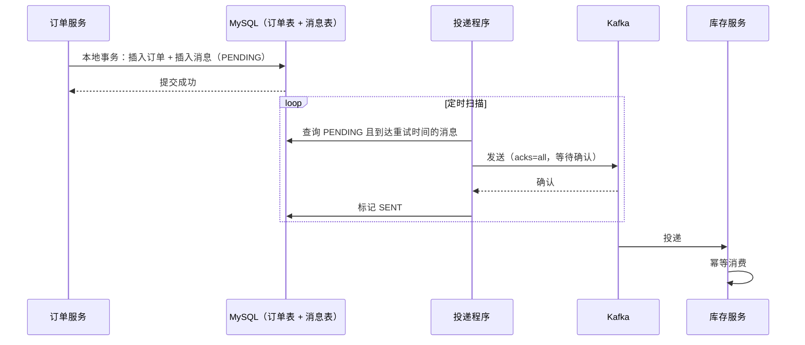
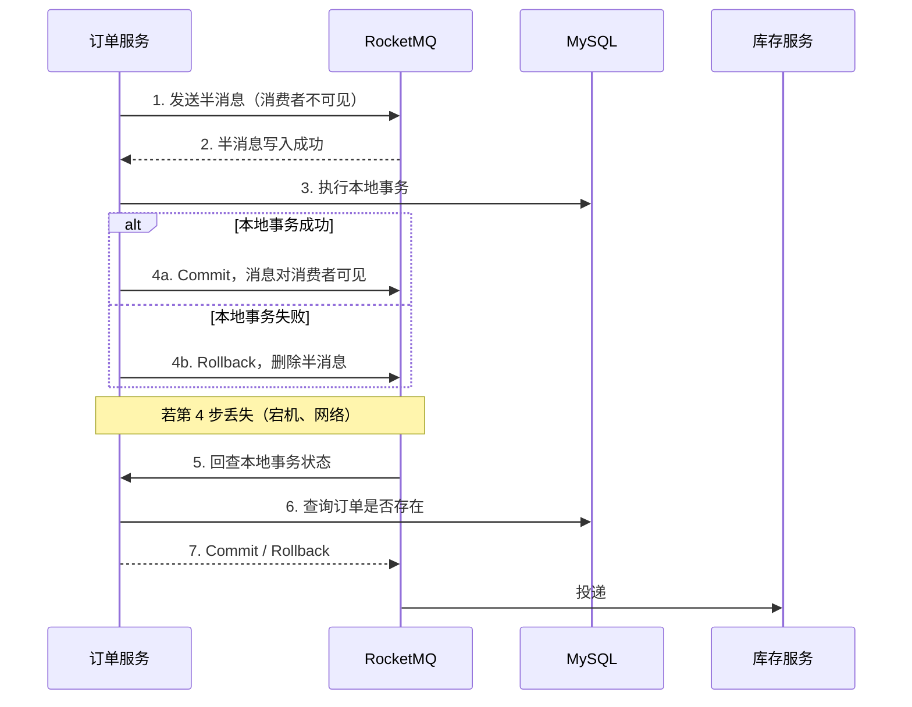

[系统设计](/knowledge/system-design/) / 系统设计基础 / 可靠消息与最终一致

**前置阅读：** [幂等设计](/knowledge/system-design/foundations/幂等设计-重复请求与重试/) · [BASE 理论](/knowledge/distributed-systems/consistency/base理论/) · [Kafka 专辑：生产者写入路径](/knowledge/distributed-systems/kafka/kafka专辑-生产者写入路径/) · [MySQL binlog 工作原理](/knowledge/database/logs-replication/深度整理总结mysql-bin-log日志工作原理/)

## 阅读起点：订单写进去了，库存却没扣

**下面是为了帮助理解而设定的假设场景，不是实际运行数据。**

订单服务的逻辑很直接：

1. 在 MySQL 中插入订单。
2. 向 Kafka 发送 `OrderCreated` 消息。
3. 库存服务消费消息，扣减库存。

某天订单服务在第 1 步提交之后、第 2 步发送之前发布重启。订单存在，消息从未发出，库存永远不会扣。对账时才发现几十笔“有订单、没扣库存”的数据。

[BASE 理论](/knowledge/distributed-systems/consistency/base理论/) 告诉我们可以接受“软状态”，最终一致即可。但**最终一致的前提是“最终”一定会到来**。消息丢了，就不是最终一致，而是永久不一致。

本文要解决的问题只有一个：**如何保证“本地数据库写入”和“消息发出”要么都发生，要么都不发生**。

---

## 为什么调整顺序解决不了

数据库和 MQ 是两个独立系统，没有共同的事务。无论怎么排顺序，中间都有一个可能宕机的缝隙。

| 写法 | 故障点 | 结果 |
| --- | --- | --- |
| 先提交事务，再发消息 | 提交后、发送前宕机；或发送失败 | 数据有，消息丢 |
| 先发消息，再提交事务 | 发送后、提交前宕机；或提交失败回滚 | 消息有，数据没有，下游处理了“幽灵订单” |
| 在事务内发消息（`@Transactional` 方法中调用 `send`） | 消息已发出，事务随后回滚 | 同上；并且发送耗时拉长了事务、占用连接 |
| 发送失败就重试几次 | 进程直接宕机时，重试代码根本不会执行 | 数据有，消息丢 |

```java
// 看起来没问题，实际上三种故障都可能发生
@Transactional
public void createOrder(Order order) {
    orderMapper.insert(order);
    kafkaTemplate.send("order-created", order.getOrderNo(), toEvent(order));
}
```

还有一个更隐蔽的问题：`kafkaTemplate.send` 是异步的，返回时消息只进入了生产者的内存缓冲区（参见 [生产者写入路径](/knowledge/distributed-systems/kafka/kafka专辑-生产者写入路径/) 中的 RecordAccumulator），进程此时宕机，缓冲区中的消息直接丢失。

**结论：只要“写库”和“发消息”是两个独立动作，就不存在一个顺序能同时避免丢失和误发。** 需要把“要发一条消息”这件事本身，变成数据库事务的一部分。

---

## 方案一：本地消息表

### 核心思路

在业务库中建一张消息表。业务数据和“待发送消息”**在同一个本地事务中写入**，由 MySQL 保证原子性。然后由一个独立的投递程序把消息表中的记录发往 MQ。



### 表结构

```sql
CREATE TABLE outbox_message (
  id             BIGINT PRIMARY KEY AUTO_INCREMENT,
  aggregate_type VARCHAR(32)  NOT NULL COMMENT '业务对象类型，如 ORDER',
  aggregate_id   VARCHAR(64)  NOT NULL COMMENT '业务对象 ID，用作消息 key',
  event_type     VARCHAR(64)  NOT NULL COMMENT '事件类型，如 OrderCreated',
  payload        JSON         NOT NULL,
  status         VARCHAR(16)  NOT NULL DEFAULT 'PENDING',
  retry_count    INT          NOT NULL DEFAULT 0,
  next_retry_at  DATETIME     NOT NULL,
  created_at     DATETIME     NOT NULL,
  KEY idx_status_next_retry (status, next_retry_at)
);
```

### 写入

```java
@Transactional
public void createOrder(Order order) {
    orderMapper.insert(order);
    outboxMapper.insert(OutboxMessage.of(
        "ORDER", order.getOrderNo(), "OrderCreated", toJson(order)));
    // 这里不发消息，事务提交即代表“消息一定会被发出”
}
```

### 投递

```java
@Scheduled(fixedDelay = 1000)
public void relay() {
    List<OutboxMessage> batch = outboxMapper.selectPending(100);
    for (OutboxMessage m : batch) {
        try {
            kafkaTemplate.send(topicOf(m), m.getAggregateId(), m.getPayload())
                         .get(5, TimeUnit.SECONDS); // 同步等待 Broker 确认
            outboxMapper.markSent(m.getId());
        } catch (Exception e) {
            outboxMapper.scheduleRetry(m.getId(), backoff(m.getRetryCount()));
        }
    }
}
```

几个必须处理的细节：

1. **同步等待确认**。`send().get()` 并配合 `acks=all`，确认 Broker 写入后再标记 `SENT`。
2. **发送成功但标记失败**会导致重发，这是允许的。本方案的语义是 **at-least-once**，消费端必须按 [幂等设计](/knowledge/system-design/foundations/幂等设计-重复请求与重试/) 处理重复。
3. **多实例投递**。多个实例同时扫描会重复发送。可以用 `SELECT ... FOR UPDATE SKIP LOCKED`（MySQL 8.0+）让每个实例领取不同的行，或按 `id % 实例数` 分片，或只让一个实例通过分布式锁领到投递权。
4. **有序性**。用 `aggregate_id` 作为消息 key，同一订单的消息进入同一分区；投递程序对同一 `aggregate_id` 按 `id` 顺序发送，前一条没成功不发后一条。
5. **失败上限**。超过最大重试次数的消息标记为 `FAILED` 并告警，进入人工处理，不能无限重试拖慢整个队列。
6. **清理**。`SENT` 的消息按保留期归档或删除，否则表持续膨胀，扫描变慢。

### 优缺点

* **优点**：只依赖本地事务和任意 MQ，原理简单，容易排查（消息状态都在表里）。
* **缺点**：轮询有延迟（秒级）；扫描给业务库带来额外读压力；消息表与业务表耦合在同一个库。

---

## 方案二：Outbox + CDC

本地消息表的写入方式不变，变的是**投递方式**：不再轮询，而是订阅数据库的 binlog。


* binlog 只记录**已提交**的事务，因此 CDC 读到 outbox 行时，业务数据一定已经提交。原理参见 [MySQL binlog 工作原理](/knowledge/database/logs-replication/深度整理总结mysql-bin-log日志工作原理/) 与 [二阶段提交工作原理](/knowledge/database/logs-replication/深度整理总结mysql-二阶段提交工作原理/)。
* binlog 按提交顺序产生，天然保持了事务提交顺序。
* CDC 组件自己记录 binlog 位点，宕机重启后从位点继续，可能重发但不会丢。
* outbox 行写入后不再需要更新状态，甚至可以写完立刻删除（binlog 里已经有了），表不会膨胀。

**代价**：多运维一套 CDC 组件；需要开启 `binlog_format=ROW`；排查问题要跨越数据库、CDC、MQ 三个系统。

**适用**：消息量大、对延迟敏感（毫秒级），或团队已经有 CDC 基础设施。

---

## 方案三：RocketMQ 事务消息

RocketMQ 把“本地消息表”的职责挪到了 MQ 内部，用**半消息 + 回查**实现。



关键在第 5 步：**回查接口必须能根据消息内容查出本地事务的真实结果**。通常是根据订单号查订单表。如果业务上查不出（比如本地事务没有留下可查询的痕迹），事务消息就无法正确工作。

* **优点**：不需要消息表，不需要轮询。
* **缺点**：绑定 RocketMQ；需要实现回查接口；对业务有侵入。

**关于 Kafka 事务**：Kafka 的事务保证的是“多条消息写入多个分区”以及“消费-处理-生产”在 Kafka 内部的原子性，**它不包含外部数据库**。用 Kafka 事务解决不了本文的双写问题，仍然需要 Outbox。

---

## 三种方案对比

| 维度 | 本地消息表 | Outbox + CDC | RocketMQ 事务消息 |
| --- | --- | --- | --- |
| 原子性依赖 | 本地事务 | 本地事务 | 半消息 + 回查 |
| 投递延迟 | 秒级（轮询间隔） | 毫秒级 | 毫秒级 |
| 对业务库压力 | 有扫描压力 | 读 binlog，压力小 | 回查时有少量查询 |
| MQ 选型 | 任意 | 任意（需 CDC 支持） | 仅 RocketMQ |
| 额外组件 | 无 | Debezium / Canal | 无 |
| 消费端语义 | at-least-once | at-least-once | at-least-once |
| 排查难度 | 低 | 中 | 中 |

**选择建议**：没有特殊约束时从本地消息表起步，它最容易理解和排查；当轮询延迟或扫描压力成为瓶颈，再升级到 CDC 投递，写入侧代码不需要改。

三种方案的消费端语义都是 **at-least-once**，这不是缺陷，而是设计：**生产端保证不丢，消费端保证不重**，两者合起来才是“效果上的恰好一次”。

---

## 和 2PC、TCC、Saga 的关系

[并发更新导致的数据覆盖以及解决方案](/knowledge/distributed-systems/consistency/并发更新导致的数据覆盖以及解决方案/) 中介绍了 2PC、TCC 和 Saga。它们和可靠消息解决的是不同形状的问题：

| 方案 | 一致性 | 适用场景 |
| --- | --- | --- |
| 2PC / XA | 强一致 | 参与方少、都支持 XA、能接受同步阻塞 |
| TCC | 最终一致，业务可控 | 下游失败时**上游需要回滚**，例如扣库存失败要取消订单 |
| Saga | 最终一致 | 长流程，每一步都有对应的补偿动作 |
| 可靠消息 | 最终一致 | 上游提交后**下游一定要执行成功**，下游失败只重试不回滚 |

判断标准：**下游失败时，上游要不要撤销？**

* 不需要撤销（发通知、加积分、同步搜索索引、更新统计）：可靠消息就够了，最简单。
* 需要撤销（扣库存失败要取消订单）：需要 TCC 或 Saga，或者在可靠消息基础上增加一条“反向消息”实现补偿，这本质上就是 Saga。

---

## 落地检查清单

1. 业务写入与 outbox 写入在**同一个本地事务**，且没有在事务内直接调用 MQ。
2. 投递程序**同步等待 Broker 确认**后才标记成功，Kafka 侧 `acks=all`。
3. 消息 key 使用**业务 ID**，保证同一业务对象的消息分区内有序。
4. 消费端**幂等**，并且先处理、后提交 offset。
5. 多实例投递有**防重复领取**的机制。
6. 失败消息有**重试上限、退避和告警**，不会无限重试。
7. 已发送消息有**清理策略**。
8. 有**对账任务**作为最后一道防线：定期比对上游业务表与下游结果，发现遗漏时补发。

---

## 总结

1. “写库 + 发消息”是双写问题，**任何顺序都存在丢失或误发的缝隙**。
2. 解法是把“要发消息”写进同一个本地事务：**本地消息表**是最朴素的实现，**Outbox + CDC** 是投递侧的升级，**RocketMQ 事务消息**是把消息表搬进 MQ。
3. 三种方案都是 at-least-once，**生产端不丢 + 消费端幂等 = 效果上的恰好一次**。
4. Kafka 事务不覆盖外部数据库，不能替代 Outbox。
5. 下游失败**只需重试**用可靠消息，**需要回滚上游**用 TCC 或 Saga。
