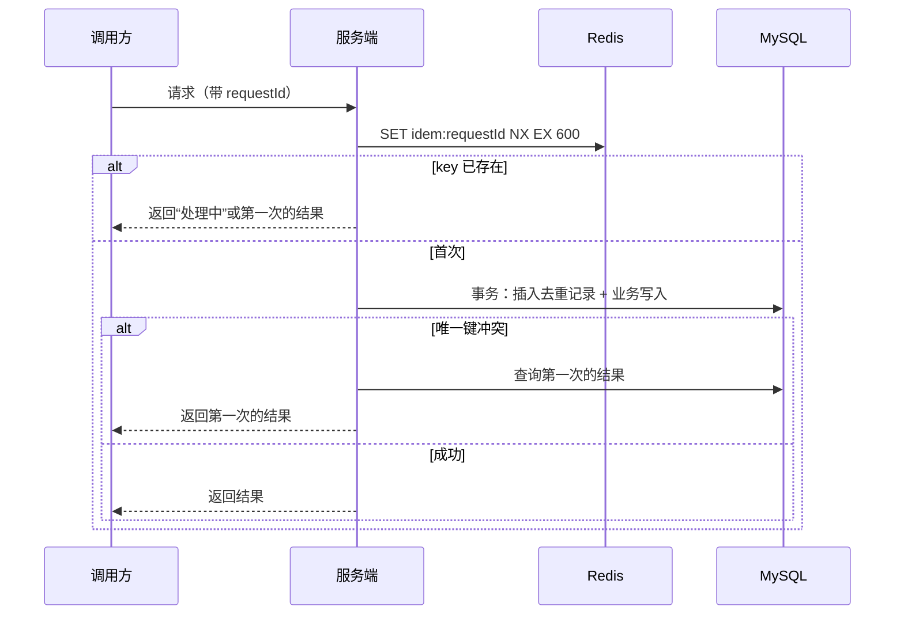

[系统设计](/knowledge/system-design/) / 系统设计基础 / 幂等设计

**前置阅读：** [并发更新导致的数据覆盖以及解决方案](/knowledge/distributed-systems/consistency/并发更新导致的数据覆盖以及解决方案/) · [Kafka 专辑：消息队列是什么](/knowledge/distributed-systems/kafka/kafka专辑-消息队列是什么/) · [Kafka 专辑：生产者写入路径](/knowledge/distributed-systems/kafka/kafka专辑-生产者写入路径/)

**下一篇：** [可靠消息与最终一致：本地消息表与 Outbox](/knowledge/system-design/foundations/可靠消息与最终一致-本地消息表与outbox/)

## 阅读起点：一次“扣了两次钱”是怎么发生的

**下面是为了帮助理解而设定的假设场景，不是实际运行数据。**

用户点击“支付”，订单服务调用支付服务扣款。支付服务已经扣款成功并提交了事务，但返回响应时网关超时了。订单服务只看到“超时”，不知道对方到底成功没有，于是按重试策略又调了一次。支付服务把第二次请求当成新请求，又扣了一次。

这里没有任何一行代码是“错的”：

* 超时重试是为了可用性，是正确的设计。
* 支付服务每次收到请求都认真扣款，也没有错。

问题在于**系统把“同一个意图的第二次到达”当成了“一个新的意图”**。分布式环境里，调用方只能得到三种结果：成功、失败、**不知道**。只要存在“不知道”，重试就不可避免，重复请求也就不可避免。

所以幂等不是“锦上添花的防御”，而是**允许重试的前提条件**。

---

## 什么是幂等

**幂等**：同一个操作执行一次和执行多次，对系统状态产生的影响相同。

注意两个细节：

1. 幂等关心的是**状态**，不是返回值。第一次扣款返回“成功”，第二次返回“已处理过”，两次返回不同，但余额只少了一次，这依然是幂等的。
2. 幂等的判断依据是**业务意图**，不是请求报文。两次报文完全相同，可能是用户真的想买两次；两次报文不同（时间戳不同），也可能是同一次点击的重试。

| 操作 | 天然幂等？| 说明 |
| --- | --- | --- |
| `SELECT` 查询 | 是 | 不改状态 |
| `UPDATE t SET status = 'PAID' WHERE id = 1` | 是 | 设置为绝对值 |
| `UPDATE t SET balance = balance - 100 WHERE id = 1` | 否 | 相对值，每执行一次少 100 |
| `INSERT` 无唯一约束 | 否 | 每次多一行 |
| `DELETE WHERE id = 1` | 是 | 删一次和删多次结果相同 |

结论：**“设置为某值”天然幂等，“在原值上加减”和“新增”天然不幂等**。大部分设计工作，就是把后者改造成前者，或者给后者加一道“是否处理过”的判断。

---

## 重复从哪里来

| 来源 | 典型场景 | 谁负责去重 |
| --- | --- | --- |
| 用户 | 双击按钮、刷新页面重新提交表单 | 服务端（前端防抖只能减少，不能杜绝） |
| 调用方重试 | RPC/HTTP 超时重试、网关重试、Feign/Ribbon 自动重试 | 被调用方 |
| 消息队列 | 消费完成但 offset 未提交就宕机或 rebalance，消息被重新投递 | 消费者 |
| 生产者重试 | Broker 已写入但 Ack 丢失，Producer 重发 | Kafka 幂等生产者只解决单分区单会话，业务层仍需兜底 |
| 定时任务 | 任务超时被调度中心重新触发、多实例同时执行 | 任务本身 |
| 人工补偿 | 运维“重跑一下”失败的批次 | 任务本身 |

[Kafka 专辑：消息队列是什么](/knowledge/distributed-systems/kafka/kafka专辑-消息队列是什么/) 里已经提到：消费者处理完业务但没来得及告诉 MQ，消息会被重发。Kafka 的默认语义是 **at-least-once（至少一次）**，这意味着**消费端幂等是使用 MQ 的义务，不是可选项**。

---

## 四种幂等手段

### 唯一约束：让数据库替你拒绝重复

最朴素也最可靠的方式。给“代表同一个业务意图”的字段加唯一索引，重复插入时数据库直接报 `Duplicate entry`。

```sql
CREATE TABLE payment_record (
  id          BIGINT PRIMARY KEY,
  order_no    VARCHAR(64) NOT NULL,
  amount      DECIMAL(12, 2) NOT NULL,
  status      VARCHAR(16) NOT NULL,
  created_at  DATETIME NOT NULL,
  UNIQUE KEY uk_order_no (order_no)
);
```

```java
try {
    paymentRecordMapper.insert(record);
} catch (DuplicateKeyException e) {
    // 已经处理过：查出原记录并返回原结果，而不是报错
    return paymentRecordMapper.selectByOrderNo(record.getOrderNo());
}
```

* **优点**：由数据库保证，并发下也正确，不依赖应用层加锁。
* **前提**：业务上存在一个“天然唯一”的字段，比如订单号、流水号、`(user_id, activity_id)`。
* **注意**：唯一约束必须和业务写入**在同一个事务**里。如果先插去重记录再在另一个事务里做业务，中间宕机会导致“标记了已处理，但业务没做”。
* **分库分表时**：唯一约束只在单库单表内生效，所以去重键必须是分片键或包含分片键，参见 [分库分表系列：核心内容](/knowledge/distributed-systems/consistency/分库分表系列-核心内容/)。

### 状态机：只允许合法的状态迁移

很多业务对象本身就有状态：订单 `CREATED → PAID → SHIPPED`。把状态迁移写成**条件更新**，重复执行时条件不满足，影响行数为 0。

```sql
UPDATE orders
SET status = 'PAID', paid_at = NOW()
WHERE order_no = 'O20261027001'
  AND status = 'CREATED';
```

```java
int rows = orderMapper.markPaid(orderNo);
if (rows == 0) {
    Order order = orderMapper.selectByOrderNo(orderNo);
    if ("PAID".equals(order.getStatus())) {
        return; // 重复回调，已处理
    }
    throw new IllegalStateException("非法状态迁移: " + order.getStatus());
}
```

这本质上是 [并发更新导致的数据覆盖以及解决方案](/knowledge/distributed-systems/consistency/并发更新导致的数据覆盖以及解决方案/) 里**乐观锁**的变体：用 `status` 代替 `version` 作为比较条件。

* **优点**：不需要额外的表，和业务语义天然贴合。
* **适用**：支付回调、审核回调、发货通知这类“推动状态前进”的操作。
* **局限**：只能防“同一迁移重复执行”，防不了“同一状态下的重复新增”，比如同一个订单重复加积分。

### 去重表：通用的“处理过”记录

当业务表没有天然唯一字段，或者一个操作会写多张表时，单独建一张去重表，以**幂等键**为唯一索引。

```sql
CREATE TABLE idempotent_record (
  idem_key    VARCHAR(128) PRIMARY KEY,
  biz_type    VARCHAR(32)  NOT NULL,
  result      VARCHAR(1024),
  created_at  DATETIME     NOT NULL
);
```

```java
@Transactional
public Result handle(String idemKey, Command cmd) {
    try {
        idempotentMapper.insert(idemKey, cmd.bizType());
    } catch (DuplicateKeyException e) {
        return idempotentMapper.selectResult(idemKey); // 返回第一次的结果
    }
    Result result = doBusiness(cmd);
    idempotentMapper.updateResult(idemKey, result);
    return result;
}
```

关键点：**去重记录的插入和业务写入在同一个本地事务中**。业务失败回滚时，去重记录一起回滚，下一次重试可以正常执行。

去重表会持续增长，需要按 `created_at` 定期归档或清理。清理窗口必须**大于最长的可能重试间隔**（比如 MQ 的最大重投时间、人工补偿的周期），否则清理后再来一次重复就防不住了。

### Redis 预检：挡住高频重复，但不能单独依赖

```text
SET idem:{key} PROCESSING NX EX 600
```

* 返回 `OK`：第一次，继续处理。
* 返回 `nil`：已经有人在处理或处理过，直接返回。

这个手段适合放在入口挡住**短时间内的高频重复**（双击、网关重试风暴），减轻数据库压力。但它不能作为唯一的保证：

1. Redis 与数据库不在一个事务里。Redis 写入成功、业务失败时，key 留在 Redis，后续合法重试会被误拦，需要在失败时删除 key。
2. 过期时间到了 key 就消失，晚到的重复请求会穿透。
3. 主从切换可能丢失刚写入的 key，参见 [Redis 哨兵](/knowledge/distributed-systems/redis-reliability/redis-哨兵/)。

所以常见组合是：**Redis 挡流量，数据库唯一约束兜底**。这和 [缓存一致性问题](/knowledge/distributed-systems/consistency/缓存一致性问题/) 中“缓存只是加速，数据库才是事实”的原则一致。

### 四种手段怎么选

| 手段 | 正确性由谁保证 | 额外存储 | 适用 |
| --- | --- | --- | --- |
| 唯一约束 | 数据库 | 无 | 有天然唯一业务键的新增操作 |
| 状态机 | 数据库条件更新 | 无 | 状态推进类操作 |
| 去重表 | 数据库 | 一张表 | 无天然唯一键、一次操作写多表 |
| Redis 预检 | 无（只是加速） | Redis key | 前置挡高频重复，必须配合上面三种之一 |

---

## 幂等键从哪里来

幂等键必须满足：**同一个业务意图的所有重试，带着同一个键；不同的业务意图，键不同**。

| 场景 | 幂等键来源 |
| --- | --- |
| 前端提交表单 | 打开页面时服务端下发一个 token，提交时带上，服务端核销 |
| 服务间调用 | 调用方生成请求号（如 `requestId`），**重试时复用**，不能每次重试重新生成 |
| 支付、退款 | 业务单号本身（订单号、退款单号） |
| 消息消费 | 消息体中的业务 ID，**不要用 MQ 的 messageId 或 offset**，生产者重发时它们会变 |
| 定时任务 | `任务类型 + 业务日期 + 分片号`，例如 `daily_settle:2026-10-27:shard-3` |

最常见的错误：调用方在**重试循环内部**生成 `requestId`。这样每次重试都是新键，幂等形同虚设。

```java
// 错误：每次重试都生成新键
for (int i = 0; i < 3; i++) {
    String requestId = UUID.randomUUID().toString();
    callPay(requestId, order);
}

// 正确：键在重试循环外生成，重试复用
String requestId = order.getOrderNo();
for (int i = 0; i < 3; i++) {
    callPay(requestId, order);
}
```

---

## 三类场景的落地方式

### 接口幂等



返回值的约定很重要：重复请求应当**返回第一次的结果**，而不是报错。否则调用方会把“已处理”理解为“失败”，继续重试或者走失败分支。

### 消息消费幂等

```java
@KafkaListener(topics = "order-paid")
public void onOrderPaid(OrderPaidEvent event, Acknowledgment ack) {
    // 状态机：只有 CREATED 能变成 PAID，重复消息影响行数为 0
    orderService.markPaidIfCreated(event.getOrderNo());
    ack.acknowledge();
}
```

两个容易忽略的点：

1. **先处理，后提交 offset**。反过来就是 at-most-once，宕机时会丢消息。
2. **重复消息和乱序消息要一起考虑**。Kafka 只保证分区内有序，参见 [Kafka 专辑：整体架构](/knowledge/distributed-systems/kafka/kafka专辑-整体架构/)。如果“已发货”消息先于“已支付”消息到达，单纯的状态机会拒绝“已发货”。处理方式是：同一个业务对象的消息用同一个 key 发送到同一个分区，或者消费端对“暂时不合法”的迁移做延迟重试而不是直接丢弃。

### 定时任务幂等

批处理任务最怕“跑了一半失败，重跑时前半部分又跑一遍”。

* 以**业务主键 + 处理批次**作为去重粒度，而不是以整个任务作为粒度。
* 每处理完一条（或一小批），把**业务写入和处理断点放在同一个事务**里提交。
* 重跑时从断点继续，已提交的部分天然不会再处理。

例如按账户批量重算状态时，每个账户的业务写回和它的处理断点在同一个事务里提交，任务中断后从断点继续即可。

---

## 常见误区

| 误区 | 问题 |
| --- | --- |
| “我加了分布式锁，所以是幂等的” | 锁只防**并发**，不防**先后**。第一个请求处理完释放锁，第二个请求照样再执行一次。锁可以配合幂等，但不能代替幂等。|
| “前端按钮已经置灰了” | 只防住了双击，防不住网关重试、服务重试、MQ 重投。|
| “先查一下有没有，没有再插” | `SELECT` 和 `INSERT` 之间有窗口，两个并发请求都查到“没有”。必须靠唯一约束或条件更新兜底。|
| “开了 Kafka 幂等生产者就不用管了” | 它只保证单分区、单生产者会话内不重复写入 Broker，生产者重启、消费端重复投递都不在它的范围内。|
| “去重表永久保存最安全” | 表无限增长影响写入性能。应按业务最长重试窗口设定保留期。|

---

## 总结

1. 分布式调用存在“不知道成功与否”的第三种结果，因此**重试必然发生，重复必然发生**。
2. 幂等关注**状态**是否一致，不要求返回值相同；重复请求应返回第一次的结果。
3. 正确性必须落在**数据库**上：唯一约束、条件更新、去重表三选一或组合；Redis 只负责挡流量。
4. 去重记录与业务写入**同一个事务**提交，失败一起回滚。
5. 幂等键在**重试循环外**生成，消息消费用**业务 ID**而不是 messageId。
6. 分布式锁防并发，幂等防重复，两者解决的是不同的问题。

下一篇 [可靠消息与最终一致](/knowledge/system-design/foundations/可靠消息与最终一致-本地消息表与outbox/) 会用到这里的结论：可靠消息方案保证“至少投递一次”，正是因为消费端已经做到了幂等，才能放心地重发。
